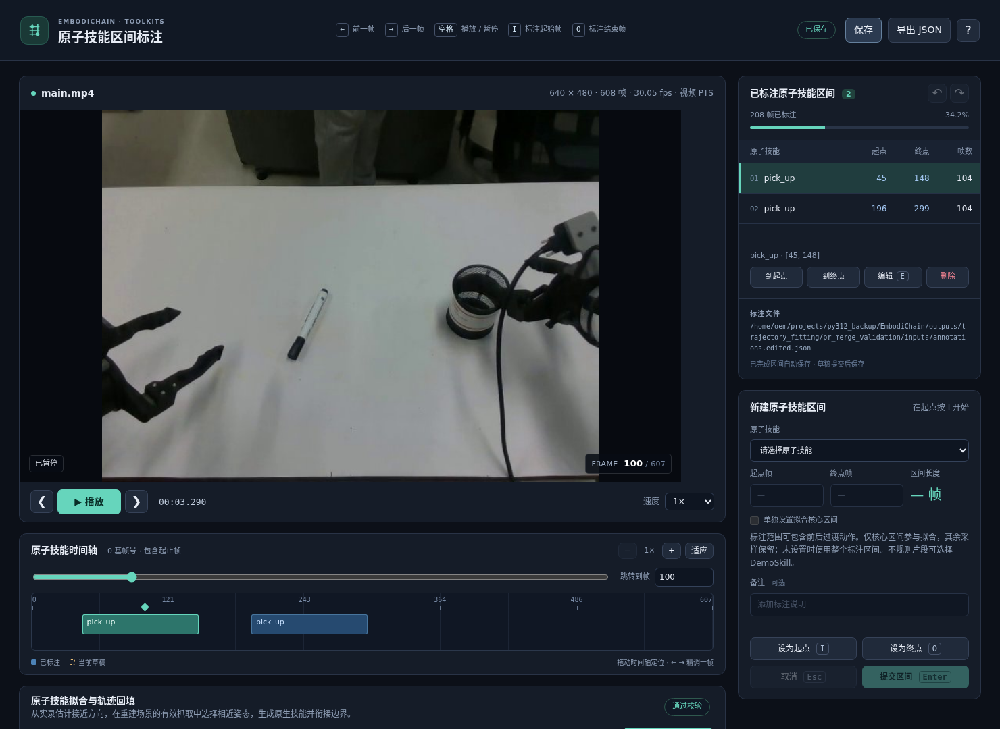

# 遥操轨迹图像序列标注

在浏览器逐帧查看遥操视频、HDF5 相机图像或内存图像序列，为原子技能标注起止帧。支持时间轴定位、技能列表、区间编辑和删除、撤销重做、JSON 自动保存与继续编辑。标注解码使用 CPU；可选关节拟合复用离线 FK/IK，不启动仿真。



## 用最小资源包完成整个流程

将含视频的资源包解压后，只需传入包目录：

```bash
conda activate py312_bk
embodichain annotate-trajectory --bundle /data/pickup-workflow.inputs \
  --port 8898 --no-browser
```

包内提供原始编码视频、关节轨迹、机器人模型及配置、场景 mesh/pose、缓存碰撞体和初始标注。
启动会校验资源摘要，自动填写所有拟合输入；无需原始录制目录或 Blender 工程。
在网页切分区间、选择技能并点击“拟合并回填完整轨迹”，即可下载 run-task 包。
视频画面辅助人工标注；参数辨识使用关节轨迹和物体 pose，不自动从 RGB 判断接触事件。

`annotations.json` 是校验过的初始标注；网页将编辑保存到 `annotations.edited.json`，重新启动后继续编辑。
`--annotations` 可指定其他编辑输出路径，但不能覆盖包内输入。`--bundle` 模式还可覆盖 `--device`、端口及是否打开浏览器；视频与拟合资源由包内配置统一指定。

解压网页下载的 run-task 包，执行动态轨迹扩增：

```bash
embodichain run-task --gym_config /data/run-task/task.yaml \
  --skill-sequence /data/run-task/skills.yaml \
  --expansion-profile /data/run-task/expansion.yaml \
  --expansion-output-dir /data/expanded --headless --device cpu
```

默认生成一条基准与两条原子技能空间扩增轨迹，DemoSkill 指令不参与扩增；输出目录须为新目录。
打包命令和资源约定见[拟合示例](../../../examples/toolkits/skill_fitting/README.md)。

## 启动

在已经安装 EmbodiChain 的环境中，安装本工具的依赖即可：

```bash
conda activate py312
python -m pip install 'av>=15.1,<18' 'fastapi>=0.115,<1' 'uvicorn>=0.30,<1'
embodichain annotate-trajectory --video /data/episode_0001.mp4
```

新安装项目时也可以选择 `pip install 'embodichain[trajectory-annotation]'`。源码安装使用 `pip install -e '.[trajectory-annotation]'`，它会同时解析项目的基础依赖；已有开发环境可以使用上面的单独依赖安装命令。

命令会打印本地网址，并默认打开浏览器。首次打开时完整扫描选定视频流、校验来源并建立准确的帧索引；长视频需要等待。按 Ctrl+C 退出服务。

```bash
embodichain annotate-trajectory \
  --video /data/episode_0001.mp4 \
  --annotations /data/labels/episode_0001.segments.json \
  --video-stream 0 \
  --port 8765 \
  --no-browser
```

- `--annotations`：读写同一标注文件，默认视频同目录的 `<stem>.segments.json`。
- `--video-stream`：容器中的实际流索引，默认第一个视频流。
- `--port`：默认 0，自动选择空闲端口；服务只监听 `127.0.0.1`。
- `--no-browser`：手动打开打印的网址。

也可使用 `python -m embodichain.toolkits.trajectory_annotator --video ...` 启动。

## HDF5 输入

```bash
embodichain annotate-trajectory \
  --hdf5 /home/oem/piper-sim-data/label_down/episode_20261022T073344_323022Z/episode.hdf5 \
  --annotations outputs/trajectory_annotation/episode.cam_high.segments.json

# 指定其他相机或缺少元数据时提供帧率
embodichain annotate-trajectory --hdf5 /data/episode.hdf5 \
  --image-key observations/images/cam_left_wrist --fps 30
```

- `--video`、`--hdf5`、`--bundle` 三选一。HDF5 以只读方式打开，不转成临时视频。
- `--image-key` 默认自动定位 `observations/images/cam_high`，同时兼容单数 `observation/images/cam_high`；两者均存在时要求显式选择。实际 demo 使用复数路径。
- 支持逐帧 JPEG/PNG 字节数组（含变长 uint8 和定长填充行）及 `N×H×W×3 uint8` 原始图像。只按需读选中相机的单帧，初始化时仅解码首帧确认尺寸；文件摘要按 1 MiB 分块计算。
- 原始数组默认 RGB，可用 `--color-order bgr` 指定 BGR；压缩图像按编码解码。
- `--fps` 优先级最高，否则依次读取图像 dataset 的 `fps`、根属性 `fps`、根 `metadata_json.record_fps`。缺少有效值时提示提供 `--fps`，不会猜测。页面明确显示时间由 FPS 推算；帧号始终来自 dataset 行索引。
- 默认标注路径为 `<stem>.<camera>.segments.json`，可用 `--annotations` 覆盖。

[可运行示例](../../../examples/toolkits/trajectory_annotation/README.md)默认使用上述 demo：

```bash
embodichain run-example toolkits/trajectory_annotation
```

## 原子技能参数辨识与连续回填

同一网页的时间轴下方提供拟合面板，复用 `fit-trajectory` 的原生技能重建与连续拼接核心，支持
**Pickup / Slide / Twist / HandOver**。已重建场景时，Pickup / Slide / Twist 使用物体 pose 和
grasp affordance 的有效抓取候选，再调用原生技能生成轨迹。没有场景时保留原有运动辨识路径；
HandOver 仍使用显式 source/destination 绑定的运动辨识。需要与输入机械臂对应的
URDF、TCP、关节顺序、夹爪命令和关节限制配置。配置与关节格式详见
[拟合示例](../../../examples/toolkits/skill_fitting/README.md)。

```bash
embodichain annotate-trajectory --video /data/episode.mp4 \
  --joints /data/joints.npz --robot-profile /data/robot_profile.json \
  --scene /data/blender_scene/physical_export --participant auto \
  --qpos-semantics measured_state --time-offset 0 \
  --annotations /data/labels/episode.segments.json
```

`--scene` 可指向重建场景 YAML 或包含 `scene_assets.yaml`、`export_report.json` 的目录。
省略时尝试读取关节记录旁的 `blender_scene/physical_export`。局部 mesh 通过导出报告的 `anchor`
矩阵变换到机器人 FK 使用的世界坐标，单位为米。`--object-id` 可指定物体；留空选择靠近实录
抓取位置的物体。机器人 URDF 引用的夹爪碰撞 mesh 必须完整存在。

网页在加载预填场景、修改场景路径或关节记录路径后，自动在后台准备碰撞网格。
也可点击“加载场景 / 检查碰撞缓存”；状态会显示物体、凸块及缓存复用数量。
首次分割使用独立子进程，视频查看和标注不受影响。结果保存在
`~/.cache/embodichain/scene_collision/`，以网格内容、分割参数和 DexSim 版本校验缓存；
姿态改变可继续复用物体局部坐标下的凸块，内容或参数变化时重新生成。
失败或被中断的处理不会发布为完整缓存。

run-task 包会携带 `scene/*.convex.obj`，通过
`shape.collision.decomposition_fpath` 引用预分割碰撞网格。每个凸块独立加载，保留杯口等凹陷；
原始 mesh 继续用于显示。解压后无需依赖本机缓存，也不会在启动时重新执行凸分解。
命令行导出复用同一缓存，尚未准备时先完成预处理。旧运行包需要重新导出才能携带这些文件。

`--participant auto` 为默认值，根据配置中的关节分组、URDF 连接关系和选区内夹爪事件选择参与臂，
同一份双臂配置可用于不同选区；未参与的部件保持原始采样。两个手都符合时明确报错，可填写
一个配置中的 motion/hand 部件名，或用 `configured` 固定使用 profile 的参与者绑定。

上述拟合参数均可省略，之后在网页填写或修改本机文件路径。`run-example toolkits/trajectory_annotation`
支持同样的拟合参数与 `--video` / `--hdf5`。HDF5 内的关节也可直接使用同一文件：

```bash
embodichain annotate-trajectory --hdf5 /data/episode.hdf5 \
  --joints /data/episode.hdf5 --qpos-key observations/qpos \
  --timestamps-key observations/timestamps \
  --robot-profile /data/robot_profile.json \
  --qpos-semantics measured_state --time-offset 0
```

1. 在右侧下拉菜单选择原子技能并提交区间。菜单包含项目内置技能（含 DemoSkill）；当前只有 Pickup / Slide / Twist / HandOver 支持参数重建，已标注的 DemoSkill 直接保留采样，其他尚不支持的技能会明确报错。
2. 填写关节记录、机器人配置、数据语义，以及视频零时刻对应的关节时间（秒）。不会从视频 FPS 推断关节采样周期。
3. 点击“拟合并回填完整轨迹”；页面先保存标注，再按时间顺序处理全部区间，无需逐段选择。未标注区间自动作为 DemoSkill 保留原始采样；没有标注时整条记录成为一段 DemoSkill。拟合期间可继续逐帧查看视频。
4. 查看自动选择的控制部件、目标物体、参数与校验报告，对比原始、原生技能（按源时钟对齐）、连续回填的关节曲线和误差。
   曲线点击按真实帧时间定位视频，支持 VFR。Viser 叠加显示两套 URDF 机器人：原始轨迹保留 visual mesh 的原有外观，回填轨迹使用蓝色、35% 不透明度的模型。
   全轨迹结果的两个播放按钮都覆盖全部视频；两套模型随视频播放、暂停、倍速和时间轴定位同步更新全部关节。
5. “下载完整回填 NPZ”导出全部原始/重建/回填/校正候选关节、时间戳与元数据。原始视频、HDF5、关节记录均不被覆盖。
6. 全部原子技能通过校验后，可下载 **run-task 运行包**。包内包含机器人模型、重建场景、`task.yaml`、`skills.yaml` 和仅 DemoSkill 区间的 tensor。解压后执行：

```bash
conda activate py312_bk
# 浏览器 Viser：自动执行物理仿真，打开终端打印的 URL
embodichain run-task --gym_config task.yaml --skill-sequence skills.yaml --headless --viser
# EmbodiChain 原生窗口：需要桌面显示，显式覆盖 headless: true
embodichain run-task --gym_config task.yaml --skill-sequence skills.yaml --no-headless
```

这里会自动执行原生技能，完成后退出；原生窗口命令不要添加 `--viser`，因为它会强制 headless。
对比原始/回填轨迹和逐帧查看仍使用网页内的双机器人 Viser 播放器。
启动时加载随包携带的凸分块，不重复调用凸分解。

运行包同时提供可编辑的 `expansion.yaml`，可与原生技能序列一起执行：

```bash
embodichain run-task --gym_config task.yaml --skill-sequence skills.yaml \
  --expansion-profile expansion.yaml --expansion-output-dir ./expanded \
  --headless --device cpu
```

默认执行一条基准和两条原子技能空间扩增轨迹；仅含 DemoSkill 时执行一条基准。
DemoSkill 的源 tensor 和按控制时钟重采样后的指令路径保持一致，交界连接可随相邻原子技能姿态调整。
当前支持 B=1、固定场景，夹爪、接触阶段与未绑定关节不参与扰动。
输出目录需为新目录，包含扩增清单、逐条执行报告及 HDF5：T 条提交指令对应 T+1 个实测机器人/物体状态。
命令执行完成与物理成功分别记录；配置字段和适用范围见[拟合示例](../../../examples/toolkits/skill_fitting/README.md)。

“数据字段、阶段提示与拟合容差”可设置 `qpos` / `timestamps` 字段、显式 `joint_dt`、PT 环境索引、
完整阶段分区 JSON，以及 `SkillFitCfg` 覆盖项。多段原子技能不能共用一份相对阶段提示，应留空以逐段估计。也可用 `--phase-hints` / `--fit-config` 从 JSON 文件预填。
没有可辨识的夹爪开闭或完整阶段提示时会报告失败；RGB 不用于自动判断接触。

标注范围允许包含技能前后的过渡动作。在编辑区间中勾选“单独设置拟合核心区间”，填写标注范围内部的核心起止帧；
标注边界保持不变，网页和 `fit-trajectory --annotations ... --segment-id ...` 均仅重建核心区间，
保留前后过渡采样。没有设置核心区间时使用整个标注范围；核心区间仍须包含完整技能阶段。
不规则示教可标记为 **DemoSkill**（`execute_demo_skill`）并保留原始轨迹；此标记本身不创建可执行 DemoSkill 资产，
也不执行参数重建。旧文件中的自由文本标签仍可读取、编辑，不会自动改名。

每次全轨迹拟合以输入的原始关节记录为基准，分别拟合全部标注，再把各自核心写入同一条轨迹，
保留原始时间戳、未参与部件和空白区间；后拟合的区间不会覆盖前面的修改。候选未通过独立校验时仍可查看和下载，该区间的 `patched_qpos` 保持原始值，
`proposed_qpos` 保留被拒绝的校正候选。标注修订发生变化后旧结果会标记过期并阻止下载，需重新拟合。
输出语义为设计参考，报告中的物理成功与碰撞状态仍为未知/未验证。

运行包的 `skills.yaml` 以半开关节采样区间 `[start, stop)` 排列原子技能与 DemoSkill，完整覆盖全部源采样。
只有 DemoSkill 区间保存 `skills/*.pt`：`qpos` 是**原始** `DOF × n_frame` 矩阵，包含关节名与绝对时间戳。
Pickup 等原子技能只保存类型化目标、对象相对 TCP、控制部件、原生 options 和 motion policy；执行时调用 AtomicSkillEngine，读取当前机器人和物体 pose 生成动作。
运行包不再保存整条 `trajectory.pt`、`qpos.pt` 或原子技能 PT。完整离线对比数据仍可单独下载 NPZ。
每个交界使用符合配置速度/加速度上限的五次关节连接；DemoSkill 按自身时钟提交，源数据不被修改。
原子技能只更新绑定的 motion/grasp 部件，其余关节保持上一条指令目标；另一臂执行动作时不会用实测夹爪开度替换全闭目标。
闭合目标位于 `robot_profile.json` 的 `hand_commands.<grasp_part>.grasp`，TCP 位于 `solvers.<motion_part>.tcp`，并导出到 `task.yaml` 的 `robot.solver_cfg`。
场景 YAML 的 `skill_fitting.pick_up.grasp_world_z_offset_m` 在拟合前补偿世界 Z；`replay_interpolation_factor` 保持既有配置名，在原生运行时作为时长倍率，控制周期不变。
机器人 JSON 的 `simulation` 显式携带刚度、阻尼、夹持力与惯量标定。执行结果写入 `execution.json`，命令完成与物理抓取成功分开记录。
详细格式及含视频/离线最小资源包见[拟合示例](../../../examples/toolkits/skill_fitting/README.md)。
普通 DemoSkill 空隙没有接触/终态成功标注，因此使用原始关节示教，不伪造监控式 ExecuteDemoSkill 契约。

场景拟合按平移距离与 SO(3) 姿态差选择靠近实录的有效抓取，并保留原生闭合阶段。
平行夹爪同时检查原姿态与绕 TCP 自身 Z 轴旋转 180° 的姿态；TCP 位置和 Z 轴不变，
两种姿态分别进行目标物体表面筛选后排序。Pickup 沿所选 TCP 的 Z 轴接近。
默认把候选生成的接近方向偏差角放宽为 60°，关闭位于目标物体最低点的推定桌面过滤，
避免近姿态分支被该平面排除。可在拟合配置 JSON 中设置
`"grasp_approach_deviation_rad": 0.5235987755982988`（30°）、
`"grasp_filter_ground_collision": true` 恢复这两项限制。报告保留实际角度、对称分支和过滤策略；
网页显示抓取姿态与实录的旋转差。
自动 Pickup 拟合可在固定选区时钟内调整接近/提起的时间分配，保留闭合持续时间；手动阶段提示
保持不变。报告分别记录原始 `source_phases` 和实际采用的 `phases`。
段首、段尾用自由运动阶段内的五次多项式连接，至少保留边界各三个原始采样，避免修改外部
位置/速度/加速度差分模板。场景路径不要求中间每帧贴合实录；每个新增或修改的关节及导数模板
仍检查机器人限制。原始数据中已有的超限单独记录为 `source_limits`，不会因拟合另一段或另一臂
而消失。有效抓取通过目标物体的有限夹爪表面筛选；启用推定桌面过滤时才增加支撑平面筛选。
关闭该过滤不保证机械臂或夹具与桌面无碰撞，报告不将轨迹拟合视为物理成功。

后台最多运行一个拟合任务，不排队；帧解码仍由原先的单一线程持有，只读取选区端点的时间，
不重新建立视频索引。服务最多保留一个结果；重做拟合和退出时关闭该结果的 Viser 服务，并清理临时 NPZ 与运行包。
网页曲线最多预览约 1000 个采样、128 个关节，预览 JSON 上限 16 MiB；下载保留全部采样。
Viser 使用完整 `original_qpos` / `patched_qpos`，在原始关节时钟上插值，不受曲线降采样影响；
按关节名映射配置，包括记录中的 mimic 关节列和未参与拟合的机械臂。两套模型使用独立运动学状态，
基座由 profile 标定与 URDF 根变换共同确定，不额外应用 TCP 偏移。
Viser 在本机自动选择空闲端口，内嵌于结果面板；模型加载失败会显示原因，拟合结果仍可下载。
模型和 mesh 由一个独立线程持有，每次播放仅保留最新的待显示时间，不累计逐帧任务。
原生规划的时间预算为协作式检查，不能中断单次原生求解；关闭服务会等待正在执行的拟合结束。

## 图像帧输入接口

核心只依赖 [`FrameSource`](frames.py) 协议，不依赖视频或 HDF5。已有 RGB 图像可直接传入：

```python
from embodichain.toolkits.trajectory_annotator.app import launch_annotation
from embodichain.toolkits.trajectory_annotator.frames import ArrayFrameSource

# images: N×H×W×3 uint8 RGB 数组，或同尺寸图像列表
launch_annotation(
    lambda: ArrayFrameSource(images, fps=30, name="episode"),
    "outputs/episode.segments.json",
)
```

调用方保留数组所有权，在应用关闭前保持内容和顺序不变。适配器逐张校验并计算摘要，不额外复制整个序列。
大规模数据可自定义 `FrameSource`，实现 `prepare`、`get_frame`、`check_unchanged` 和 `close`，返回 `FrameSourceInfo` 与单张 `ImageFrame`。
图像统一为 `H×W×3 uint8 RGB`，帧号从 0 开始；借用图像缓冲区至少有效到下一次读帧。
工厂创建、准备、读帧和关闭均在一个工作线程执行；保存线程只调用不访问解码/HDF5 句柄的 `check_unchanged`。
应用负责预览缩放、JPEG 编码、有界缓存和标注保存。程序化服务入口为 `create_annotation_app(factory, annotations)`，启动入口为 `launch_annotation`。
文件适配器分别位于 [`video.py`](video.py) 与 [`hdf5.py`](hdf5.py)，公共接口参考[API 说明](../../../docs/source/api_reference/trajectory_annotator.rst)。

## 标注

1. 用时间轴、帧号输入框或播放按钮定位原子技能起点，左右键逐帧精调。
2. 按 **I** 设置起点，从下拉菜单选择原子技能，例如 Pickup、Twist 或 DemoSkill。选择后按 Enter 返回视频区。
3. 定位原子技能最后一帧，按 **O** 设置终点。
4. 检查原子技能、起止帧和帧数，按 **Enter** 提交。已完成区间显示在时间轴和右侧列表中。
5. 选中列表中的标注，按 **E** 修改、Delete 删除，或点击起止帧跳转。

帧号从 **0** 开始，起止帧**均包含**。`[120, 185]` 包含 66 帧，对应 Python 切片 `frames[120:186]`。允许空隙和单帧原子技能，同一轨道的已完成区间不能重叠。

桌面布局左侧为视频和与视频等宽的原子技能时间轴，右侧依次为“已标注原子技能区间”和“新建/编辑原子技能区间”。标题栏常驻提示 ←/→ 逐帧、空格播放/暂停、I/O 标注起止帧。

整条时间轴均可按住拖动，包括已标注色块内部；游标按鼠标位置定位，不吸附到区间边界。点击色块可同时选中该技能，列表中的起止帧按钮仍用于精确跳转。
每帧占一个等宽单元，闭区间覆盖从起点单元左沿到终点单元右沿；游标和刻度位于对应帧单元中心。色块不会因标签长度、内边距或最小宽度被撑宽，短标签可悬停查看。
长序列在缩略比例下一个屏幕像素可能对应多帧，精确定位可放大时间轴、使用 ←/→ 或输入帧号。

每次只有一个草稿。编辑已有标注时，原版本保留到提交；Esc 取消。删除和撤销只修改标注。存在草稿时先提交或取消，再切换编辑、删除或撤销。

| 快捷键 | 操作 |
| --- | --- |
| Space | 播放 / 暂停，末帧重新播放时从头开始 |
| ← / → | 前 / 后一帧；Shift 跨 10 帧 |
| Home / End | 首帧 / 末帧 |
| G | 输入帧号跳转 |
| I / O | 将当前显示帧设为起点 / 终点 |
| L | 选择原子技能 |
| Enter / Esc | 提交 / 取消草稿 |
| E | 编辑选中的标注 |
| Delete / Backspace | 删除选中的标注 |
| Ctrl/Cmd + Z | 撤销；加 Shift 重做，最多保留 100 次 |
| Ctrl/Cmd + S | 保存已完成标注 |
| ? | 快捷键帮助 |

输入文本时保留正常的文字编辑快捷键。播放中设置端点会暂停在当前已经显示的帧；手动寻帧期间需等画面显示后再标记。页面失去焦点后自动暂停。

## 保存与输出

提交后的修改在停止编辑 1 秒后自动保存。也可点击“保存”或按 Ctrl/Cmd+S。新项目在第一次保存前不创建文件；未提交草稿不写入 JSON。状态栏明确显示未保存、保存中、保存成功或失败。

重新用同一命令打开数据会加载原标注。JSON 使用 `schema_version: 2`（保存核心区间时使用 v3），包含 0 基/闭区间声明、与容器无关的 `source` 信息（类型、身份、帧数、尺寸、帧率、时间来源和适配器详情）、修订号，以及 `segments` 数组。界面与内部模型使用原子技能区间命名；保留现有 JSON/API 的 `segments` 字段和文件名后缀，以继续读取已有标注。数组元素示例：

```json
{
  "id": "seg_2e841dc2-0e4c-4b37-8d97-1d064da7e8a1",
  "label": "pick_up",
  "start_frame": 120,
  "end_frame": 185,
  "note": "可选备注"
}
```

写入前校验，临时文件 fsync 后原子替换；失败时保留旧文件与页面修改。多标签页的旧修订和磁盘外部修改会被拒绝覆盖，可先“导出 JSON”保留当前已完成标注，再重新打开。导出副本不代表本地保存成功。

可选 `core_interval: {"start_frame": 120, "end_frame": 185}` 声明标注内部的拟合核心范围，同样使用绝对视频帧号和闭区间。其前后采样仍属于原标注，回填时保留原值。文件包含该字段时保存为 v3，旧版本读取器会显式拒绝该格式。

文件路径相对于标注 JSON 保存。文件适配器用 SHA-256 绑定源内容，并将相机路径、流索引、帧率或颜色解释等选择纳入身份检查；移动文件后可显式传入新路径，相同内容仍可恢复。内存图像按像素、顺序和 FPS 计算身份。不同内容或选择不能套用已有标注。兼容旧版 `schema_version: 1` 的 `source_video` 文档，读取时只在内存中转换，下次成功保存才写入 v2（含核心区间时为 v3）。

本工具生成区间标注文件。将视频帧映射到机器人控制 step、裁剪视频或切分关节轨迹需要后续消费程序显式处理；现有 recorder 的半开区间不能直接复用本工具的闭区间端点。

## 视频与资源约定

以 MP4/H.264 为主要验收输入，其他容器/编码取决于 PyAV/FFmpeg。支持恒定与可变帧率，以及非零起始 PTS。首版要求帧 PTS 存在且严格递增、视频分辨率固定；原始无时间戳 H.264 流等输入会报告原因。播放不处理音频。

帧号按完整解码的显示顺序定义，包含 B 帧和解码器尾帧，不能由 `time × FPS` 推算。随机跳转按关键帧定位并校验 PTS，必要时从头解码。预览最长边默认 1280 像素；JPEG 缓存默认上限 64 MiB，紧凑帧索引另设 64 MiB 预算，不预加载完整 RGB 视频。性能不足时播放降低实际速度，不跳过索引帧或积压请求。

## 开发验证

```bash
python -m pytest tests/toolkits/trajectory_annotator/test_annotation.py tests/toolkits/trajectory_annotator/test_frames.py -q

# 可选：实际浏览器键盘、删除恢复和异步帧/保存检查。
python -m pip install playwright
python -m playwright install chromium firefox
python -m pytest tests/toolkits/trajectory_annotator/test_browser.py -q
```

浏览器检查也可使用系统 Chrome，或通过 `ANNOTATION_CHROMIUM_EXECUTABLE` 指定可执行文件。缺少可选浏览器时明确跳过。

性能测量入口支持 `--video` 或 `--hdf5`，例如：`python -m scripts.benchmark.toolkits.trajectory_annotation --video /data/episode.mp4`。报告初始化时间、随机寻帧、连续取帧及缓存延迟、RSS 和索引/缓存占用；具体数值取决于分辨率、编码、关键帧间隔和硬件。

实际 HDF5 demo（3644 帧、640×480、30 FPS）在 AMD Ryzen 9 9950X、py312、JPEG 质量 85 上，含文件摘要的初始化为 0.215 秒；50 次随机预览中位数 0.993 毫秒、P95 1.101 毫秒。测量不含 HTTP 和浏览器渲染，不据此保证固定播放帧率。
