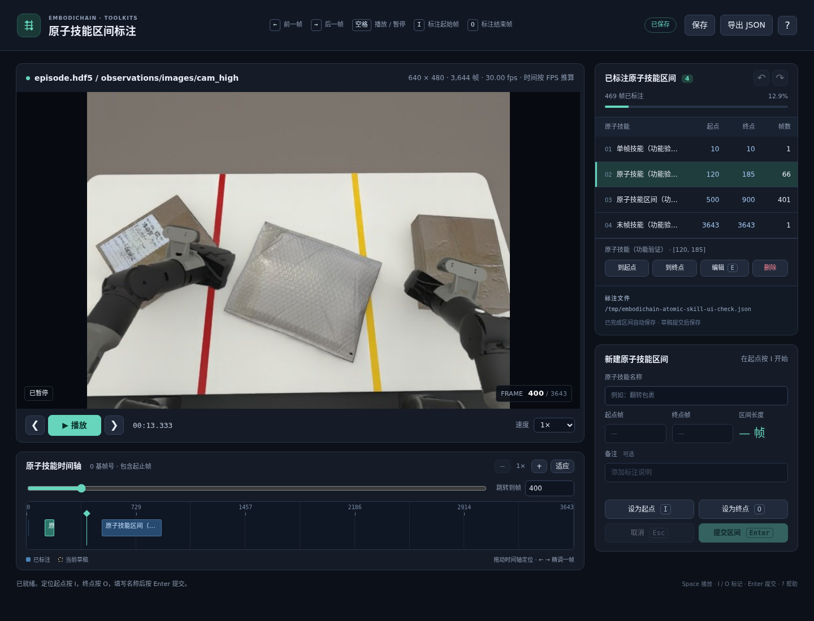

# 遥操轨迹图像序列标注

在浏览器逐帧查看遥操视频、HDF5 相机图像或内存图像序列，为原子技能标注起止帧。支持时间轴定位、动作列表、区间编辑和删除、撤销重做、JSON 自动保存与继续编辑。运行时使用 CPU，不启动仿真。



## 启动

在已经安装 EmbodiChain 的环境中，安装本工具的依赖即可：

```bash
conda activate py312
python -m pip install 'av>=15.1,<18' 'fastapi>=0.115,<1' 'uvicorn>=0.30,<1'
embodichain annotate-trajectory --video /data/episode_0001.mp4
```

新安装项目时也可以选择 `pip install 'embodichain[trajectory-annotation]'`。源码安装使用 `pip install -e '.[trajectory-annotation]'`，它会同时解析项目的基础依赖；已有开发环境可以使用上面的单独依赖安装命令。

命令会打印本地网址，并默认打开浏览器。首次打开时完整扫描选定视频流、校验来源并建立准确的帧索引；长视频需要等待。按 Ctrl+C 退出服务。

```bash
embodichain annotate-trajectory \
  --video /data/episode_0001.mp4 \
  --annotations /data/labels/episode_0001.segments.json \
  --video-stream 0 \
  --port 8765 \
  --no-browser
```

- `--annotations`：读写同一标注文件，默认视频同目录的 `<stem>.segments.json`。
- `--video-stream`：容器中的实际流索引，默认第一个视频流。
- `--port`：默认 0，自动选择空闲端口；服务只监听 `127.0.0.1`。
- `--no-browser`：手动打开打印的网址。

也可使用 `python -m embodichain.toolkits.trajectory_annotator --video ...` 启动。

## HDF5 输入

```bash
embodichain annotate-trajectory \
  --hdf5 /home/oem/piper-sim-data/label_down/episode_20261022T073344_323022Z/episode.hdf5 \
  --annotations outputs/trajectory_annotation/episode.cam_high.segments.json

# 指定其他相机或缺少元数据时提供帧率
embodichain annotate-trajectory --hdf5 /data/episode.hdf5 \
  --image-key observations/images/cam_left_wrist --fps 30
```

- `--video` 和 `--hdf5` 二选一。HDF5 以只读方式打开，不转成临时视频。
- `--image-key` 默认自动定位 `observations/images/cam_high`，同时兼容单数 `observation/images/cam_high`；两者均存在时要求显式选择。实际 demo 使用复数路径。
- 支持逐帧 JPEG/PNG 字节数组（含变长 uint8 和定长填充行）及 `N×H×W×3 uint8` 原始图像。只按需读选中相机的单帧，初始化时仅解码首帧确认尺寸；文件摘要按 1 MiB 分块计算。
- 原始数组默认 RGB，可用 `--color-order bgr` 指定 BGR；压缩图像按编码解码。
- `--fps` 优先级最高，否则依次读取图像 dataset 的 `fps`、根属性 `fps`、根 `metadata_json.record_fps`。缺少有效值时提示提供 `--fps`，不会猜测。页面明确显示时间由 FPS 推算；帧号始终来自 dataset 行索引。
- 默认标注路径为 `<stem>.<camera>.segments.json`，可用 `--annotations` 覆盖。

[可运行示例](../../../examples/toolkits/trajectory_annotation/README.md)默认使用上述 demo：

```bash
embodichain run-example toolkits/trajectory_annotation
```

## 图像帧输入接口

核心只依赖 [`FrameSource`](frames.py) 协议，不依赖视频或 HDF5。已有 RGB 图像可直接传入：

```python
from embodichain.toolkits.trajectory_annotator.app import launch_annotation
from embodichain.toolkits.trajectory_annotator.frames import ArrayFrameSource

# images: N×H×W×3 uint8 RGB 数组，或同尺寸图像列表
launch_annotation(
    lambda: ArrayFrameSource(images, fps=30, name="episode"),
    "outputs/episode.segments.json",
)
```

调用方保留数组所有权，在应用关闭前保持内容和顺序不变。适配器逐张校验并计算摘要，不额外复制整个序列。
大规模数据可自定义 `FrameSource`，实现 `prepare`、`get_frame`、`check_unchanged` 和 `close`，返回 `FrameSourceInfo` 与单张 `ImageFrame`。
图像统一为 `H×W×3 uint8 RGB`，帧号从 0 开始；借用图像缓冲区至少有效到下一次读帧。
工厂创建、准备、读帧和关闭均在一个工作线程执行；保存线程只调用不访问解码/HDF5 句柄的 `check_unchanged`。
应用负责预览缩放、JPEG 编码、有界缓存和标注保存。程序化服务入口为 `create_annotation_app(factory, annotations)`，启动入口为 `launch_annotation`。
文件适配器分别位于 [`video.py`](video.py) 与 [`hdf5.py`](hdf5.py)，公共接口参考[API 说明](../../../docs/source/api_reference/trajectory_annotator.rst)。

## 标注

1. 用时间轴、帧号输入框或播放按钮定位原子技能起点，左右键逐帧精调。
2. 按 **I** 设置起点，输入原子技能名称，例如“翻转包裹”。名称输入框中按 Enter 返回视频区。
3. 定位原子技能最后一帧，按 **O** 设置终点。
4. 检查原子技能名称、起止帧和帧数，按 **Enter** 提交。已完成区间显示在时间轴和右侧列表中。
5. 选中列表中的标注，按 **E** 修改、Delete 删除，或点击起止帧跳转。

帧号从 **0** 开始，起止帧**均包含**。`[120, 185]` 包含 66 帧，对应 Python 切片 `frames[120:186]`。允许空隙和单帧原子技能，同一轨道的已完成区间不能重叠。

桌面布局左侧为视频和与视频等宽的原子技能时间轴，右侧依次为“已标注原子技能区间”和“新建/编辑原子技能区间”。标题栏常驻提示 ←/→ 逐帧、空格播放/暂停、I/O 标注起止帧。

整条时间轴均可按住拖动，包括已标注色块内部；游标按鼠标位置定位，不吸附到区间边界。点击色块可同时选中该技能，列表中的起止帧按钮仍用于精确跳转。
每帧占一个等宽单元，闭区间覆盖从起点单元左沿到终点单元右沿；游标和刻度位于对应帧单元中心。色块不会因标签长度、内边距或最小宽度被撑宽，短标签可悬停查看。
长序列在缩略比例下一个屏幕像素可能对应多帧，精确定位可放大时间轴、使用 ←/→ 或输入帧号。

每次只有一个草稿。编辑已有标注时，原版本保留到提交；Esc 取消。删除和撤销只修改标注。存在草稿时先提交或取消，再切换编辑、删除或撤销。

| 快捷键 | 操作 |
| --- | --- |
| Space | 播放 / 暂停，末帧重新播放时从头开始 |
| ← / → | 前 / 后一帧；Shift 跨 10 帧 |
| Home / End | 首帧 / 末帧 |
| G | 输入帧号跳转 |
| I / O | 将当前显示帧设为起点 / 终点 |
| L | 输入原子技能名称 |
| Enter / Esc | 提交 / 取消草稿 |
| E | 编辑选中的标注 |
| Delete / Backspace | 删除选中的标注 |
| Ctrl/Cmd + Z | 撤销；加 Shift 重做，最多保留 100 次 |
| Ctrl/Cmd + S | 保存已完成标注 |
| ? | 快捷键帮助 |

输入文本时保留正常的文字编辑快捷键。播放中设置端点会暂停在当前已经显示的帧；手动寻帧期间需等画面显示后再标记。页面失去焦点后自动暂停。

## 保存与输出

提交后的修改在停止编辑 1 秒后自动保存。也可点击“保存”或按 Ctrl/Cmd+S。新项目在第一次保存前不创建文件；未提交草稿不写入 JSON。状态栏明确显示未保存、保存中、保存成功或失败。

重新用同一命令打开数据会加载原标注。JSON 使用 `schema_version: 2`，包含 0 基/闭区间声明、与容器无关的 `source` 信息（类型、身份、帧数、尺寸、帧率、时间来源和适配器详情）、修订号，以及 `segments` 数组。界面与内部模型使用原子技能区间命名；保留现有 JSON/API 的 `segments` 字段和文件名后缀，以继续读取已有标注。数组元素示例：

```json
{
  "id": "seg_2e841dc2-0e4c-4b37-8d97-1d064da7e8a1",
  "label": "翻转包裹",
  "start_frame": 120,
  "end_frame": 185,
  "note": "可选备注"
}
```

写入前校验，临时文件 fsync 后原子替换；失败时保留旧文件与页面修改。多标签页的旧修订和磁盘外部修改会被拒绝覆盖，可先“导出 JSON”保留当前已完成标注，再重新打开。导出副本不代表本地保存成功。

文件路径相对于标注 JSON 保存。文件适配器用 SHA-256 绑定源内容，并将相机路径、流索引、帧率或颜色解释等选择纳入身份检查；移动文件后可显式传入新路径，相同内容仍可恢复。内存图像按像素、顺序和 FPS 计算身份。不同内容或选择不能套用已有标注。兼容旧版 `schema_version: 1` 的 `source_video` 文档，读取时只在内存中转换，下次成功保存才写入 v2。

本工具生成区间标注文件。将视频帧映射到机器人控制 step、裁剪视频或切分关节轨迹需要后续消费程序显式处理；现有 recorder 的半开区间不能直接复用本工具的闭区间端点。

## 视频与资源约定

以 MP4/H.264 为主要验收输入，其他容器/编码取决于 PyAV/FFmpeg。支持恒定与可变帧率，以及非零起始 PTS。首版要求帧 PTS 存在且严格递增、视频分辨率固定；原始无时间戳 H.264 流等输入会报告原因。播放不处理音频。

帧号按完整解码的显示顺序定义，包含 B 帧和解码器尾帧，不能由 `time × FPS` 推算。随机跳转按关键帧定位并校验 PTS，必要时从头解码。预览最长边默认 1280 像素；JPEG 缓存默认上限 64 MiB，紧凑帧索引另设 64 MiB 预算，不预加载完整 RGB 视频。性能不足时播放降低实际速度，不跳过索引帧或积压请求。

## 开发验证

```bash
python -m pytest tests/toolkits/trajectory_annotator/test_annotation.py tests/toolkits/trajectory_annotator/test_frames.py -q

# 可选：实际浏览器键盘、删除恢复和异步帧/保存检查。
python -m pip install playwright
python -m playwright install chromium firefox
python -m pytest tests/toolkits/trajectory_annotator/test_browser.py -q
```

浏览器检查也可使用系统 Chrome，或通过 `ANNOTATION_CHROMIUM_EXECUTABLE` 指定可执行文件。缺少可选浏览器时明确跳过。

性能测量入口支持 `--video` 或 `--hdf5`，例如：`python -m scripts.benchmark.toolkits.trajectory_annotation --video /data/episode.mp4`。报告初始化时间、随机寻帧、连续取帧及缓存延迟、RSS 和索引/缓存占用；具体数值取决于分辨率、编码、关键帧间隔和硬件。

实际 HDF5 demo（3644 帧、640×480、30 FPS）在 AMD Ryzen 9 9950X、py312、JPEG 质量 85 上，含文件摘要的初始化为 0.215 秒；50 次随机预览中位数 0.993 毫秒、P95 1.101 毫秒。测量不含 HTTP 和浏览器渲染，不据此保证固定播放帧率。
