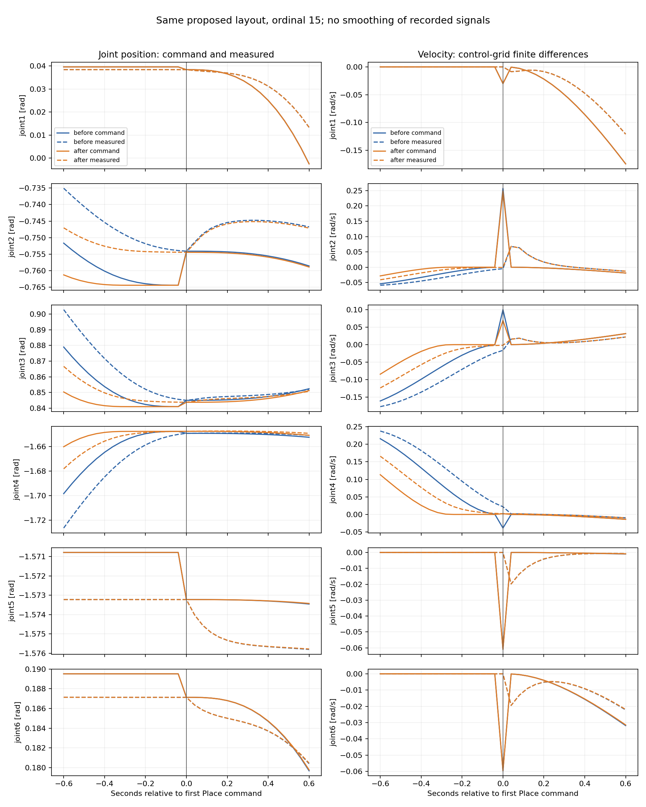
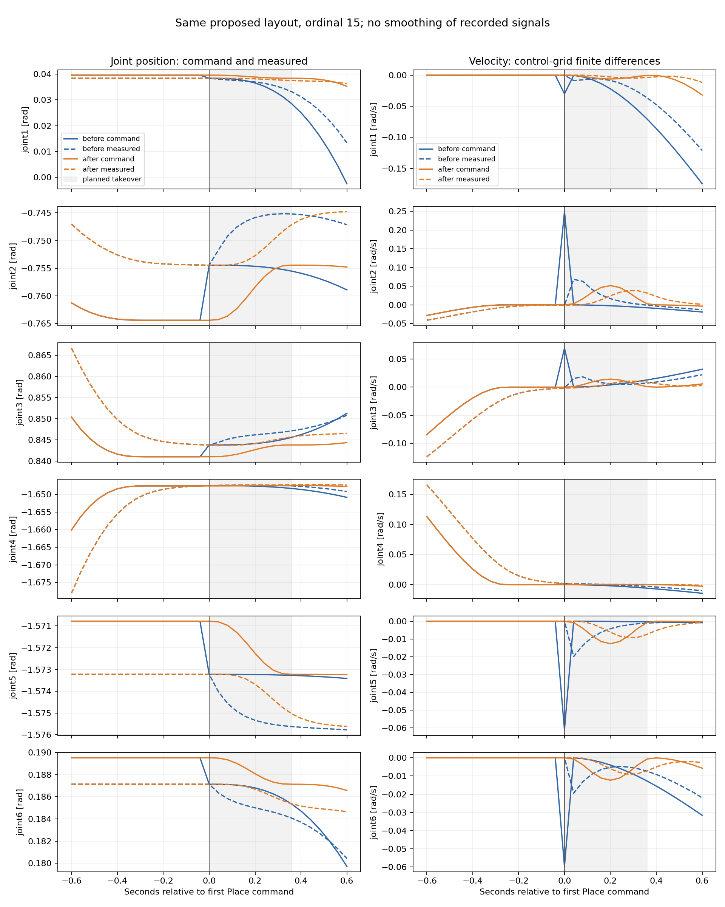
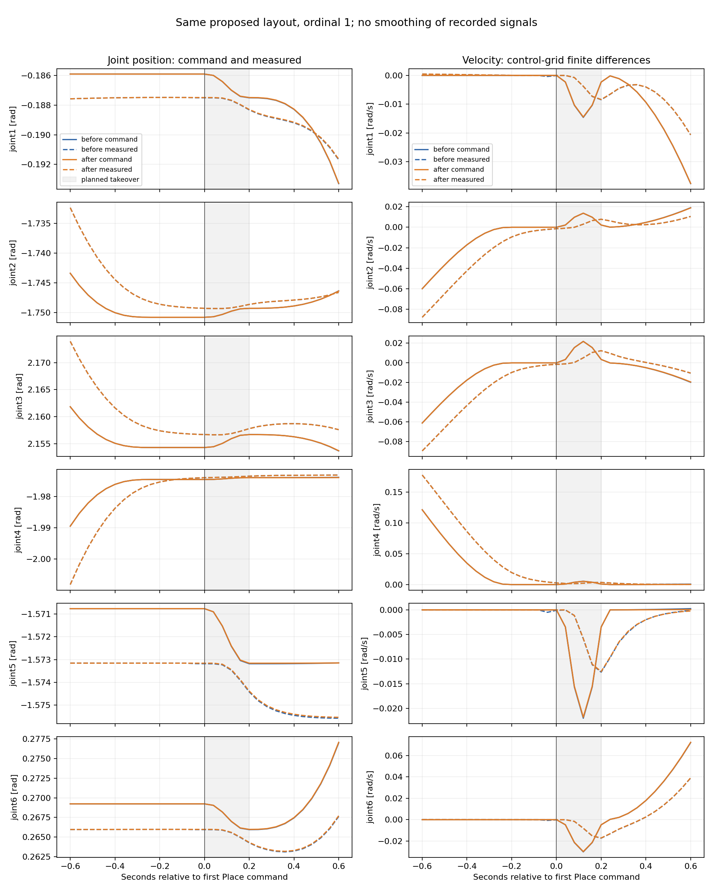
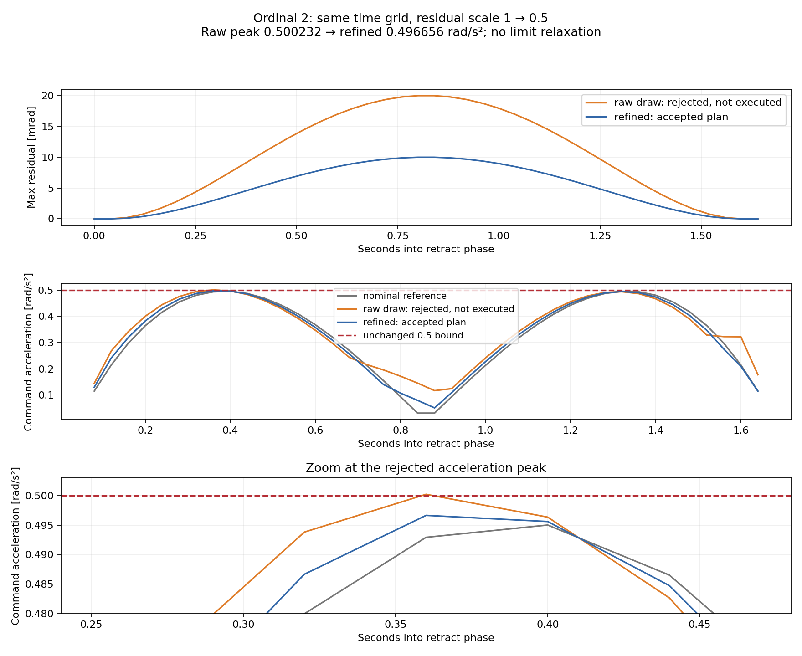

# Skill boundary diagnosis and controlled stops

Native configured expansion jobs enable `tracking.boundary_stop` in their owned
execution-policy snapshot. Authored policy files, physical/contact validators,
scene samplers and grasp/release gates are unchanged. Scalar component overrides
and inline policy declarations use the existing canonical resolver.

```yaml
tracking:
  kind: timed
  boundary_stop: true
  boundary_position_tolerance: 0.01
  boundary_velocity_tolerance: 0.005
  boundary_timeout: 1.5
```

Explicit `false` retains historical behavior. Direct Atomic users remain opt-in.
Position tolerance uses each joint's coordinate units (rad or m); velocity uses
those units per second. Configure tighter/application-specific values when the
controller and physical task support them. Defaults accommodate the observed
steady reference error of the Default UR5 pick-place setup; they are not universal
robot safety limits or an acceleration/jerk guarantee.

After the nominal final command, the session continues sending the same command
until two distinct measured control boundaries satisfy target-position error and
finite-difference position speed. Hand targets are retained; no trajectory sample
is modified. This reduces residual physical motion before the next skill captures
its actual start state. The remaining reference-to-measurement error can still
cause a bounded target jump. This feature does not implement fly-through blending.

Native qvel is validated finite and logged separately. This matters for backends
whose post-substep velocity differs from control-grid displacement. Existing
terminal acceptance remains an additional requirement. Timeout and invalid data
reject only affected rows and preserve ordinary safe-stop behavior. New frames
consume wall/step budgets and are recorded as actual actions with T+1 observations.

`boundary_diagnostic` runtime events contain the bound joint IDs, error, native
and control-grid measured speeds, elapsed time, readiness, timeout and tolerances.
The first control-speed sample is unknown and serialized as null. Failed and
cancelled runs must not be pooled into successful episode statistics.

## Reproduce comparisons

Use separate baseline and modified checkouts with the same Python environment,
CPU affinity and visible GPU. Run each pair serially in before/after and then
after/before order, keeping all settings identical:

```bash
OMP_NUM_THREADS=1 MKL_NUM_THREADS=1 SDL_VIDEODRIVER=offscreen CUDA_VISIBLE_DEVICES=1 \
python -m scripts.benchmark.expansion.task_pose_coverage \
  --worker --group A --scene open --rows 4 --rollouts 16 \
  --candidates 512 --seconds 600 --output /absolute/fresh-result
```

Repeat for group D. The task owns Default physics; `collision_backend: newton`
is the independent collision checker, not a switch of the physical backend.
Retain configuration, source manifest, attempts, rejected evidence and receipts.
The benchmark source manifest includes Atomic and Gym Task Program code.

`scripts/benchmark/expansion/skill_boundaries.py` consumes a comparison directory
with `runs.json` and `{A,D}-{0,1}-{before,after}` worker directories. Each run entry
contains case, group, revision and metrics (wall_s, committed, executed). It outputs
per-boundary JSON, percentile summaries and six-joint position/velocity PNG/PDF:

```bash
python -m scripts.benchmark.expansion.skill_boundaries --input /absolute/comparison
```

The plotted pair is chosen by largest baseline target jump among successful
same-ordinal pairs whose initial object poses match within 1e-4 componentwise.
The plot reports raw positions and control-grid finite differences, aligned to
first Place command, without postprocessing smoothing. Aggregate results include
all successful boundaries; success rates retain all executed attempts. The source
artifacts and pair selection are recorded for independent inspection.

## Recorded Default-backend qualification

Baseline: `fb96705b0`. UR5 pick-place, open scene, seed 7, B=4, 16 rollout
budget and 512 proposal budget, groups A (bounded/FIFO) and D
(workspace/coverage), each run serially in before/after then after/before order.
Physics is Default CPU; independent geometry checking uses Newton CPU. Visible
GPU 1 is held constant; eight CPU cores and one numerical thread are used.
Measured wall time includes setup, execution, original acceptance and export,
not Python process import. Full source/config manifests are retained per run.

| Group | Confirmed / executed before → after | Mean wall seconds before → after | Boundary command jump P95 (rad) before → after | Measured control-speed P95 (rad/s) before → after |
| --- | --- | --- | --- | --- |
| A | 30/32 → 30/32 | 54.12 → 56.47 | 0.009904 → 0.009540 | 0.021962 → 0.003043 |
| D | 20/26 → 18/26 | 48.71 → 49.19 | 0.006324 → 0.005695 | 0.021708 → 0.003002 |

D did not fill the requested quota in either version: proposal budgets were
exhausted. The new gate rejects one additional previously accepted sample per
repeat: terminal residual approximately 0.01066 rad exceeds the explicit 0.01
threshold after 1.5 s, despite zero control-grid speed. No existing predicate
was relaxed. D's successful-set boundary statistics therefore have a different
population; they are not an isolated causal improvement estimate. Effective
accepted throughput decreases approximately 4.2% for A and 10.9% for D. Two
orders/one seed are insufficient for a general performance claim.

The mechanism demonstrably reduces residual measured motion, but does not remove
reference jumps from steady tracking bias. It should not be advertised as a
complete cure for command discontinuities. A future boundary-conditioned planner
is required for strict continuous references. The evidence shown below deliberately
retains the visible command spikes.



The pair is A, repeat 0, candidate ordinal 15: largest baseline target jump among
matching successful pairs, initial object pose components differ by at most
1.06e-6. Blue is before, orange after; solid is command, dashed measured. Speeds
are finite differences on the 40 ms control grid. Time zero is each recording's
first Place command; recorded signals are not smoothed.

A collection driver is also available:

```bash
CUDA_VISIBLE_DEVICES=1 python -m scripts.benchmark.expansion.skill_boundaries \
  --collect --baseline /absolute/baseline-checkout \
  --revision /absolute/modified-checkout --input /absolute/new-comparison
```

## Reference-conditioned takeover (follow-up)

`tracking.boundary_reference_bridge` adds a rest-to-rest controller-reference
prefix for supported native free entry phases. Expansion inherits its default
from `boundary_stop`; an explicit stop opt-out therefore retains legacy behavior
unless the bridge is separately enabled. The Gym observation provider captures
owned position/velocity targets separately from measured qpos/qvel. Planning
never relabels those references as measurements.

The prefix starts at the previous drive target with zero target velocity and ends
at the original first plan sample. Existing minimum-jerk interpolation provides
bounded samples on the original control grid. Position limits, discrete speed
and acceleration across the join, and velocity-target derivatives are checked.
The original suffix positions and velocity references remain intact, with the
original zero-velocity start enforced at the join. Prefix samples are real
commands, not a smoothing pass over exported evidence.

The prefix inherits the first phase name so held-object and phase guards remain
active. Segment lengths and scene-monitor indices are shifted together. Expansion
and mapped retiming cannot overwrite the prefix or join stencil. Rebuilding cannot
prepend twice. Projected compilation advances reference snapshots consistently;
failed rows do not contribute a stale reference or moving target to bridge sizing.
Original collision evidence is invalidated for a changed plan; existing runtime
geometry/contact/task acceptance still owns qualification. No continuous collision
certificate is claimed. This initial bridge also requires revision zero and disabled action replanning/retry
budgets: zero feedforward velocity alone cannot prove a position-only reference
is stationary during an in-flight recovery. External nominal sources and undeclared entry phases keep
their original behavior and report the unavailable bridge in diagnostics.

### Drive-bias diagnosis

Four matched layouts retain bitwise-identical Pick terminal command targets:

| Diagnostic-only configuration | Mean per-episode maximum arm-joint error |
| --- | --- |
| Original arm stiffness 10000, damping 1000 | 5.842 mrad |
| Stiffness 20000, damping 1000 | 2.900 mrad |
| Stiffness 10000, damping 500 | 4.387 mrad |

These controlled interventions support gain-dependent steady tracking bias rather
than changed geometric endpoints. They are excluded from performance/success
comparisons. Native post-substep velocity differs from control-grid displacement;
the recorded effort channel is zero and is not treated as measured drive torque.
A gravity-toggle probe had no independently verified post-reset readback and is
inconclusive, so no claim attributes the entire bias to gravity or saturation.
The handoff planner removes the reference reset; it does not eliminate physical
tracking bias or retune the robot's gains.

### Paired qualification against the stop-only version

Baseline is `532fe6ef4`, with the same B=4, seed 7, 16-rollout/512-proposal budgets,
Default CPU physics and both serial run orders used above. Every successful
Pick→Place boundary has an exactly zero command position jump after the change.
The acceleration window is reported explicitly in each JSON row (normally
−0.04 to +0.48 s relative to handoff), so a shifted nearby spike is not hidden.

| Group | Confirmed / executed before → after | Mean wall seconds | Jump P95 (mrad) | Window command acceleration P95 (rad/s²) |
| --- | --- | --- | --- | --- |
| A | 30/32 → 30/32 | 52.31 → 54.61 | 9.534 → 0 | 5.961 → 0.446 |
| D | 18/26 → 18/26 | 48.76 → 50.16 | 5.695 → 0 | 3.560 → 0.400 |

Window maxima are 0.459 and 0.400 rad/s² after takeover, below the unchanged
0.5 bound. Wall-time increases are 4.4% and 2.9%. These are two repeats of one
seed, not a general performance guarantee. Existing D quota shortfalls and
stop-gate rejection remain; no gate was loosened to recover success.

An initial joint-residual smoke was 4/4 before and 3/4 after: the original
edited-phase acceleration validator rejects one generated Place variant
(acceleration ratio 1.425). This failure is retained as evidence; the bounded repair below addresses this
budget-exhaustion case. Broader operator qualification remains separate. Main matrix results are object-pose
operator results, not a claim that all trajectory operators preserve yield.



The paired plot uses ordinal 15 with exactly matching initial object poses.
Blue is stop-only; orange includes planned takeover. Solid lines are commands,
dashed lines measurements. Velocities are unsmoothed control-grid differences;
they are not native instantaneous velocity readings. The numerical matrix has
per-run source manifests; later fail-closed rebuild/retiming and interface guards
have focused tests plus a separate B=4 native smoke.

## Joint-residual rejection recovery

The earlier 3/4 probe exposed a near-limit rejection-sampling weakness, not a
failure of the reference prefix. The failure occurs in Place/retract candidate
checks, before plan restoration/rebuilding. The nominal phase already consumes
about 99% of the acceleration bound. Residual amplitude is sampled from joint
range, independently of the phase's remaining dynamic margin. A fixed random
budget can therefore miss a feasible amplitude; preserving endpoints alone does
not constrain discrete acceleration. The old error reports the last rejection,
not the closest one.

The native adapter now preserves the original random sequence and preference
for unscaled candidates. Only after raw `max_proposals` is exhausted does it
retain the closest motion rejection and try at most eight deterministic
halvings. Every materialized result must pass the unchanged joint/motion checks
and original minimum delta, followed by unchanged FK, reconstruction, collision
and physical/task validation. It does not retime, alter protected samples or
accept nominal repeats. Memory remains O(TD), retaining one candidate rather
than the entire proposal pool. This is bounded local repair, not a complete
feasibility solver.

Provenance includes `proposal` (raw source index), `raw_proposal_count`,
`residual_scale`, raw checks and the accepted checks. Refined plan archives also
include `raw_candidate`; original passing draws retain their amplitude.

### Same-configuration qualification

Baseline `6cd7da36b`; Default CPU, group A, joint_residual, seed 7, B=4,
4-rollout/128-scene-candidate budgets, 64 raw motion proposals, 240 seconds.
Velocity/acceleration limits remain 0.5; minimum joint delta remains 0.002 rad.
Both before/after and after/before were run serially with the same CPU affinity
and visible GPU. Earlier exploratory baseline runs also achieved 4/4: the
failure is sensitive to the small dynamic margin, not a guaranteed failure on
every run of the current baseline.

| Metric | Before | After |
| --- | --- | --- |
| Confirmed/executed, two orders | 6/8 (3/4 each) | 8/8 (4/4 each) |
| Mean wall seconds, setup through export | 21.776 | 21.208 |
| Qualified episodes/minute | 8.27 | 11.32 |
| Pick→Place command jump, maximum | 0 rad | 0 rad |
| Handoff-window command acceleration, maximum | 0.415 rad/s² | 0.411 rad/s² |

The restored ordinal 2 exhausts all 64 raw draws. Its closest draw (index 4)
has acceleration ratio 1.000464, above the unchanged 1+1e-6 acceptance threshold.
A residual scale of 0.5 yields ratio 0.993311 (0.993013 on the second repeat)
and actual max delta 0.009999 rad, above the original 0.002 minimum. All endpoints,
hand columns and noneditable samples match the reference exactly. The original
reference itself still must pass validation; repair cannot bypass that gate.



The handoff plot compares shared successful ordinal 1. The failed ordinal 2 had
no executed Place path before repair; its raw rejected plan is shown separately:



The 2.6% wall-time difference is descriptive for this small sample, not a general
speedup claim. Effective throughput improves mainly by recovering the fourth
qualified episode. The rejected candidate is not labeled as measured execution.
Analysis supports `--operator joint_residual`; per-run source manifests and raw
artifacts retain the comparison evidence. Final changes to archive size and
private ownership were followed by a separate native smoke.
