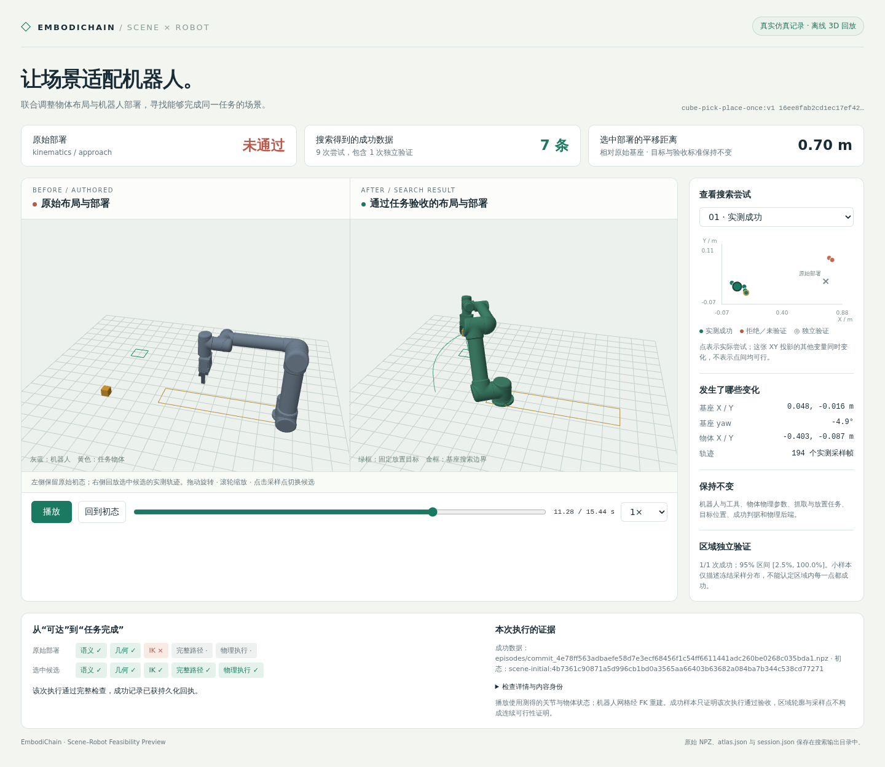

# Joint scene and robot installation search

## Preview the effect in 3D



```bash
pip install -e '.[feasibility]'
embodichain run-example expansion/scene_robot_feasibility/preview --output outputs/scene_feasibility_preview --open
```

The preview first checks an intentionally distant UR5 installation, then searches
the permitted cube XY and installation XY/yaw domain using the same task,
physical parameters, fixed placement goal and measured acceptance conditions.
The default demo allows 300 seconds for eight search candidates and one independent
validation trial; the initial comparison has its own bounded check. A successful
search is not guaranteed within this budget.

Open `outputs/scene_feasibility_preview/index.html` to compare the original
installation with the selected search result. Drag to orbit both views, scroll
to zoom, select candidates from the plot/dropdown, and play or scrub successful
recordings. The page shows actual stage outcomes, changed base/object poses,
confirmed writes and independent validation separately. Failed candidates retain
their initial proposal and diagnostic checks, without a fabricated trajectory.

Playback uses measured joint and entity states from accepted NPZ episodes. Robot
link meshes are exported through the native scene exporter and animated with FK;
the export checks native/FK frame agreement. No physics is rerun in the browser,
and no external JavaScript or network service is required. The original view
shows an initial configuration, not an executed failure trajectory. Small-sample
region intervals do not certify neighboring configurations.

After generating once, rebuild/open the HTML without importing simulation:

```bash
embodichain run-example expansion/scene_robot_feasibility/preview --output outputs/scene_feasibility_preview --reuse --open
```

To visualize an existing run, supply the original workflow:

```bash
embodichain run-example expansion/scene_robot_feasibility/preview --config examples/expansion/scene_robot_feasibility/search.ur5.yaml --from-run outputs/scene_feasibility --output outputs/scene_feasibility_replay
```

The last command evaluates that workflow's authored installation and reads its
existing `atlas.json`/`episodes/`; it does not perform another search. The resolved
request must match. `preview.json` preserves the detached mesh/frame data and
`workflow.json` preserves the exact search configuration. Output directories
must be new, or explicitly reopened with `--reuse`.

## Search configuration

Run from the repository root with the installed simulation runtime:

```bash
pip install -e '.[feasibility]'
embodichain search-scene-feasibility --config examples/expansion/scene_robot_feasibility/search.ur5.yaml --output outputs/scene_feasibility
```

The authored task picks, lifts, places and releases one cube. The job changes the
cube layout and UR5 installation while preserving the robot/tool, goal and
measured acceptance criteria. It checks an explicit phase graph before invoking
the existing Task Program runtime; actual runtime replanning and physical outcome
still decide acceptance. Structural contact permissions name physical URDF
frames and must be re-authored when the embodiment changes.

`atlas.json` contains exact proposals, independent held-out trials and conditional
joint regions. `session.json` retains shared attempt/receipt accounting. Accepted
`episodes/*.npz` contain T controller targets with T+1 measured state/timestamp
samples. Failures stay diagnostic evidence. `report.html` is an offline slice
inspector; the remaining dimensions are explicit conditions, and outlined boxes
are proposal regions rather than continuously certified sets.

The example allows 600 seconds, eight search candidates and two held-out trials
per selected region. These small counts are a smoke configuration, not evidence
of a high population success rate. Search and validation are bounded; finding no
successful region is a valid result. The general API defaults to eight independent
validation trials per region and reports an exact 95% interval only for a complete
fixed-count allocation.

For composed dual arms, define both simultaneous TCPs in a phase and move the
whole robot installation as one group. A Python `TaskProgramFeasibilityHost` can
bind multiple operation modes through `configure_mode` and supply richer semantic
or event validators. The configured adapter accepts one runtime mode, preserves
control-part names, and requires explicit runtime provenance-to-phase mappings.

The UR5 job enables a workspace prior for the declared grasp target. A bounded
joint-uniform FK population is prepared when no workspace cache is configured;
valid cached qpos/FK data can be reused instead. Half of prior requests retain
uniform exploration, and every proposed layout still runs fresh IK/path/physical
checks. The report records prior identity and guided/fallback counts.

`search.dual_ur5.yaml` exercises the existing verified tabletop HandOver program,
with paired preflight reach requirements and explicit measured transfer/release
events. The canonical runtime owns grasp choice and the full handover/placement
motion; native qualification must be assessed from its resulting atlas, rather
than inferred from the preflight endpoints alone.

`search.bar_dual_ur5.yaml` uses the configured rigid-bar transfer task: grasp,
handover, then placement. It preserves the composed robot's relative mounting
while searching the installation and bar/support-group layout.

## Evaluate Newton collision queries

From a source checkout with the simulation runtime and the `feasibility` extra:

```bash
OMP_NUM_THREADS=4 python -m scripts.benchmark.scene.feasibility_collision \
  --collect-config examples/expansion/scene_robot_feasibility/search.ur5.yaml \
  --collect-config examples/expansion/scene_robot_feasibility/search.bar_dual_ur5.yaml \
  --output outputs/benchmarks/newton_collision
```

Each configured workload uses one search candidate and at most one independent
trial to profile the existing execution path. It saves physical collision shapes,
the SDK's original convex declarations, phase permissions and a bounded reservoir
of 256 queried states. The standalone comparison uses independent Newton states
with no physics stepping. It compares CPU, CUDA and CUDA Graph queries against
the current FCL checker at B=1/8/32/256. The physical task host remains B=1.

`results.json` retains measurements and qualification errors; `report.md` contains
timing/memory, classification agreement and complete-fixture qualification tables.
Reuse captured inputs with repeated `--fixture path/to/fixture-*.json` arguments
to rerun measurements without collecting another task. Timings separate geometry
setup, device-resident queries and the full host-input-to-host-result call. B=1
timings repeat one representative query, not the average cost of a task.

This is a benchmark prototype, and the production checker remains FCL. Primitive
and native convex-geometry agreement does not establish complete mesh support:
the benchmark includes a concave-solid containment counterexample. Newton's
separation values are limited to its detection band and are not global minimum
distances. Dependency declarations reuse DexSim's `trimesh` and Newton packages;
the `feasibility` extra supplies FCL for the existing runtime and comparison.
