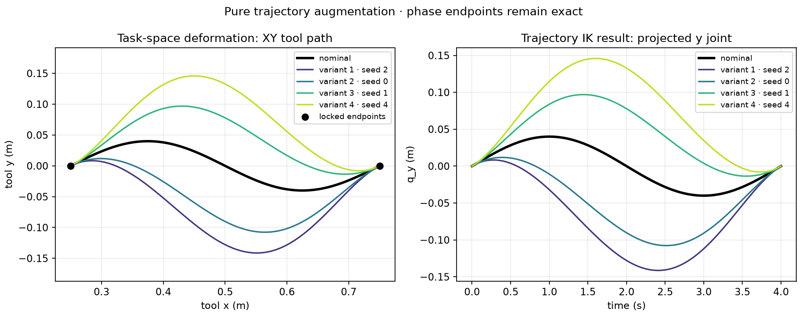
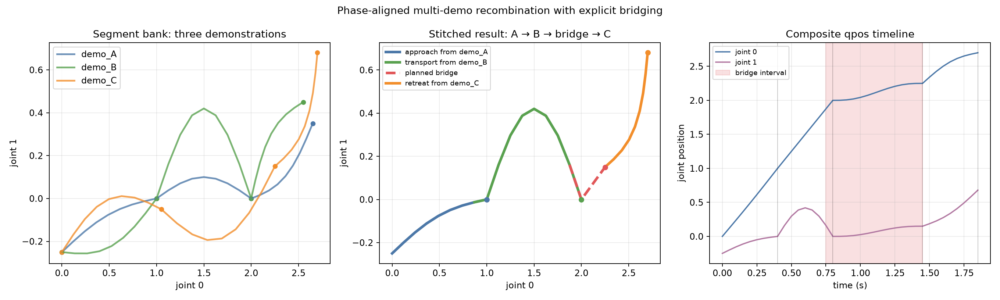
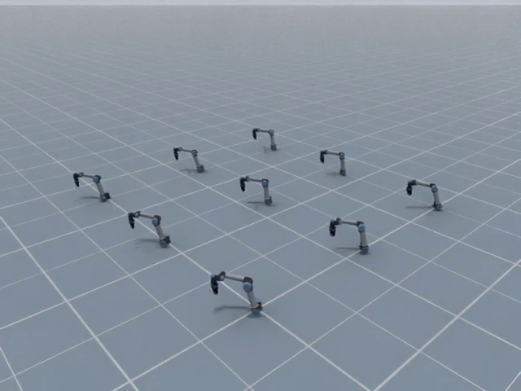
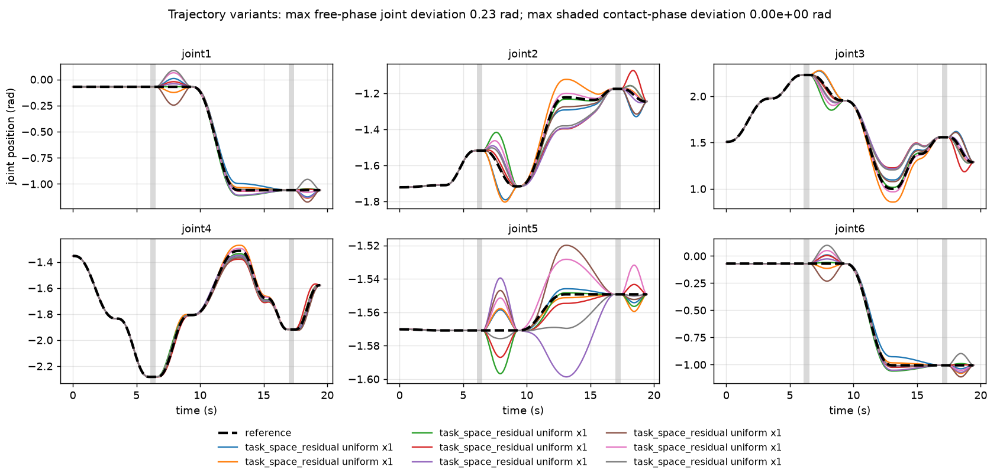

# Trajectory augmentation showcases

## Pure trajectory: task-space deformation and segment stitching

Generate two CPU-only figures without constructing a simulator:

```bash
python examples/expansion/trajectory/pure_trajectory_augmentation_showcase.py \
  --output-dir /tmp/embodichain-pure-trajectory
```

The first figure applies four bounded task-space residuals to one analytic tool
path, projects each target back to qpos with batched trajectory IK, and makes
the shared locked endpoints visible. The second builds a phase-indexed segment
bank from three demonstrations, composes Approach from A, Transport from B and
Retreat from C, and highlights the explicitly planned minimum-jerk bridge.
``summary.json`` records IK residuals, selected source lineage and bridge phase
IDs. Add ``--show`` to open the Matplotlib windows after rendering.

This example deliberately contains no image observations, affordance labels or
physical execution. Collision, dynamics and task-success validation remain
required before its outputs could be used as expert trajectories.

### Task-space deformation and trajectory IK



The black curve is the nominal trajectory. Colored curves use different local
random streams while sharing the exact black endpoint samples. The right panel
shows the corresponding qpos returned by trajectory IK.

### Phase-aligned multi-demo stitching



The composite takes Approach from demo A, Transport from demo B, and Retreat
from demo C. The red dashed path and shaded time interval are the explicit
minimum-jerk bridge inserted at the discontinuous B/C boundary.

## Task-environment trajectory augmentation

Joint, task-space and manipulability-guided proposals share
`expand_trajectory_variants()` and `CandidateCoordinator`. Configure independent
factors through `TrajectoryAugmentationCfg` (or the `augmentation` field of
`TrajectoryExpansionCfg`):

```python
from embodichain.lab.sim.motion.expansion import TrajectoryAugmentationCfg

cfg = TrajectoryAugmentationCfg.from_mapping({
    "factors": {
        "spatial": {"enabled": True, "method": "joint_residual"},
        "task_space": {
            "enabled": True,
            "frame_id": "arm_tcp",
            "max_translation_m": 0.04,
            "max_rotation_rad": 0.02,
            "ik": {"max_iterations": 32},
        },
        "manipulability": {"enabled": True, "guided_proposals": 4},
    },
})
```

Supply `kinematics(qpos) -> (poses, jacobians)` to the generator/coordinator.
The input columns follow `template.controlled_joint_indices`; output shapes are
`(T, 4, 4)` and `(T, 6, C)` in the controlled frame's root coordinates. The host
binds the declared frame and TCP. Task-space phases require
`task_space_residual` in both template and phase permissions. Joint-only phases
retain their own permissions when factors are combined.

The order is task-space deformation and IK, optional joint-path edit and
re-projection, then retiming. Manipulability guidance selects among those
complete proposals, using the same motion checks, deduplication and total draw
budget. `max_attempts` includes inner guidance draws. The nominal row stays
unchanged; failed IK draws are rejected rather than reused. Disable factors to
select the individual routes; guided sampling without another path factor uses
joint residuals. One guided proposal retains the existing coverage-only mode.

For `CandidateCoordinator`, register a positive `manipulability_reference` with
`ExpansionSession.register_case()` when manipulability coverage is enabled.
Guidance uses that same initial-state normalizer. Standalone generation can
accept the scalar explicitly or derive it from nominal FK/Jacobians. Candidate
metadata includes the requested/actual band, selected score and number of scored
draws. Those planned scores do not replace measured rollout validation.

The showcase below uses this shared generation path, adding only the robot
kinematics binding, selected phase permissions and replay policy.

Run the PickUp → Place task scene as a 3×3 parallel simulation: environment 1
replays the nominal trajectory and environments 2–9 replay eight distinct
endpoint-preserving task-space deformations:

```bash
python examples/expansion/trajectory/task_environment_augmentation_showcase.py \
  --output-dir /tmp/embodichain-task-augmentation \
  --num_envs 9 \
  --device cuda \
  --headless
```

The showcase uses the existing Atomic Action task scene and MotionGenerator
planning path. By default it builds the augmentation reference with bounded IK
interpolation on a 40 ms command grid, while simulation continues to integrate
at its 10 ms physics period. This avoids turning the planner's internal 2 mm
Cartesian discretization into thousands of augmentation samples. It converts
the shared plan to the production
``TaskSpaceTrajectory`` contract, bends the lift/transport/retract paths in the
horizontal plane, adds a small orientation residual, and projects each target
through batched trajectory IK. The showcase uses an 8 cm translation bound, a
0.05 rad rotation bound and a 0.01 normalized joint-path separation threshold
so all nine paths are visibly different. The grasp and release waypoints remain
exact. Generation fails instead of silently reusing a row if nine distinct
IK-valid variants cannot be produced. The output directory receives the
nine-way joint/path plots plus a wide-view
``place_auto_play.mp4`` showing all arenas at once.





Useful overrides include:

```bash
--trajectory_variants 9
--task_space_translation_m 0.08
--task_space_rotation_rad 0.05
--dedup_tolerance 0.01
--variant_seed 7
--trajectory_strategy motion_gen
--trajectory_control_dt 0.01
```

The last two flags opt back into the planner-timed, physics-rate reference for
comparison. The faster showcase defaults preserve the same phase and endpoint
contracts; only the reference command grid changes.

Pass ``--trajectory_variant_mode joint_space`` to return to the earlier
``joint_residual`` / ``via_points`` / ``nullspace_residual`` / retiming demo.

This is a physical execution showcase. It does not claim confirmed dataset
commits; use the expansion coordinator and EpisodeSink flow for collection.
