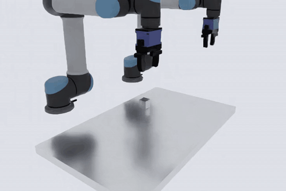

# Task Program from a USD environment

This example imports the complete physical scene from `scene.usda`, adds the
configured Dual UR5 embodiment, and runs Pick and Place through the existing
verified Task Program executor. The source contains a static table and a
dynamic cube, with no robot. The left arm performs the task.

[](media/demo.mp4?raw=1)

[Download the 19-second MP4](media/demo.mp4?raw=1) or [view a still frame](media/poster.png). The clip renders the recorded
poses from a successful 477-control-step execution. Lift, acquisition/release,
placement, uprightness and settling are checked during the original execution.

From the repository root:

```bash
python .agents/skills/add-task-program/scripts/inspect_deployment.py \
  examples/gym/usd_scene_pick_place/task.dual_ur5.yaml --json

python -m embodichain run-task \
  --gym-config examples/gym/usd_scene_pick_place/task.dual_ur5.yaml \
  --headless --renderer no-render --seed 42 --max_episodes 1 \
  --record_trajectory --trajectory_save_dir outputs/usd_scene_pick_place/trajectories
```

The program measures a minimum 4 cm lift, a final position error below 2 cm,
upright orientation and physical settling. Verified effect monitors check
acquisition and release; compilation alone does not establish task success.
The ordinary trajectory recorder saves the committed episode for replay.
Sensor acquisition is disabled in this deployment; select a native renderer
and enable sensors when using the embodiment's cameras.

Open the recorded episode in the existing Viser replay viewer:

```bash
python -m embodichain run-task \
  --gym-config examples/gym/usd_scene_pick_place/task.dual_ur5.yaml \
  --headless --renderer hybrid --viser --replay --replay_mode control \
  --replay_trajectory outputs/usd_scene_pick_place/trajectories/traj_env0_000000.pt
```

Rotate or zoom the 3D view, and drag the **Frame** slider to inspect the task.

## Import another scene

`env.yaml` owns `simulation.usd_scene`, using `UsdImportCfg` fields:

```yaml
simulation:
  usd_scene:
    name: environment
    source:
      file_path: ./scene_package.zip
    asset_cfgs:
      /Asset/World/cube:
        uid: cube
      /Asset/World/table:
        uid: support_surface
```

The whole-scene source accepts `.usd`, `.usda`, `.usdc`, `.usdz` and a standard
AssetRevision `.zip`. File paths resolve relative to the environment file,
including paths without a `./` prefix. ZIP files must declare one USD
entrypoint and pass the SDK's metadata, digest and reference validation; an
arbitrary ZIP containing USD is not a standard package. Schema-valid unknown
quality facts and absent certification remain unknown, and do not establish
runtime readiness.

Use the actual source prim paths. This sample uses `/World/...`; the canonical
AssetRevision package adds `/Asset`, so its overrides normally use
`/Asset/World/...`. A `source.root_prim_path`, variants, namespace and a rigid
scene `pose` retain the existing whole-scene import semantics. The inspector
reports source paths, resource types, UIDs, joints and logical Task Program
bindings. Objects used by the task must have an explicit `asset_cfgs` UID;
`integration.yaml.scene_binding` then maps logical entities to those UIDs.
No object lists are generated or spawned a second time.

The input must already omit robots. Robot and sensor capabilities come from
the selected embodiment; this route rejects USD robot configuration bindings
and does not infer or remove robots from prim names. Existing object lists can
add other physical resources, provided their UIDs do not conflict.

An imported scene defaults to no extra ground plane. Set the environment's
`default_ground: true` to add one deliberately. Backend and gravity remain
owned by `env.yaml`; explicit USD gravity must agree after unit/axis and scene
placement conversion. Imported physical types, constraints and materials use
the existing SDK/backend support. Unsupported types fail explicitly.

USDZ references remain package-addressed. AssetRevision ZIP extraction remains
alive until the native scene is closed; runtime facade sources address the
resolved USD, while the environment inventory retains the original ZIP and
its digest. Source changes between preflight and construction are rejected.

Task programs, affordances, control endpoint meanings and success conditions
remain explicit configuration. This importer does not infer them from
AssetRevision semantics or GenSim output directories. Semantic export mapping
is tracked separately in [#1158](https://github.com/DexForce/EmbodiChain/issues/1158).
