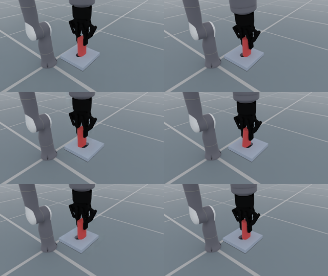

# Default-asset Rizon4S / Robotiq policy inference

The worktree was merged with main `3a9e10939ec92bb69b972337a6a4a6eb18b6798a`. This preview composes the existing registered `FlexivRizon4S/rizon4s.urdf` and `Robotiq2F85/Robotiq2F85.urdf` through the native URDF assembly path. Source visual meshes/materials, collision geometry, inertials, joint names and mimic relations are retained. It does not regenerate the arm or hand through the Menagerie converter.

The unchanged checkpoint `e8454a0a59d8c3b50d4f472965c95a24a0ee97d09b71aa1757948483ad7d75ce` drives the new robot using its actual joint encoders/FK. It was trained on the earlier nominal parallel-jaw model. The original 97.73% nominal assessment does not apply to this new asset/runtime combination. No retraining or scripted insertion is used.

[Native video](preview.mp4) — 960×540, 25 fps, 326 frames / 13.04 s. All three prespecified episode outcomes and terminal holds are included. Episode times below are control counts × 0.02 s, not individually measured native clock intervals.

| Seed | Controls | Control-grid seconds | Outcome |
|---|---:|---:|---|
| 30000 | 250 | 5.00 | Timeout; grasped, not captured |
| 30001 | 140 | 2.80 | Failure; terminal grasp condition not met |
| 30002 | 195 | 3.90 | Failure; terminal grasp condition not met |

This is **0/3**, a small transfer preview rather than a new success-rate benchmark. The default mimic hand has different geometry/dynamics from the trained sliding-jaw approximation. The engineering TCP is 145 mm along the default hand's base z, with 90° yaw to align its x-opening direction with task TCP y; the flange mount is identity. At the unchanged ready joint posture, TCP position changes by `[2.008676528930664e-05, 0.0, -0.025199979543685913]` metres. These are setup differences, not an established causal explanation of the failed transfer.

The recorded runtime uses DexSim `0.5.1+528daf12fd44b9383b30165ac484cf79b574e873`, Newton `1.7.0`, MuJoCo/Warp `3.15.0` and Warp `1.17.0`. Raw contact parameters use an isolated application of the documented SDK contact patch; an isolated MuJoCo Warp3.15 allocation overlay changes EPA horizon24→128 only. Shared SDK tracked files finish with no diff. The previous3.12 overlay was not reused. Version, source hashes and per-episode metrics are in [inference_report.json](inference_report.json); full trace and logs remain under `outputs/assembly_default_assets_20261026/`.

Gym now samples ordinary contact sensors once after each control's physics, before auto-reset. Histories still sample each physical substep. Reset observations read cleared/retained sensor buffers rather than querying the SDK's invalidated contact snapshot. No extra World.update is introduced; sampling-count and selective-reset behavior have CPU regression coverage. This corrects runtime integration; it is not a policy performance improvement claim.

Reproduce through the existing preview entry point with `--gym-config` selecting `task.study.default_assets.yaml` (see the parent README). Prepare the recorded SDK/runtime overlays first. The earlier checkpoint and its frozen training configuration/resources remain unchanged.
