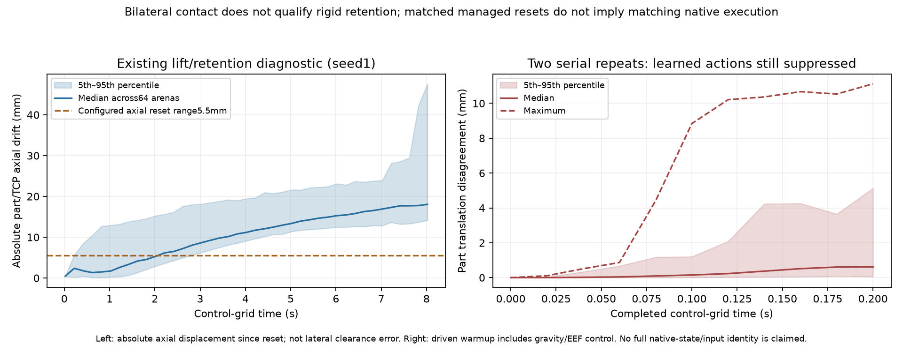

# 默认机器人资产：实验设置复核与成功率差距

本轮独立测试为 **7240/8192=88.3789%**，95%Wilson区间 **87.6669%–89.0550%**，未达到95%工程目标。目前最应优先验证的是**驱动暖机/接触执行的可重复性和真实负载夹持稳定性**。没有证据支持把差距简单归因于机械臂增益变大、孔销尺寸改变或训练步数不够；也尚未定位一个可确认的源码缺陷。

审查固定在`40e8ed41ab83cebdf1776a19a462172702ee4e63`。三组对象分别是：旧nominal滑动夹爪模型及其97.73%评测、旧权重换默认资产后的0/3预览、本轮默认资产从随机权重训练并在950处恢复的1000-update lineage。三者不能混作同一成功率曲线。当前源码树保留核心结论、设置对比和关键数据；中间状态快照、完整探针和重复媒体见[证据归档](../../../../sim/assembly/validation/ARCHIVE.md)，相应链接指向清理前的固定提交。

## 设置与资产对比

| 项目 | 旧nominal | 默认资产重训练 | 结论 |
|---|---|---|---|
| 装配几何 |孔52×32mm；销49.5×29.5×90mm、0.5kg；间隙每侧1.25mm；板18mm+底2mm|相同|125个数值差最大1.11e-16；hash还包含MuJoCo版本元数据，不能据hash变化判断夹具变形 |
| 机械臂7个运动连杆 |质量16.930kg|相同；转到同一link坐标后惯量最大差4.41e-8kg·m²|未发现显著运动连杆动力学变化；固定基座质量差不应当作运动质量差 |
| 手部质量/机构 |1.052608kg；两个独立滑动夹指|0.414137kg；1个转动leader+5个mimic从动关节|显著改变抓持动力学；总DOF9→13 |
| 碰撞几何 |总20块；夹指采用矩形pad boxes|总17块；保留源knuckle/手指coarse mesh|接触位置、法向和传力方式改变，数值摩擦参数相同不代表接触响应相同 |
| 实际机械臂控制 |Kp80、Kd20、动作尺度0.02|相同运行时覆盖|序列化robot预设289…与4000…不同，但任务初始化覆盖它们，不能据此归因 |
| 夹爪驱动 |滑动关节5000N/m、10N·s/m、30N|转动leader100N·m/rad、10N·m·s/rad、5N·m|不同单位与机构，不能把30与5或5000与100直接比较强弱 |
| 夹爪约束 |无mimic|源mimic树+native equality+1%leader增益的从动稳定驱动；solref(.002,1)|仍不是作者辨识闭链动力学；solimp保留导入默认，未使用被否决pilot的.9999 |
| TCP |相对link7较短|沿link7 z增加25.2mm；ready世界z降低约25.2mm|reset同时从新TCP放置孔板和零件，未发现25mm孔销相对错位；旧权重的FK输入分布会改变 |
| PPO/时序策略 |4096×32；Adam3e-4；5epochs/20minibatches；gamma.98、lambda.95；33帧特征、30历史、32latent|相同；仅实验名、gym路径、预算上限2000→1000不同|本轮保留131.072M transitions已多于旧选中350update的45.875M；不能仅凭预算上限解释失败 |
| Runtime |Newton1.6、MuJoCo/Warp3.12|Newton1.7、MuJoCo/Warp3.15、SDK528daf冻结副本|资产与引擎同时变化，不是资产单因素实验 |
| 评测 |旧最终8192均衡；训练时first-completed|最终8192均衡；20个保存点先各512均衡选模|应比较独立最终评测；first-completed是受完成速度影响的诊断 |

完整字段和文件SHA见[设置对比JSON](experimental_settings_comparison.json)。初态是局部XY±12.5mm、沿夹持轴±5.5mm、固定ready姿态与单一几何；不覆盖论文的工作空间、几何、倾斜和接触随机化矩阵。[论文study设置](https://arxiv.org/html/2610.23849v1#A1)与公开deployed模型也应分开：study尺度0.02/Kp80，本任务采用该组；公开deployed peg meta为尺度0.04/Kp40，不能混用作唯一参考。

默认资产转移预览使用通用linkage `solref=(.002,10)`，本轮改为`(.002,1)`。在相同time constant/impedance下，当前MuJoCo Warp公式中的归一化刚度项增大100倍，而归一化阻尼项不变；这不是实测夹持力或真实Nm/rad刚度比。重力补偿也按各自URDF重新构建，不能由手部质量变化直接断言静态补偿错误。

## 已有证据指向什么

**1. 双侧接触成立，不等于零件稳定夹持。** 8环境6秒探针8/8满足其接触保留判据，但最终轴向滑移13.1–19.7mm、最大20.115mm，倾斜可到0.237rad。64环境探针中43个满足“到达抬升目标后保持接触”的复合判据，17个未到达目标但没有后续锁存失抓，4个在controls261/301/355/380锁存失抓。后者只在25步后开始检测，不能覆盖初始瞬态。43个通过者也有13.12–24.10mm最大轴向滑移；判据只要求TCP首次进入0.5mm位置容差，未要求此后持续保姿，更没有证明负载同步离开夹具。它不足以替代真实负载夹持资格实验。

本次952个失败episode有899个终点`grasped=false`(94.43%)、279个终点`captured=true`、53个达到250步。后两类与第一类可重叠。captured是部分进入，不能直接改标为完全装配成功。需要记录失抓、滑移、几何入孔与接触的时间先后，才能确认哪一项先发生。

独立任务的平均时长约0.90s，失败中位时长0.74s，短于6–8s夹持探针。长时漂移不能直接当成短episode失败的原因；应在实际动作下重点测首0–1s的闭合、负载位姿和接触时序。

**2. 策略动作施加前，串行复测已出现执行分叉。** 第200次更新同一权重、同一配置/资源(41个文件逐字节一致)、seed10000/64环境/512个episode：旧开发评测413/512，当前并发选模377/512。追加两次新进程串行诊断为394/512和402/512；这两次不参与选模或最终测试。

两次串行诊断的reset关节位置/速度、孔板与零件位姿、缓存33维特征、首个策略输出在全部64环境逐位相同。首个控制步后，零件平移最大差109.246µm、转角差0.009908rad；第10个控制之前已积累10.5327mm最大平移差。前10个控制仍屏蔽学习策略动作，但会施加重力前馈、EEF目标和基于测量位置的保持控制。因此并发不是出现分叉的必要条件，学习策略命令差也不能发起首步分叉。

这是**驱动暖机/控制执行/原生状态初始化的资格缺口**，还不是已定位的引擎bug。完整native模型、warm-start/接触内部状态、实际qf/关节目标没有共同指纹；returned TensorDict的完整1023维观测也未被helper递归保存。CPU读回本身可能影响调度。不能据此断言全部仿真输入相同或把分叉唯一归因于GPU原子顺序。见[指纹比较](https://github.com/DexForce/EmbodiChain/blob/f8f5dfcc81b03e0fe4a9698d46bfcf406d9a89a0/examples/learning/blind_assembly/validation/default_retrain_20261026/repro_fingerprint_comparison.json)、[串行运行记录](https://github.com/DexForce/EmbodiChain/blob/f8f5dfcc81b03e0fe4a9698d46bfcf406d9a89a0/examples/learning/blind_assembly/validation/default_retrain_20261026/serial_review.json)及两组NPZ。

图左是相对reset的**轴向**位移，5.5mm线只是同轴reset范围参照，不是横向间隙阈值。图右只画策略动作被屏蔽的前10个驱动控制；时间轴均为control-grid时间，非逐物理步时钟。CSV保留分位值。

**3. 物理精度不能由“无NaN/无溢出”代替。** 当前保留父训练950步和续训50步、独立评测都通过其控制边界的有限值/容量检查，但ITERATIONS预算告警存在。父950快照最多4073/4096世界带sticky标记；这不是4073个世界每个子步都未收敛的计数。首次21ms、其次约20ms的控制时钟，以及float32对tolerance的1e-6下限，在旧/新记录中都存在，不能单独当作新增资产的原因。还需实际约束残差、冲量和步长/迭代收敛对照。

**4. 暂不能据日志诊断优化器是主因。** action-bound系数为0，2.1是未加权诊断值；native和作者公开JS都使用未裁到[-1,1]的输出，随后限制关节目标，未发现动作裁剪不一致。评测使用确定性均值，因此训练entropy升高不直接等于评测随机。辅助loss相似也不能证明latent质量相同。warmup10→30的已有对照只改变同一权重的推理条件，并且失抓保护仍从25步启用，不能推断“用30步重新训练一定更差”。

## 建议的验证顺序

1. **先固定执行链。** 在相同初态、相同固定输入下，记录完整native模型/约束参数、初始历史、实际qf、qpos/qvel目标和从动目标；从第一个物理子步比较direct stepping与graph warmup。先定位是否为控制输入、初始化还是求解敏感性。
2. **独立验证真实负载夹持。** 夹具不提供支撑时，分别测闭合瞬态、5mm抬升、持续保姿、轴向/转角漂移、双侧力、air time及mimic残差。持续到位、负载到位与“首次到位后接触保持”分别记账。
3. **做同引擎正交对照。** 在当前冻结runtime上重放旧hand/profile作为正控制，再逐项比较新hand几何、惯量、linkage参数。100/200/400迭代与1/0.5/0.25ms步长使用固定初态/输入；比较残差与任务量，单凭同seed不视作配对。
4. **补失败时序。** 每个episode记录geometry-seated、captured、grasped、penetration、hold counter、part/TCP漂移以及第一次触发保护的时刻；区分先失抓、先卡滞、坐底后接触退出和单纯超时。
5. **再训练对照。** 固定通过物理资格检查的profile后，用相同预算/种子比较当前配方与学习率/探索调度；同时报告实际目标饱和、动作平滑性和decoder逐类混淆。每轮重新在开发集选模，最终测试集不参与参数选择。完整多种子/分布实验仍待执行。

这些是建议实验，并未在本轮暗中修改成功条件、替换夹爪物理或继续启动新的长训练。

## 源码缺陷摘要

| 优先级 | 位置 | 缺陷 | 影响 | 建议 |
|---|---|---|---|---|
| N/A | N/A | 在本次选定静态范围内，未发现已证实的新增源码缺陷 | 不代表95%学习/物理资格通过 | 优先完成上述执行、夹持与因果对照 |

## 评审摘要

| 评审项 | 结果 |
|---|---|
| 目标 |40e8ed41；旧nominal6efa18c、默认资产转移179d0e1与本轮实测对照 |
| 范围 |机器人/夹具冻结资源、控制/reset/接触、PPO/时序/评测与复现证据；并非整PR所有235文件的全面批准 |
| 执行 |multi-agent；独立robotics、engine、ai，lead独立复算物理与评测/串行证据 |
| 确认缺陷 |P0:0；P1:0；P2:0；P3:0 |
| 代码评审结论 |选定范围No actionable findings；实验95%验收未通过，物理原因未完全定位 |
| 验证 |实验代码595项针对性回归、发布合并后857项；专家复用57项learning+12项task CPU检查(有重叠，不累加)；2次实际串行诊断；8192独立评测 |
| 剩余风险 |未标定闭链/接触动力学，未指纹完整native初态与输入；单种子/单几何；作者完整训练/240维critic定义缺失 |

## 角色覆盖

| 角色 | 选择范围 | 实际执行者 | 状态与证据 | 候选处理 |
|---|---|---|---|---|
| robotics |资产/坐标/惯量/控制；含verification lens |/root/review_default_assets_robotics |Complete静态与CPU；lead复核七连杆惯量与fixture |无确认缺陷；滑移与机构差异保留为待因果验证假设 |
| engine |有效参数、reset/接触/初始化；含reliability/verification lenses |/root/review_default_assets_engine |Complete静态/归档及串行指纹独立复核；未自行启动GPU |无确认缺陷；排除把pilot.9999当训练profile、把sticky计数当子步收敛误差 |
| ai |PPO/观测/奖励/评测/实验设计；含verification lens |/root/review_default_assets_ai |Complete配置/数据/CPU；primary论文与JS核对 |无确认缺陷；排除动作clip缺失、预设增益即有效增益等未经证实结论 |

未为没有独立具体表面的security/agentic/API/HPC另外启动角色；本次不涉及新的远程发布、权限或Task Program接口评审。code-review发现没有被作为未经授权的PR评论发布。
