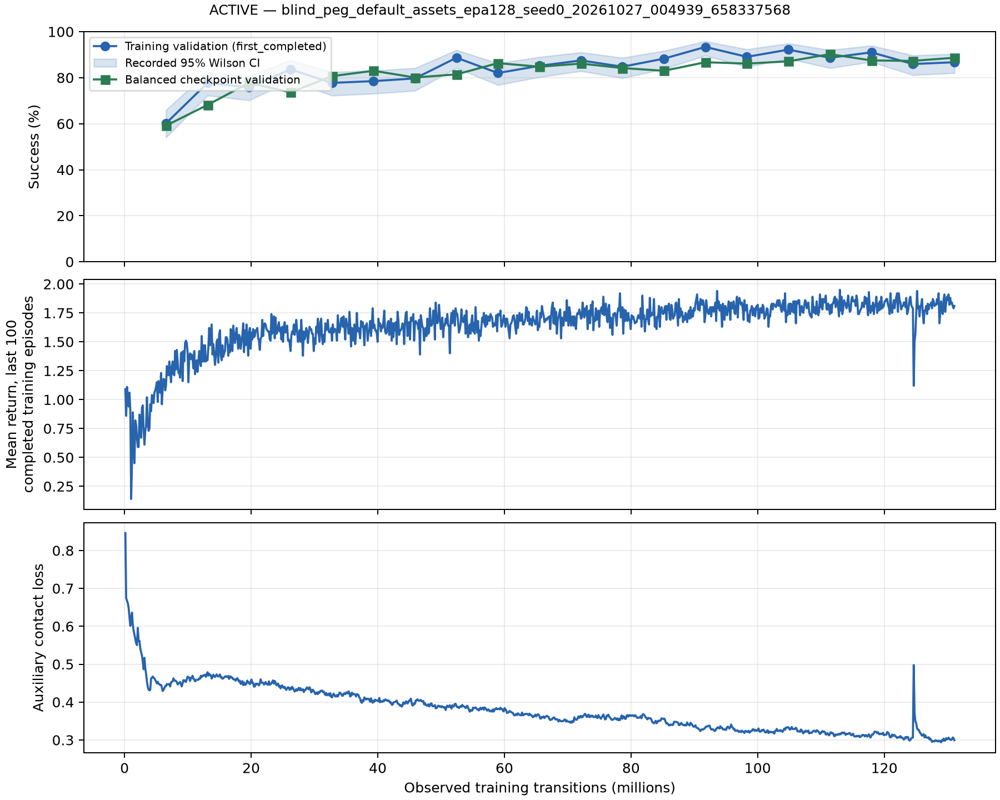

# Native peg RL learning record

Disposition: **active**. Nominal single-geometry development evidence; no formal paper-reproduction qualification.

Observed completed-update transitions: 131072000; recorded updates: 1000.
Native capacity: `no_capacity_loss_observed_through_snapshot` through snapshot step 131072000; current health status: completed.
Convergence budget: `budget_exhaustion_observed`. Raw native qpos/qvel/qacc: `all_observed_native_states_finite`. Control clock: `control_clock_mismatch_observed`.
Fresh final-evaluation coverage only: capacity `no_capacity_loss_observed_through_snapshot`, convergence `budget_exhaustion_observed`, raw qpos/qvel/qacc `all_observed_native_states_finite`, clock `control_clock_mismatch_observed`. This does not upgrade earlier training coverage.

## Time & Memory

| implementation | cost_time_ms | cpu_delta_mb | gpu_delta_mb | peak_gpu_mb | measured_scope |
| --- | --- | --- | --- | --- | --- |
| Native PPO | 2072962.644647 | unmeasured | unmeasured | unmeasured | health-wrapper wall through snapshot, includes setup/validation |

## Success & Other Metrics

| scope | success_rate | ci95_low | ci95_high | success_samples | avg_reward |
| --- | --- | --- | --- | --- | --- |
| latest training validation (first_completed) | 0.867188 | 0.820140 | 0.903378 | 256.000000 | 1.769531 |
| selected balanced development validation | 0.902344 | 0.873556 | 0.925139 | 512.000000 | 1.832031 |
| independent final episodes | 0.883789 | 0.876669 | 0.890550 | 8192.000000 | 1.801758 |

## Leaderboard

| rank | algorithm | overall_success_rate | scope | qualification |
| --- | --- | --- | --- | --- |
| 1 | Native PPO | 0.883789 | independent final episodes | nominal single-run evidence only; active |

One geometry per run, uncalibrated robot/gripper dynamics and local resets; this does not reproduce the full paper distribution or establish sim-to-real capability.
Confidence intervals are the recorded episode intervals, not uncertainty across training seeds. Curves are unsmoothed. A running health snapshot may lag TensorBoard events; no missing metrics are filled with zero.
Finite RL losses or sanitized actor observations do not establish raw native state finiteness. Missing native-state checks remain unverified. Recorded clock checks cover only their explicitly observed initial controls, not all individual physics substeps.
