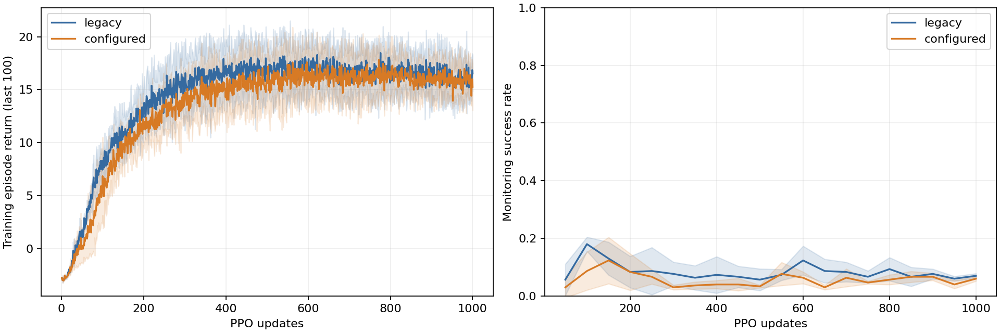

# Configured manipulation RL

Run `compare_push_cube.py --gpus 3 4 --output output/configured_rl_comparison`
from the repository root, choosing available GPUs. It schedules six independent
PPO experiments with the fixed 64 × 1024 × 1000 budget, seeds 42/43/44 and
legacy/configured PushCube variants. Each worker reloads its final checkpoint
and compares it with the untrained policy on 100 identical initial cases.

For a smoke check, add `--iterations 2 --cases 3` and use a separate output
directory. Reduced runs never qualify as formal convergence evidence. Existing
results are reused only if their identity, budget, complete cases and
configuration/implementation fingerprints match. The runner never increases
training budgets automatically.

The full protocol and condition configuration are described in
`docs/source/guides/configured_manipulation_rl.md`.

## Recorded qualification

The six-run comparison started on 2026-10-30 did **not** meet the fixed
convergence threshold. The configured environment passed noninferiority to
legacy, but gained only 12 percentage points over untrained policies instead
of the required 20. Rewards, hyperparameters, thresholds and final update
budgets were kept fixed.

| Training seed | Legacy success | Configured success | Untrained configured |
|---|---:|---:|---:|
| 42 | 6% | 12% | 0% |
| 43 | 8% | 7% | 0% |
| 44 | 3% | 17% | 0% |
| Mean ± seed std (`ddof=0`) | 5.7% ± 2.1% | 12.0% ± 4.1% | 0% |

All final checkpoints contain 1000 updates and 65,536,000 training transitions
on each persisted model path. Each initial/final policy used deterministic
actions and 100 single-environment resets with case seeds 20000–20099. Actual
initial cube, target and robot states matched across all six runs. Paired
initial weights and PPO settings matched; training-seed initializations were
distinct.

| Final metric, 300 cases per environment | Legacy | Configured |
|---|---:|---:|
| Mean episode return | 27.2380 | 26.5284 |
| Mean final XY goal distance / m | 0.1521 | 0.1436 |
| Mean episode length | 97.41 | 93.62 |
| Successful termination / truncation / failure | 17 / 283 / 0 | 36 / 264 / 0 |

Monitoring uses the existing batched evaluator and monitoring seeds; final
acceptance uses the separate fixed-case evaluator.

## Runtime notes and artifacts

Seed 42 resumed from official update-900 checkpoints after native PhysX
CUDA700 failures, restoring optimizer/LR/global RNG with fresh simulator
episodes. Its final 100 updates and all seed 43/44 updates used
`CUDA_LAUNCH_BLOCKING=1` for both variants.

A shared checkout branch switch removed the configured deployment after
configured seed 44 had saved its final checkpoint. Only its evaluations were
repeated from verified frozen source. Paired legacy seed 44 was interrupted at
update 966 and resumed from checkpoint 900 to 1000. Initial policies, unsaved
work and original logs were retained. These are not uninterrupted benchmark
runs and do not establish a causal performance difference between implementations.

Full local evidence remains under `output/configured_rl_comparison_20261030/`:
resolved configurations, raw metrics and case initial states, recovery records,
logs, and six archived checkpoints indexed by `checkpoint_manifest.json`.
