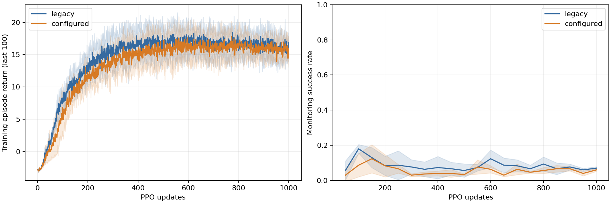

# PushCube fixed-budget PPO comparison

**Convergence acceptance: FAIL.** The configured environment passed the
noninferiority requirement, but its gain over the untrained policies was
12 percentage points, below the required 20 points. Rewards, thresholds,
hyperparameters, and final update budgets were kept fixed.

## Protocol

- Legacy and configured PushCube, training seeds **42, 43, 44**: six models.
- **64 environments × 1024 rollout steps × 1000 PPO updates** per model:
  65,536,000 training transitions on each persisted model path.
- The existing robot/TCP, default physics, observations, actions, reward
  formulas, network architecture, and PPO hyperparameters were retained.
- Monitoring every 50 updates, local logs, W&B disabled, at most two simulator
  processes on separate RTX PRO 5000 GPUs.
- Final acceptance uses the **update-1000 checkpoint**, deterministic actions,
  and 100 single-environment resets with case seeds **20000–20099**. The saved
  initial policies use these same cases.
- Actual initial cube poses, virtual targets, and robot joint positions matched
  across all six runs and both policy evaluations. Paired old/new initial
  weights and PPO settings matched; training-seed initializations were distinct.

## Final fixed-case results

| Training seed | Legacy success | Configured success | Untrained configured |
|---|---:|---:|---:|
| 42 | 6% | 12% | 0% |
| 43 | 8% | 7% | 0% |
| 44 | 3% | 17% | 0% |
| Mean ± seed standard deviation | 5.7% ± 2.1% | 12.0% ± 4.1% | 0% |

Standard deviations use the three seed rates with `ddof=0`.

| Final metric, 300 cases per environment | Legacy | Configured |
|---|---:|---:|
| Mean episode return | 27.2380 | 26.5284 |
| Mean final XY goal distance / m | 0.1521 | 0.1436 |
| Mean episode length | 97.41 | 93.62 |
| Successful termination | 17 | 36 |
| Truncation | 283 | 264 |
| Failure termination | 0 | 0 |

The noninferiority condition (configured mean at least legacy mean minus
5 percentage points) **passed**. The improvement condition (configured mean
at least untrained mean plus 20 percentage points) **failed**. Integer counts
independently confirmed these verdicts: 17/300 legacy successes, 36/300
configured successes, and 0/300 untrained configured successes.

## Learning curves

Monitoring uses the existing batched training evaluator and its monitoring
seeds. The final table uses the separate fixed-case evaluator. These curves
therefore do not replace final-checkpoint acceptance.

## Runtime limitations and recovery

Seed 42 encountered a native PhysX CUDA700 failure. Both variants resumed from
their official update-900 checkpoints, restoring optimizer, learning rate, and
global RNG while starting fresh simulator episodes. Seed 42's final 100 updates
and all seed 43/44 updates used `CUDA_LAUNCH_BLOCKING=1` for both variants.

A shared checkout branch switch removed the configured deployment file after
configured seed 44 had saved its update-1000 checkpoint. Only its initial/final
policy evaluations were repeated using a preserved source snapshot. The paired
legacy run was interrupted at update 966 and resumed from its update-900
checkpoint to update 1000. Fingerprinted harness, environment, condition,
trainer/runtime code, and task declarations matched the earlier recorded runs.
The initial-policy files were preserved. Unsaved work, retries, and raw logs
were retained, so physical compute and elapsed time include recovery overhead.

These results are not uninterrupted benchmark runs and do not establish a
causal performance difference between implementations.

Configured PushCube classifies falling as failure/termination; legacy PushCube
keeps falling-as-truncation. Configured deadline precedence also suppresses
accepted success and its success bonus on a timed-out step. Raw measurements
remain available in `task_outcome`. Other reward formulas were retained.

## Evidence and reproduction

[Machine-readable metrics](metrics.json) contain the protocol, per-seed scores,
checkpoint SHA-256 values, software versions, and audit results. Full local
artifacts are retained under `output/configured_rl_comparison_20261030/`:
resolved training configurations, fixed-case JSON and initial poses, raw logs,
curves, recovery records, and six archived checkpoints indexed by
`checkpoint_manifest.json`.

Use the [comparison runner](../../compare_push_cube.py) with a fresh output
directory to reproduce the protocol. The [configuration guide](../../../../../docs/source/guides/configured_manipulation_rl.md)
describes the environment contracts.
