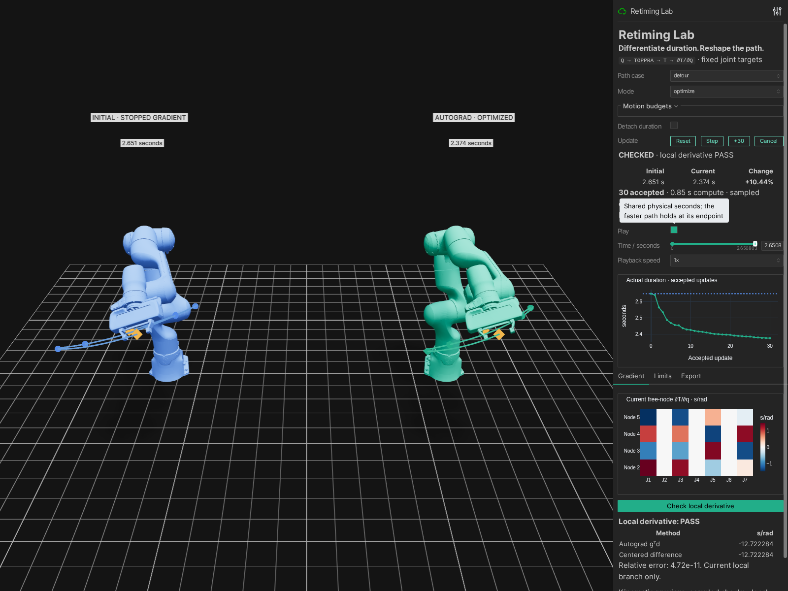

# Differentiate duration, reshape a path

Open a CPU-only Franka demonstration of `DifferentiableRetimingLayer`. The blue
robot follows the initial path. The green robot follows a path whose **free joint
nodes** were updated using the gradient of physical execution duration. Fixed
joint targets remain unchanged. No training or checkpoint is required.

```bash
pip install -r examples/learning/differentiable_toppra/requirements.txt
embodichain run-example learning/differentiable_toppra/view_path_optimization
```

Open `http://127.0.0.1:8105`; forward the port on a remote host. Startup runs 30
accepted updates of a deterministic six-node detour. The default case decreases
from about 2.65 to 2.37 seconds in the validated CPU configuration. These are
local path-optimization results, not neural-policy training gains.



## What demonstrates differentiation?

```python
free = initial[free_indices].clone().requires_grad_(True)
path = initial.index_copy(0, free_indices, free)
result = layer(path.unsqueeze(0))
gradient = torch.autograd.grad(result.duration.sum(), free)[0]
```

The derivative passes through spline fitting and the timing solver. A heatmap
shows the **current free-node** gradient in seconds/radian. `Check local
derivative` compares its directional derivative with centered finite differences.
Differences are used only to verify the derivative; updates use autograd.

Enable **Detach duration** to disconnect the objective. Retiming still works,
but the example has no autograd objective and performs no path update. It reports
an unavailable autograd connection, rather than calling the mathematical
derivative zero. Switching modes/inputs resets optimization to the initial path.

## Explore

- **detour:** keep start/end fixed and optimize four free nodes.
- **via_joint:** also fix node 4; optimize the remaining three free nodes.
  The middle node is a geometric target, not a requested stop.
- **stationary:** zero motion, zero duration and two valid solver samples.
- **optimize:** initial and optimized paths use identical motion budgets.
- **retime:** the same initial geometry uses reference versus current budgets;
  this illustrates forward timing rather than path optimization.

Reset, take one step, continue 30 steps or cancel. Inputs replace pending work;
one CPU worker owns the numerical computation. Updates from older inputs cannot
replace the current generation. Cancellation retains the last displayed accepted
state. The cumulative update limit is 100.

Motion budgets start at `min(URDF velocity, 1 rad/s)` and an explicit **2 rad/s²
acceleration planning budget**. Global velocity and acceleration multipliers are
independent. A chosen joint may have an additional independent bottleneck.
Acceleration is not presented as a calibrated hardware limit.

Play the trajectories on the **same physical clock**: the faster robot reaches
the end earlier and holds. Playback selects native returned samples using their
arrival times; it never resamples positions while claiming the old derivatives
remain valid. Playback speed changes the preview rate, not recorded durations.

Yellow markers are fixed joint nodes mapped through FK. Colored points are path
nodes. Curves and the TCP cursor are computed from returned positions. For a
middle node, the UI separately reports fixed-node error and the closest output
sample's joint error: uniform time samples need not hit the node exactly.

## Optimization and boundaries

The objective is duration alone, with first-order, normalized negative-gradient
steps. Maximum node change is 0.02 rad; up to ten backtracking trials halve that
step and apply an Armijo coefficient of 1e-4. Free nodes retain 0.02 rad inside
URDF limits; returned trajectories are never clipped. A candidate must solve,
pass 512-sample joint/dynamic checks and descend before it is accepted.

Display trajectories have 128 samples; validation uses 512, with `grid_size=100`
for both. Actual solver grids also depend on path length. A zero/small gradient,
failed solve, exhausted backtracking or update budget has its own visible status.
Gradients are local to the current filtering/grid/active-constraint branch;
finite-difference disagreement is reported rather than hidden. The procedure
uses no higher-order derivatives and does not differentiate optimizer updates.

This is a kinematic preview with sampled checks, not a collision, jerk, hardware
tracking or continuous geometric certificate. It demonstrates a reusable
retiming layer, without asserting that a neural motion generator learns better.

## Export and replay

For a fresh offline result:

```bash
embodichain run-example learning/differentiable_toppra/optimize_path \
  --output outputs/retiming_demo
embodichain run-example learning/differentiable_toppra/view_path_optimization \
  --run outputs/retiming_demo
```

The viewer's Export tab writes a fresh result directory. Each contains:

- `run.json`: settings, real status, update history, geometry identity and checks;
- `trajectories.npz`: input/optimized nodes, fixed mask, gradients, native
  positions/velocities/accelerations/intervals and their request budgets;
- `summary.png`: path projection, duration history, gradients and limit use.

Loading verifies robot identity/order and recomputes output to check agreement
with saved arrays. Prior outputs are never overwritten. Both commands accept
`--urdf` for a local official Franka URDF; the viewer also accepts `--host`,
`--port` and `--output`. Numeric generation accepts `--case`, `--steps` and
`--detach-duration`.

Run bounded checks, using fresh output directories:

```bash
embodichain run-example learning/differentiable_toppra/optimize_path \
  --smoke --output outputs/retiming_numeric_smoke
embodichain run-example learning/differentiable_toppra/view_path_optimization \
  --smoke --output outputs/retiming_viewer_smoke
```

Numeric smoke covers all three cases, directional derivatives, at least 5%
default-case descent, fixed nodes, the detached control, uniform clock scaling
and export/reload. Viewer smoke constructs robot meshes, invalidates a running
request, edits detached/static settings, checks native playback and HTTP, and
exports a result. Production tests own retiming numerics and layer contracts.
