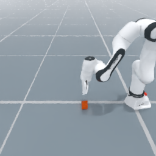
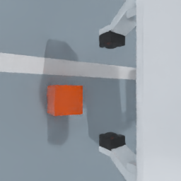

# ODS data-stream validation results

All 27 main runs and nine appendix diagnostics passed on the shared validation host. The main matrix uses three fixed seeds; the appendix uses one diagnostic seed. There is no learner or policy evaluation.

## Fixed protocol

Timed code: `cf18c610b`. C=8, P=2, N=32, B=32, H=2, F=32 (33 frames), K=128. Nominal demand 76.2422 chunks/s; observation window 308.6518 s. Three fixed seeds per main cell. Simulation uses a selected primary GPU plus a separately reserved auxiliary GPU for the qualified Vulkan initialization footprint; each child has eight disjoint CPU cores. The host is shared, without an exclusive-device or cold-filesystem-cache guarantee.

## Figures

[Full generated report and exports](figures/report.md) · [Data-flow animation](figures/data_flow.gif)


## Main results

Values below are medians of the three fixed seeds. Per-source maxima include lifetime deliveries, including late completed batches. The K-limited delivery rate includes the full observation window and terminal exhausted idle time; it is not a transport-capacity measurement.

| Vision | Arm | Launch to first batch (s) | Reader to first batch (s) | Delivered chunks/s | Largest source delivery count | Peak sampled PSS (GiB) |
| --- | --- | ---: | ---: | ---: | ---: | ---: |
| state | lerobot | 242.32 | 2.958 | 13.27 | 128 | 3.57 |
| state | streaming | 74.34 | 0.003 | 76.31 | 1867 | 3.67 |
| state | protected | 73.52 | 0.004 | 12.44 | 128 | 3.54 |
| single | lerobot | 401.54 | 4.287 | 13.27 | 128 | 8.77 |
| single | streaming | 83.96 | 1.428 | 27.99 | 630 | 7.80 |
| single | protected | 83.52 | 1.424 | 12.03 | 128 | 7.70 |
| dual | lerobot | 537.08 | 6.214 | 13.27 | 128 | 17.21 |
| dual | streaming | 93.56 | 2.365 | 14.51 | 318 | 10.70 |
| dual | protected | 93.76 | 2.404 | 11.72 | 128 | 10.71 |

## Supported conclusions

- Streaming and protected streaming consumed all four generations. Independent audits verified valid chunk delivery before the last publication of generations 2, 3 and 4 in all 18 main online runs, including fully converted RGB payloads in both camera modes.
- All initial-cache numeric payload signatures matched within each paired seed/vision comparison. Every protected source remained at or below 128 delivered chunks; streaming exceeded that value.
- The preallocated numeric/image cache was 1,814,400 bytes (state), 1,260,105,600 bytes (single), or 2,518,396,800 bytes (dual) across all relevant runs. These figures exclude simulator, Python, decoded output, prefetch and log memory.
- A separate real full-payload audit kept the original returned tensors across full physical cache replacement and checked every raw/canonical tensor byte, including both cameras and all 33 frames.
- Cold first-batch differences include the C-before-consume versus finalized-N-before-consume barrier, generation, encoding and finalization. They do not isolate shared-memory transport speed.
- Reuse caps are upper bounds. Unused credits on evicted sources retire, so protected streaming need not deliver N*K chunks or consume every accepted source.

## Lifecycle and limits

All 27 main processes and their reader/quality workers exited normally, with no forced termination or observed residual owned process group. Every main run and the three Frozen diagnostics also recorded a common Python resource-tracker semaphore-cleanup warning at process exit; the six file-reuse appendix runs had none. It remains disclosed; a warning alone is not proof of a persistent OS leak, and this result is not a claim of warning-free shutdown. Earlier placement/shutdown failures are retained separately and were not relabeled or substituted with favorable seeds.

The payload returns all 33 RGB context frames at 256x256; this is a sequence-delivery workload, not a VLA benchmark that reads only historical images. AV1 is lossy, and fixed-reference quality checks are not full-corpus perceptual-quality validation. New source IDs do not prove improved state coverage; delivered chunks do not establish training updates or learning efficiency.

## Appendix diagnostics

| Vision | Frozen C8 / K128 chunks | LeRobot first C8 / K128 chunks | Unbounded ready-source LeRobot chunks/s |
| --- | ---: | ---: | ---: |
| state | 1024 | 1024 | 75.68 |
| single | 1024 | 1024 | 73.82 |
| dual | 1024 | 1024 | 40.95 |

Frozen and first-C LeRobot stop normally after their delivery credits are exhausted; they do not reset budgets and replay old data. These are one-seed diagnostics, not three-seed performance estimates. The first-C adapter restricts eligible sources to the original eight but reuses the full finalized N32 directory. Its SDK numeric metadata and `final_disk_bytes` can include all N32; it is not a physically cropped eight-episode dataset or a storage/memory-matched baseline.

The ready-source unbounded LeRobot visual rates exceed the current online streaming medians of 27.99 and 14.51 chunks/s. Source update work and accessible pool sizes differ between these paths. This result does not establish an ODS visual-delivery throughput advantage. Profiling the complete image-copy/conversion/lock path is a separate optimization task; these measurements do not identify one operation as the cause. Each dual batch alone contains about 1.55 GiB of RGB float32 image data, and the ownership audit retains one additional original backing allocation in both backends.

Unconsumed prefetch is drained after dispatch stops and is never counted as delivered. In the unbounded single-camera appendix, 32 late chunks remain in the lifetime ledger but are excluded from window throughput and latency statistics. The three unbounded readers each discard another 128 prefetched chunks without consuming delivery credits.

## Evidence

Machine-readable per-run main values: [JSON](main/metrics.json), [CSV](main/metrics.csv); appendix: [JSON](appendix/metrics.json), [CSV](appendix/metrics.csv). The calibration, independent audits, lifecycle regressions, device qualification, failed attempts and file hashes are preserved with this bundle. The timed commit and postprocessing source/patch hashes are recorded separately in [postprocessing.json](figures/postprocessing.json); all 391 original audited timing inputs remained unchanged.

## Recreate the figures

The archive contains original configs, summaries, event/batch/resource logs, supervision records and dataset sidecars, without the large datasets themselves. It is sufficient for rendering and inspection; rerunning video reads requires the generated corpora or a new acquisition run.

```bash
mkdir -p /tmp/ods-stream-measurements
tar -xzf examples/ods/data_stream_demo/results/2026-10-21/measurement-logs.tar.gz -C /tmp/ods-stream-measurements
python -m examples.ods.data_stream_demo.report /tmp/ods-stream-measurements \
  --output /tmp/ods-stream-figures --animation
```

Run the full experiment with a fresh calibration on the target machine using the example README. The archived calibration is evidence from this host, not a portable protocol for a different GPU UUID, runtime or code revision.

## Qualified views

These unmodified samples illustrate the actual third-person and wrist-camera profile from the physical qualification run; they are not additional timing observations.

| Third-person | Wrist |
| --- | --- |
|  |  |
