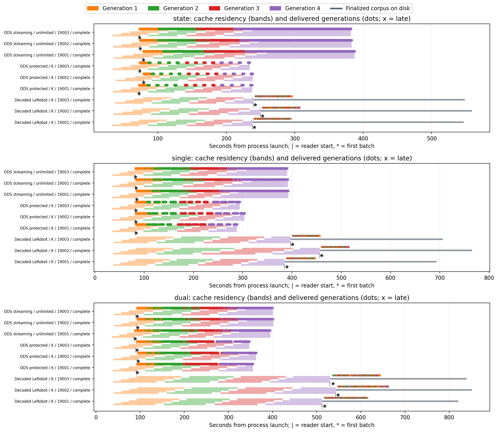
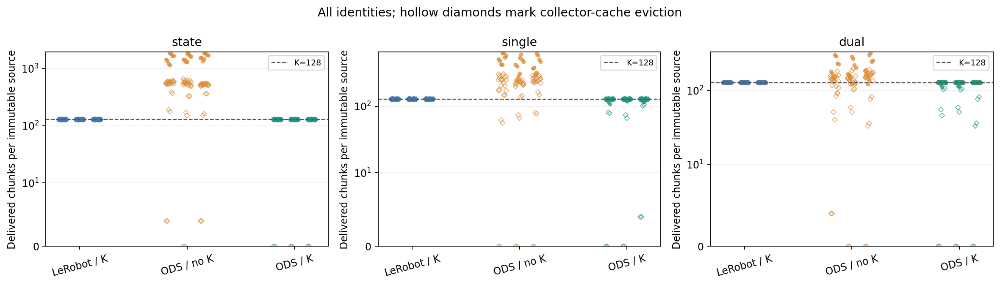
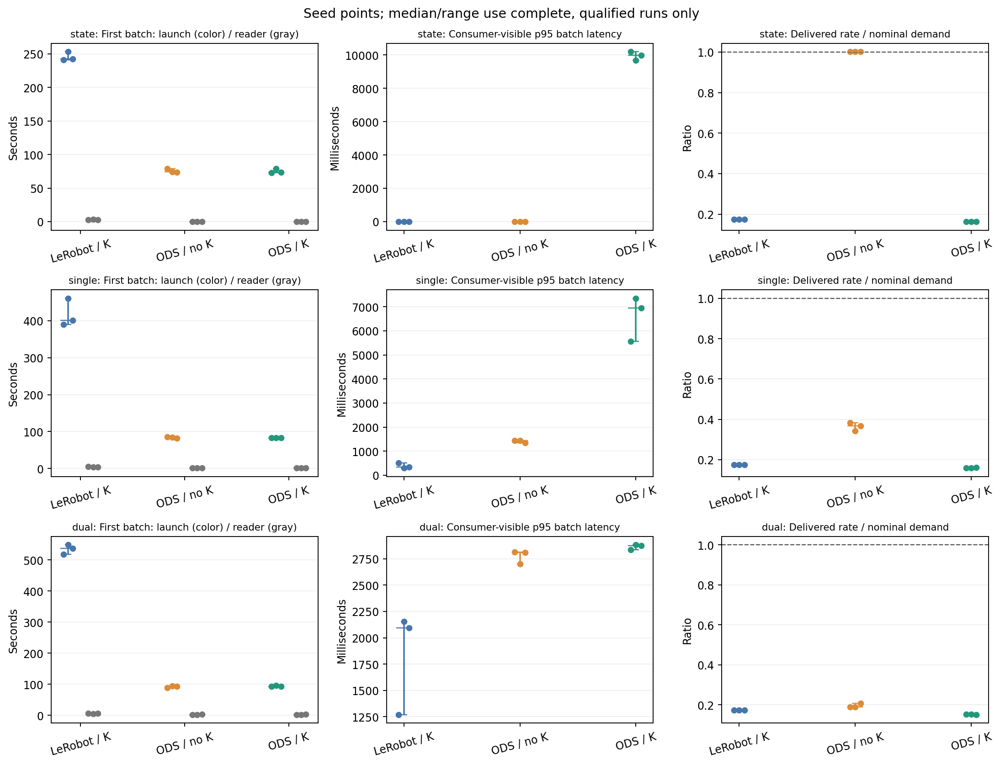
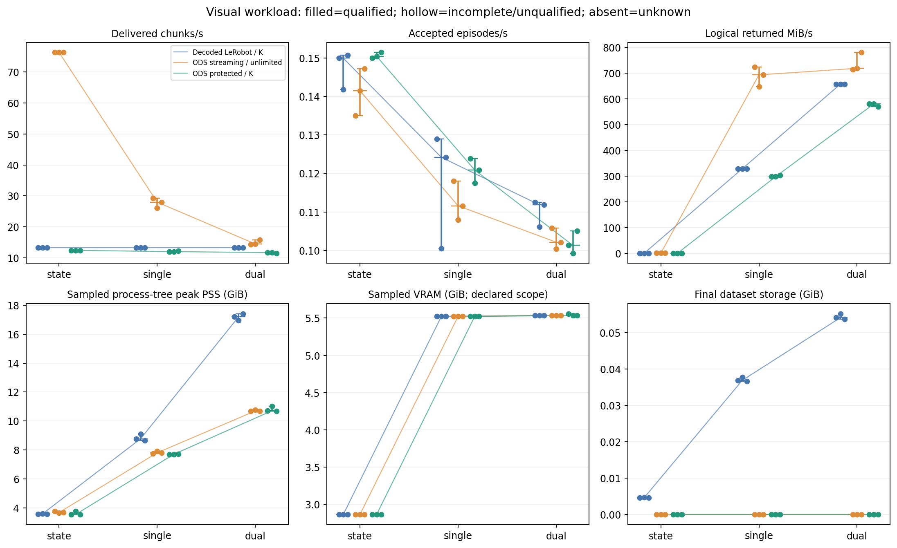
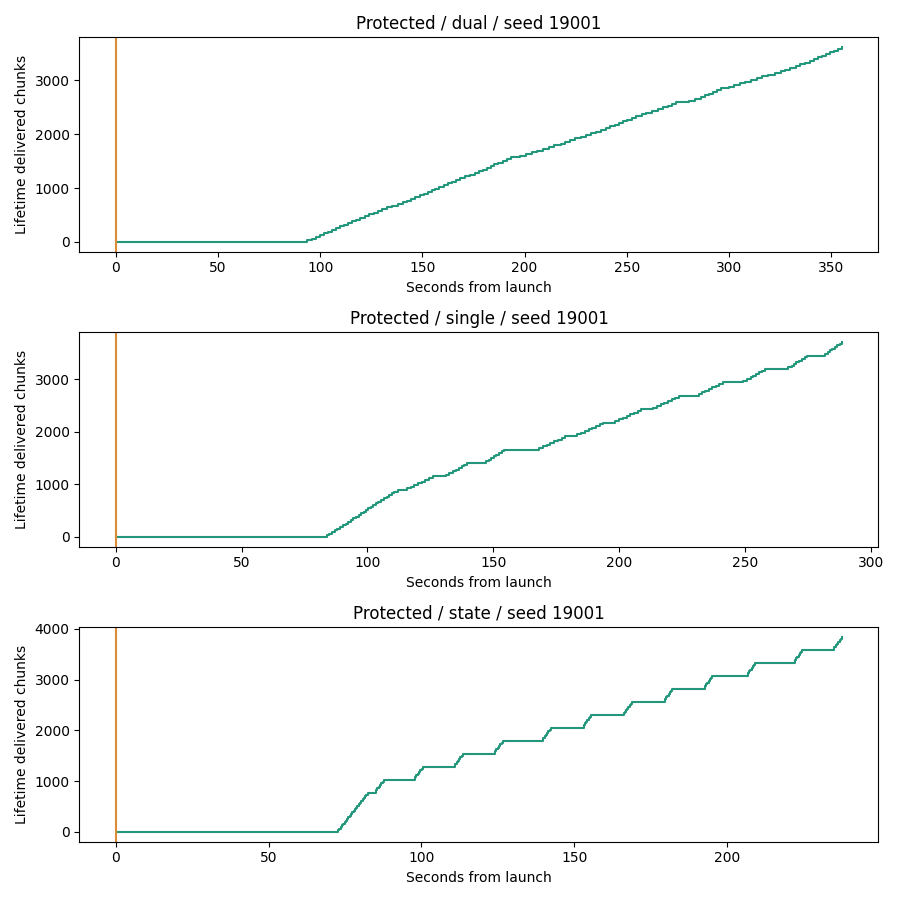

# ODS data-stream capability report

This report measures data delivery, not training or policy quality. It does not assume ODS is faster than decoded LeRobot.

All attempted runs are retained below. Filled plot markers and aggregate median [min,max] include only complete, explicitly qualified report/appendix runs. Hollow markers preserve measurements from incomplete, unqualified, smoke or calibration runs; missing measurements are unknown, never zero. Appendix results are one-seed diagnostics when only one seed is present.

## Time and memory

| Group / vision | Attempted / qualified | First batch from launch (s) | First batch from reader (s) | Batch p95 (s) | Chunks/s | Peak PSS (GiB) | Final disk (GiB) |
| --- | --- | --- | --- | --- | --- | --- | --- |
| Main: Decoded LeRobot / K / state | 3 / 3 | 242 [241, 253]; n=3 | 2.96 [2.75, 3.08]; n=3 | 0.00232 [0.00201, 0.00254]; n=3 | 13.3 [13.3, 13.3]; n=3 | 3.57 [3.56, 3.59]; n=3 | 0.00461 [0.00459, 0.0047]; n=3 |
| Main: Decoded LeRobot / K / single | 3 / 3 | 402 [390, 461]; n=3 | 4.29 [4.2, 4.95]; n=3 | 0.331 [0.295, 0.505]; n=3 | 13.3 [13.3, 13.3]; n=3 | 8.77 [8.65, 9.11]; n=3 | 0.0369 [0.0366, 0.0377]; n=3 |
| Main: Decoded LeRobot / K / dual | 3 / 3 | 537 [518, 549]; n=3 | 6.21 [5.63, 6.78]; n=3 | 2.09 [1.27, 2.15]; n=3 | 13.3 [13.3, 13.3]; n=3 | 17.2 [17, 17.4]; n=3 | 0.0541 [0.0537, 0.0552]; n=3 |
| Main: ODS streaming / unlimited / state | 3 / 3 | 74.3 [73.4, 78.8]; n=3 | 0.00331 [0.00314, 0.00386]; n=3 | 0.00357 [0.00329, 0.0037]; n=3 | 76.3 [76.3, 76.3]; n=3 | 3.67 [3.65, 3.75]; n=3 | 0 [0, 0]; n=3 |
| Main: ODS streaming / unlimited / single | 3 / 3 | 84 [82.4, 85.2]; n=3 | 1.43 [1.39, 1.48]; n=3 | 1.44 [1.35, 1.44]; n=3 | 28 [26.1, 29.2]; n=3 | 7.8 [7.73, 7.9]; n=3 | 0 [0, 0]; n=3 |
| Main: ODS streaming / unlimited / dual | 3 / 3 | 93.6 [88.9, 94.7]; n=3 | 2.37 [2.2, 2.82]; n=3 | 2.81 [2.7, 2.81]; n=3 | 14.5 [14.4, 15.8]; n=3 | 10.7 [10.7, 10.8]; n=3 | 0 [0, 0]; n=3 |
| Main: ODS protected / K / state | 3 / 3 | 73.5 [72.8, 79.2]; n=3 | 0.00375 [0.00338, 0.00426]; n=3 | 9.98 [9.68, 10.2]; n=3 | 12.4 [12.4, 12.4]; n=3 | 3.54 [3.54, 3.75]; n=3 | 0 [0, 0]; n=3 |
| Main: ODS protected / K / single | 3 / 3 | 83.5 [83.3, 83.7]; n=3 | 1.42 [0.994, 1.44]; n=3 | 6.95 [5.57, 7.35]; n=3 | 12 [12, 12.2]; n=3 | 7.7 [7.69, 7.71]; n=3 | 0 [0, 0]; n=3 |
| Main: ODS protected / K / dual | 3 / 3 | 93.8 [93, 95.9]; n=3 | 2.4 [2.22, 2.78]; n=3 | 2.88 [2.83, 2.88]; n=3 | 11.7 [11.5, 11.7]; n=3 | 10.7 [10.7, 11]; n=3 | 0 [0, 0]; n=3 |
| Appendix: Decoded LeRobot / unlimited / state | 1 / 1 | 4.5 [4.5, 4.5]; n=1 | 2.95 [2.95, 2.95]; n=1 | 0.00267 [0.00267, 0.00267]; n=1 | 75.7 [75.7, 75.7]; n=1 | 2.11 [2.11, 2.11]; n=1 | 0.00461 [0.00461, 0.00461]; n=1 |
| Appendix: Decoded LeRobot / unlimited / single | 1 / 1 | 5.86 [5.86, 5.86]; n=1 | 4.25 [4.25, 4.25]; n=1 | 0.273 [0.273, 0.273]; n=1 | 73.8 [73.8, 73.8]; n=1 | 8.81 [8.81, 8.81]; n=1 | 0.0369 [0.0369, 0.0369]; n=1 |
| Appendix: Decoded LeRobot / unlimited / dual | 1 / 1 | 8.03 [8.03, 8.03]; n=1 | 6.15 [6.15, 6.15]; n=1 | 1.19 [1.19, 1.19]; n=1 | 41 [41, 41]; n=1 | 15.2 [15.2, 15.2]; n=1 | 0.0541 [0.0541, 0.0541]; n=1 |
| Appendix: ODS frozen / C / K / state | 1 / 1 | 74.6 [74.6, 74.6]; n=1 | 0.00434 [0.00434, 0.00434]; n=1 | 0.00336 [0.00336, 0.00336]; n=1 | 3.32 [3.32, 3.32]; n=1 | 3.58 [3.58, 3.58]; n=1 | 0 [0, 0]; n=1 |
| Appendix: ODS frozen / C / K / single | 1 / 1 | 83.8 [83.8, 83.8]; n=1 | 0.969 [0.969, 0.969]; n=1 | 0.988 [0.988, 0.988]; n=1 | 3.32 [3.32, 3.32]; n=1 | 7.93 [7.93, 7.93]; n=1 | 0 [0, 0]; n=1 |
| Appendix: ODS frozen / C / K / dual | 1 / 1 | 91.3 [91.3, 91.3]; n=1 | 1.93 [1.93, 1.93]; n=1 | 1.93 [1.93, 1.93]; n=1 | 3.32 [3.32, 3.32]; n=1 | 10.8 [10.8, 10.8]; n=1 | 0 [0, 0]; n=1 |
| Appendix: Decoded LeRobot / C / K / state | 1 / 1 | 4.63 [4.63, 4.63]; n=1 | 2.96 [2.96, 2.96]; n=1 | 0.00328 [0.00328, 0.00328]; n=1 | 3.32 [3.32, 3.32]; n=1 | 2.11 [2.11, 2.11]; n=1 | 0.00461 [0.00461, 0.00461]; n=1 |
| Appendix: Decoded LeRobot / C / K / single | 1 / 1 | 5.9 [5.9, 5.9]; n=1 | 4.3 [4.3, 4.3]; n=1 | 0.308 [0.308, 0.308]; n=1 | 3.32 [3.32, 3.32]; n=1 | 6.8 [6.8, 6.8]; n=1 | 0.0369 [0.0369, 0.0369]; n=1 |
| Appendix: Decoded LeRobot / C / K / dual | 1 / 1 | 7.27 [7.27, 7.27]; n=1 | 5.61 [5.61, 5.61]; n=1 | 1.33 [1.33, 1.33]; n=1 | 3.32 [3.32, 3.32]; n=1 | 13.9 [13.9, 13.9]; n=1 | 0.0541 [0.0541, 0.0541]; n=1 |

Launch latency includes the collect-N LeRobot barrier versus the initial-C ODS barrier. Reader latency begins with source-ready access; LeRobot still performs real video decoding. These scopes overlap and must not be added. Final-batch latency includes waiting and output conversion; worker item-service time is a separate component measurement, not decoder kernel time.

## Integrity and exposure

| Group / vision | Delivered chunks | Within window | After window | K violations | Unconsumed prefetch | PSNR (dB) | MAE |
| --- | --- | --- | --- | --- | --- | --- | --- |
| Decoded LeRobot / K / state | 4.1e+03 [4.1e+03, 4.1e+03]; n=3 | 4.1e+03 [4.1e+03, 4.1e+03]; n=3 | 0 [0, 0]; n=3 | 0 [0, 0]; n=3 | 0 [0, 0]; n=3 | unknown (n=0) | unknown (n=0) |
| Decoded LeRobot / K / single | 4.1e+03 [4.1e+03, 4.1e+03]; n=3 | 4.1e+03 [4.1e+03, 4.1e+03]; n=3 | 0 [0, 0]; n=3 | 0 [0, 0]; n=3 | 0 [0, 0]; n=3 | 40 [39.8, 40.1]; n=3 | 1.76 [1.75, 1.76]; n=3 |
| Decoded LeRobot / K / dual | 4.1e+03 [4.1e+03, 4.1e+03]; n=3 | 4.1e+03 [4.1e+03, 4.1e+03]; n=3 | 0 [0, 0]; n=3 | 0 [0, 0]; n=3 | 0 [0, 0]; n=3 | 39.6 [39.3, 39.9]; n=3 | 1.75 [1.73, 1.76]; n=3 |
| ODS streaming / unlimited / state | 2.36e+04 [2.36e+04, 2.36e+04]; n=3 | 2.36e+04 [2.36e+04, 2.36e+04]; n=3 | 0 [0, 0]; n=3 | 0 [0, 0]; n=3 | 0 [0, 0]; n=3 | unknown (n=0) | unknown (n=0) |
| ODS streaming / unlimited / single | 8.67e+03 [8.1e+03, 9.06e+03]; n=3 | 8.64e+03 [8.06e+03, 9.02e+03]; n=3 | 32 [32, 32]; n=3 | 0 [0, 0]; n=3 | 0 [0, 0]; n=3 | unknown (n=0) | unknown (n=0) |
| ODS streaming / unlimited / dual | 4.51e+03 [4.48e+03, 4.9e+03]; n=3 | 4.48e+03 [4.45e+03, 4.86e+03]; n=3 | 32 [32, 32]; n=3 | 0 [0, 0]; n=3 | 0 [0, 0]; n=3 | unknown (n=0) | unknown (n=0) |
| ODS protected / K / state | 3.84e+03 [3.84e+03, 3.84e+03]; n=3 | 3.84e+03 [3.84e+03, 3.84e+03]; n=3 | 0 [0, 0]; n=3 | 0 [0, 0]; n=3 | 0 [0, 0]; n=3 | unknown (n=0) | unknown (n=0) |
| ODS protected / K / single | 3.71e+03 [3.71e+03, 3.78e+03]; n=3 | 3.71e+03 [3.71e+03, 3.78e+03]; n=3 | 0 [0, 0]; n=3 | 0 [0, 0]; n=3 | 0 [0, 0]; n=3 | unknown (n=0) | unknown (n=0) |
| ODS protected / K / dual | 3.62e+03 [3.55e+03, 3.62e+03]; n=3 | 3.62e+03 [3.55e+03, 3.62e+03]; n=3 | 0 [0, 0]; n=3 | 0 [0, 0]; n=3 | 0 [0, 0]; n=3 | unknown (n=0) | unknown (n=0) |
| Decoded LeRobot / unlimited / state | 2.34e+04 [2.34e+04, 2.34e+04]; n=1 | 2.34e+04 [2.34e+04, 2.34e+04]; n=1 | 0 [0, 0]; n=1 | 0 [0, 0]; n=1 | 128 [128, 128]; n=1 | unknown (n=0) | unknown (n=0) |
| Decoded LeRobot / unlimited / single | 2.28e+04 [2.28e+04, 2.28e+04]; n=1 | 2.28e+04 [2.28e+04, 2.28e+04]; n=1 | 32 [32, 32]; n=1 | 0 [0, 0]; n=1 | 128 [128, 128]; n=1 | 40 [40, 40]; n=1 | 1.76 [1.76, 1.76]; n=1 |
| Decoded LeRobot / unlimited / dual | 1.26e+04 [1.26e+04, 1.26e+04]; n=1 | 1.26e+04 [1.26e+04, 1.26e+04]; n=1 | 0 [0, 0]; n=1 | 0 [0, 0]; n=1 | 128 [128, 128]; n=1 | 39.9 [39.9, 39.9]; n=1 | 1.73 [1.73, 1.73]; n=1 |
| ODS frozen / C / K / state | 1.02e+03 [1.02e+03, 1.02e+03]; n=1 | 1.02e+03 [1.02e+03, 1.02e+03]; n=1 | 0 [0, 0]; n=1 | 0 [0, 0]; n=1 | 0 [0, 0]; n=1 | unknown (n=0) | unknown (n=0) |
| ODS frozen / C / K / single | 1.02e+03 [1.02e+03, 1.02e+03]; n=1 | 1.02e+03 [1.02e+03, 1.02e+03]; n=1 | 0 [0, 0]; n=1 | 0 [0, 0]; n=1 | 0 [0, 0]; n=1 | unknown (n=0) | unknown (n=0) |
| ODS frozen / C / K / dual | 1.02e+03 [1.02e+03, 1.02e+03]; n=1 | 1.02e+03 [1.02e+03, 1.02e+03]; n=1 | 0 [0, 0]; n=1 | 0 [0, 0]; n=1 | 0 [0, 0]; n=1 | unknown (n=0) | unknown (n=0) |
| Decoded LeRobot / C / K / state | 1.02e+03 [1.02e+03, 1.02e+03]; n=1 | 1.02e+03 [1.02e+03, 1.02e+03]; n=1 | 0 [0, 0]; n=1 | 0 [0, 0]; n=1 | 0 [0, 0]; n=1 | unknown (n=0) | unknown (n=0) |
| Decoded LeRobot / C / K / single | 1.02e+03 [1.02e+03, 1.02e+03]; n=1 | 1.02e+03 [1.02e+03, 1.02e+03]; n=1 | 0 [0, 0]; n=1 | 0 [0, 0]; n=1 | 0 [0, 0]; n=1 | 40 [40, 40]; n=1 | 1.76 [1.76, 1.76]; n=1 |
| Decoded LeRobot / C / K / dual | 1.02e+03 [1.02e+03, 1.02e+03]; n=1 | 1.02e+03 [1.02e+03, 1.02e+03]; n=1 | 0 [0, 0]; n=1 | 0 [0, 0]; n=1 | 0 [0, 0]; n=1 | 39.9 [39.9, 39.9]; n=1 | 1.73 [1.73, 1.73]; n=1 |

One credit is one anchor-source chunk, independent of camera count or context length. Delivered chunks and reuse are lifetime counts, including any complete batch returned after the observation deadline; late batches are excluded from window throughput and latency metrics. Source counts include evicted identities. A cap bounds delivery rather than optimizer updates. AV1 video is lossy; speed must be considered alongside the reported raw-reference quality, codec and recording configuration. Infinite PSNR for exact equality requires an explicit equality count in the run metadata; it is not replaced with a finite score.

## Run qualification

| Run | Suite | Seed | Status | Qualified | Reason / error |
| --- | --- | --- | --- | --- | --- |
| ODS frozen / C / K / dual | appendix | 19001 | complete | True | See retained summary |
| ODS frozen / C / K / single | appendix | 19001 | complete | True | See retained summary |
| ODS frozen / C / K / state | appendix | 19001 | complete | True | See retained summary |
| Decoded LeRobot / K / dual | report | 19001 | complete | True | See retained summary |
| Decoded LeRobot / K / dual | report | 19002 | complete | True | See retained summary |
| Decoded LeRobot / K / dual | report | 19003 | complete | True | See retained summary |
| Decoded LeRobot / K / single | report | 19001 | complete | True | See retained summary |
| Decoded LeRobot / K / single | report | 19002 | complete | True | See retained summary |
| Decoded LeRobot / K / single | report | 19003 | complete | True | See retained summary |
| Decoded LeRobot / K / state | report | 19001 | complete | True | See retained summary |
| Decoded LeRobot / K / state | report | 19002 | complete | True | See retained summary |
| Decoded LeRobot / K / state | report | 19003 | complete | True | See retained summary |
| Decoded LeRobot / C / K / dual | appendix | 19001 | complete | True | See retained summary |
| Decoded LeRobot / C / K / single | appendix | 19001 | complete | True | See retained summary |
| Decoded LeRobot / C / K / state | appendix | 19001 | complete | True | See retained summary |
| Decoded LeRobot / unlimited / dual | appendix | 19001 | complete | True | See retained summary |
| Decoded LeRobot / unlimited / single | appendix | 19001 | complete | True | See retained summary |
| Decoded LeRobot / unlimited / state | appendix | 19001 | complete | True | See retained summary |
| ODS protected / K / dual | report | 19001 | complete | True | See retained summary |
| ODS protected / K / dual | report | 19002 | complete | True | See retained summary |
| ODS protected / K / dual | report | 19003 | complete | True | See retained summary |
| ODS protected / K / single | report | 19001 | complete | True | See retained summary |
| ODS protected / K / single | report | 19002 | complete | True | See retained summary |
| ODS protected / K / single | report | 19003 | complete | True | See retained summary |
| ODS protected / K / state | report | 19001 | complete | True | See retained summary |
| ODS protected / K / state | report | 19002 | complete | True | See retained summary |
| ODS protected / K / state | report | 19003 | complete | True | See retained summary |
| ODS streaming / unlimited / dual | report | 19001 | complete | True | See retained summary |
| ODS streaming / unlimited / dual | report | 19002 | complete | True | See retained summary |
| ODS streaming / unlimited / dual | report | 19003 | complete | True | See retained summary |
| ODS streaming / unlimited / single | report | 19001 | complete | True | See retained summary |
| ODS streaming / unlimited / single | report | 19002 | complete | True | See retained summary |
| ODS streaming / unlimited / single | report | 19003 | complete | True | See retained summary |
| ODS streaming / unlimited / state | report | 19001 | complete | True | See retained summary |
| ODS streaming / unlimited / state | report | 19002 | complete | True | See retained summary |
| ODS streaming / unlimited / state | report | 19003 | complete | True | See retained summary |

## Figures

Availability, cache residency and delivered-generation timelines. Offline collector bands stop at reader start (after engine shutdown); gray lines show finalized files on disk independently of remaining K. Unrecorded write locks are not inferred. [SVG](01_timeline.svg) · [PDF](01_timeline.pdf)

Per-source reuse; hollow diamonds mean collector-cache eviction. For LeRobot, all finalized corpus files remain available despite collector eviction. The K line is a protection setting, not an optimal learning budget. [SVG](02_reuse.svg) · [PDF](02_reuse.pdf)

Cold versus source-ready first batch, consumer p95 and served demand. Quota waits and service bottlenecks must be interpreted using the retained counters. [SVG](03_latency_demand.svg) · [PDF](03_latency_demand.pdf)

State/single/dual workload costs. Logical MiB/s is returned tensor payload, not measured bus or disk bandwidth. Memory coverage follows each run's instrumentation declaration. [SVG](04_visual_load.svg) · [PDF](04_visual_load.pdf)

Animation replays logged deliveries; it is not a recording of simulation or a separate measurement.

## Interpretation limits

A new source identity does not establish broader state coverage. Fixed cache tensor bytes do not establish constant total process memory. Protected waiting can intentionally reduce delivered throughput; it must not be presented as a copy/decoder bottleneck. This finalized local LeRobot path does not establish that the LeRobot ecosystem cannot stream. No universal speedup, learning-efficiency or policy-performance claim follows from these measurements.

Raw summaries and input paths, including configuration, qualification failures and cleanup records, are preserved in [report.json](report.json). Re-run this renderer after interrupted experiments have written their final summaries; partial JSONL lines fail visibly rather than being discarded.
