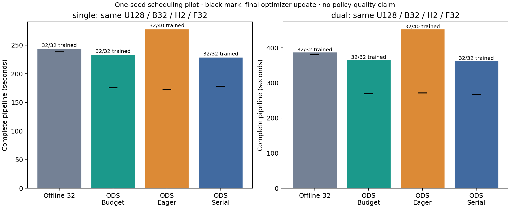
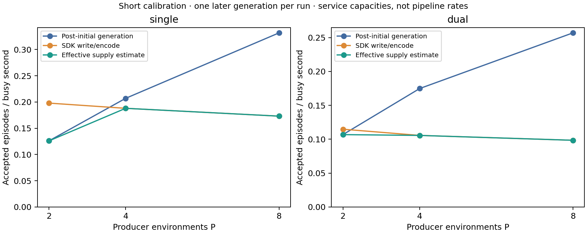

# Budget-aware ODS prefetch: capacity and matched scheduling pilot

The budget-aware scheduler removes eight accepted-but-untrained tail episodes.
In this single-seed matched pilot, it reduces complete pipeline time by
**16.07% / 19.27%** versus eager scheduling and **4.27% / 5.49%** versus
Offline-32 for single/dual views. **It does not establish better diversity or
a positive generation/training-overlap contribution:** serial controls are
2.02% / 0.75% faster than overlap in these observations.

All **14 actual runs pass**: six capacity calibrations and eight pilot
outcomes, including six primary outcomes and two eager diagnostics. The strict
primary report contains four eligible pairs. All original 30-attempt study
records remain unchanged. No new policy-quality evaluation is requested.
## Frozen protocol

Implementation: `915510b58ceb63d028d295a2e2532780e6f79967`. The 26 base hashes and six additional encoder/target dependencies are saved in `protocol.json` and `frozen-source/`. Actual suite manifests record 30 of these files, including four shared encoder modules; the target/observation helpers are checked against current and frozen files, not claimed as runtime-captured inputs. Calibrations use C8/B32/K128/U40, P=2/4/8, seed19001 and both real camera modes. Every calibration consumes two generations and eight later-generation updates. This is a short service observation, not proof of long-run stationarity.

Pilot work is U128/B32/H2/F32: 4,096 chunks and 131,072 valid future action targets. Initial weights, normalization, CPU affinity and two primary GPU UUIDs must match within each vision. Single uses GPUs3/4 and CPUs0–7; dual uses GPUs5/7 and CPUs8–15. GPU7 also has the disclosed passive graphics scope. Host admission is not exclusive reservation. All accepted data is recorded through standard LeRobot; the offline arm really decodes with TorchCodec. No changes to the model, K, physical task or success criterion enter this comparison.

## Three-stage preflight

| Vision | P | Generation ep/s | Recorder ep/s | Effective ep/s | Ready updates/s | Supply updates/s at K128 | Demand/supply |
| --- | ---: | ---: | ---: | ---: | ---: | ---: | ---: |
| dual | 2 | 0.1068 | 0.1148 | 0.1068 | 6.30 | 0.427 | 14.75 |
| dual | 4 | 0.1748 | 0.1057 | 0.1057 | 6.25 | 0.423 | 14.78 |
| dual | 8 | 0.2570 | 0.0985 | 0.0985 | 6.13 | 0.394 | 15.56 |
| single | 2 | 0.1260 | 0.1979 | 0.1260 | 10.86 | 0.504 | 21.55 |
| single | 4 | 0.2070 | 0.1880 | 0.1880 | 10.87 | 0.752 | 14.45 |
| single | 8 | 0.3317 | 0.1731 | 0.1731 | 10.94 | 0.692 | 15.80 |

Generation uses post-initial generation busy time; recording uses actual SDK write/encode service; ready learner time includes batch materialization, device transfer and synchronized optimizer work. Initial fill, data waits, staging, finalization and shutdown remain separate. These independent service spans overlap and cannot be added into pipeline wall time.

The predetermined rule selects the smallest tested P reaching 90% of the best effective supply `min(generation, recording)`: P4 for single, P2 for dual. The pilot uses P4 as the smallest common setting reaching the threshold for both modes, while retaining the individual recommendations. P8 increases generation speed but reduces recording throughput under this shared CPU budget. More producer environments are therefore not a general efficiency improvement.

At P4, one C8 block funds 32 updates, about 2.9/5.1 ready-service seconds for single/dual, versus roughly 39/46 generator-service seconds and 43/76 recorder-service seconds per block. K128 deliberately prevents keeping the fast learner busy with unlimited old data. Increasing U alone does not change this capacity imbalance. The implied K for a busy learner is diagnostic; it is not a recommended reuse setting or evidence of learning safety.

## What the scheduler can establish

With 4,096 delivered training chunks and K128, at least 32 sources must be trained. In this workload a block exhausts its credits before the successor is ready. Eager scheduling can request a fifth block even though four already fund the full budget; budget-aware scheduling avoids this when arrival is too late. K remains a maximum: the CPU qualification also checks that fast production may refresh before exhaustion.

A removed unused tail can lower cost without increasing trained diversity. Matching the 32-source offline point is not itself a diversity advantage, and a new source ID is not evidence of a new physical state. Primary results therefore retain effective sources, XY cells, anchor voxels and deduplicated supervised frames beside all timing ratios.

## Complete measured outcomes

| Vision | Path | Complete s | Last update s | Post-update s | Trained / accepted |
| --- | --- | ---: | ---: | ---: | ---: |
| single | Offline-32 | 243.006 | 238.237 | 4.769 | 32 / 32 |
| single | ODS Budget | 232.636 | 175.626 | 57.009 | 32 / 32 |
| single | ODS Eager | 277.191 | 172.660 | 104.531 | 32 / 40 |
| single | ODS Serial | 228.039 | 178.002 | 50.037 | 32 / 32 |
| dual | Offline-32 | 385.823 | 380.575 | 5.248 | 32 / 32 |
| dual | ODS Budget | 364.626 | 269.476 | 95.149 | 32 / 32 |
| dual | ODS Eager | 451.649 | 271.235 | 180.414 | 32 / 40 |
| dual | ODS Serial | 361.901 | 267.218 | 94.683 | 32 / 32 |

All eight outcomes complete U128/B32/H2/F32 with 32 trained sources, effective source count 32, 26 occupied initial XY cells and 4,096 unique anchors. Budget, Eager and Serial each cover 192 anchor voxels and 16,100 unique target frames; Offline-32 covers 188 voxels and 16,157 target frames. These small opposing differences do not establish a meaningful diversity advantage. New source IDs never substitute for physical coverage.

Independent reconstruction confirms that Budget/Eager use the same trained numeric trajectories and ordered update/source-anchor manifest, initialization and normalization. Their accepted volumes are 32/40 and unused tails 0/8. Budget/Serial match the complete accepted manifest and training trace. Raw rendered RGB identity is not established; dual final model hashes differ, which is retained as a diagnostic rather than hidden or labeled exact numerical replay.

The serial control still overlaps recording with generation and training. It excludes only generation/optimizer overlap, so it is not a fully serialized pipeline. Budget finishes its final update earlier, but its final SDK recording completion is later than Serial by 4.460 s / 2.604 s. The remaining exit-time difference is only 0.137 s / 0.120 s. This locates the measured endpoint difference without identifying its cause; contention, order and codec variability have not been experimentally isolated.

**What is now supported:** bounded reuse, actual refresh, complete artifact recording, removal of a useless tail, three-stage capacity guidance and a modest measured cold-offline time reduction. **What remains unproven:** a diversity lead, positive overlap-only speedup, stable multi-seed gains, or a converged learned policy. Do not launch another full matrix solely to turn a narrow or negative effect into a headline. A subsequent optimization should isolate recorder/retained-block handoff cost and its critical path before changing the protocol.

## Audit and retained evidence

`independent-audit.json` verifies all 14 runs from events, checkpoint/optimizer state, SDK/numeric and all-frame video receipts, zero-evaluation status and normal process-group closure. The 322 original dataset/checkpoint/control files (2,210,984,748 bytes) remain at the paths in `external-artifacts.json`; SHA hashes identify them without adding GB binaries to Git. A mid-pilot native-library capture is verified again after the cohort.

The first audit tool invocation rejected a mistaken exact source-manifest-size assumption; its false receipt and original driver are preserved under `qualification/`. The corrected driver verifies every recorded source against the protocol union and passes. Earlier tool self-check failures and the analysis import-path correction are also retained. These are tool qualifications, not substituted or failed experiment cells. No experimental status, seed, work ledger or measured time was rewritten to make a comparison pass.

`inputs/` contains byte-identical report inputs, and `report/` contains the primary figures/Markdown. The complete original text logs, including the large derived suite/report JSON, are stored once in `raw-logs.tar.gz`; all 380 decompressed members pass their SHA checks in `raw-log-files.json`. A compact suite overview is explicitly derived. Redundant giant report JSON can be regenerated. `reproduction-check.json` verifies the same six qualified main outcomes, four pairs, aggregates, resource aggregates and paired results from the packaged inputs.

## Reproduction

Run the README calibration and pilot commands in the pinned py311 environment, using fresh output directories and admitted devices. The exact recipes, hardware records and command arguments are retained with the study. The original datasets/checkpoints stay at the inventoried external paths; they are not large Git binaries. Decode/numeric/video integrity audits remain mandatory and outside pipeline time. Evaluation-scenes=0 explicitly records `not_requested`; no new learned-policy success result is claimed.

After all attempts close, regenerate the compact comparison with `python analyze.py INPUTS --output SCRATCH`, and the strict primary report with `python -m examples.ods.data_stream_demo.training_report INPUTS/pilot/main --output SCRATCH/report`. Eager controls are outside `pilot/main/` and never enter primary aggregates. Independent reconstruction uses the retained events and checkpoint/video evidence.
