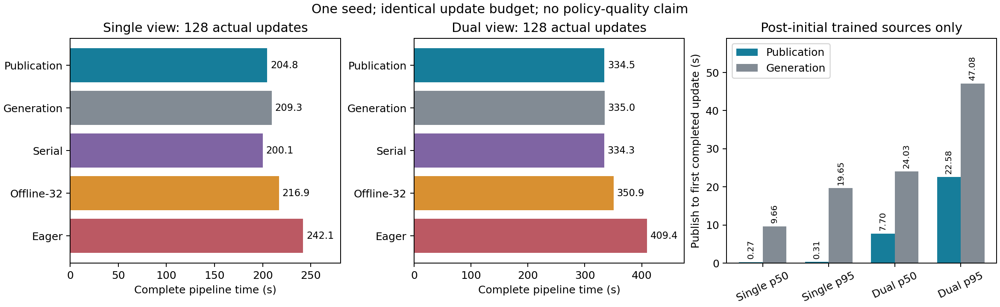

# Publication handoff and recorder service: measured pilot

Published subbatches now reach training before the rest of their generation
finishes. The clearest measured improvement is freshness: **48 of 128 updates
complete before full-generation publication** in each vision mode. Complete
pipeline time improves only modestly versus the generation-handoff diagnostic;
serial remains slightly faster than overlap. **This study does not establish
a diversity advantage, positive overlap-only speedup, or policy learning.**

Implementation is frozen at `8f101b29738598fd83c01a5b4882888b7d87a5b9`.
All 10 fresh runs pass the [independent audit](INDEPENDENT-AUDIT.md).
The six earlier smoke runs are functional qualification only: their older
serial archive barrier and trace format exclude them from performance claims.
Dates use Asia/Shanghai; raw event timestamps use the host monotonic clock.

## What changed

- After common initial C-episode normalization, copy complete published
  P-episode subbatches under the existing publication lock. Validate source,
  continuity, frame prefix and ownership before returning independent data.
  Lock contention returns immediately; worker failures remain failures.
- Train each retained block within its lifetime K budget. Keep the union of
  training, staging and serial-ready raw owners at most C; shared cache C and
  writer queue 2, active packet 1 and pending submission 1 are separate bounds.
  Do not request replacement before every accepted source has been copied.
- Serial archives subbatches during production too, but waits for complete
  generation before updating. This removes the extra archive barrier from the
  control. Its ordered source/anchor work, numeric data, initialization and
  normalization match overlap. Raw RGB equality is not established; both final
  model hashes differ. Treat this as scheduling attribution, not exact replay.
- Partition recorder episode service into validation, `add_frame`,
  `save_episode`, and manifest/reference stages. Preserve the outer event.
  `save_episode` includes codec and SDK commit; it is not pure encoding time.
- Expose encoder threads, default 1. The pilot uses 2 consistently in every
  arm. SDK parallel camera encoding remains disabled to avoid a process pool
  fork from the writer thread in a CUDA process.

No public immediate sampling/error contract, model, task distribution, or
training budget changed. Trace v2 records retained-block boundaries and the
new recipe settings; historical v1 remains readable.

## Protocol and results

One seed (19001), single and dual cameras, U128/B32/H2/F32, C8/P4/K128.
Each run completes 4,096 chunks and 131,072 valid targets. FP32 model and
optimizer recipe remain identical across arms. Each vision uses the same two
primary GPUs and eight CPU cores; the host is shared, not exclusively reserved.
All arms record standard LeRobot datasets; Offline-32 trains through the
actual SDK/TorchCodec decode path. No physical policy evaluation was requested
in these systems runs. This is a pilot, not the three-seed formal matrix.

| Mode | Single complete time (s) | Dual complete time (s) | Trained / accepted sources | Early updates |
| --- | ---: | ---: | ---: | ---: |
| ODS publication, budget | 204.842 | 334.537 | 32 / 32 | 48 |
| ODS generation handoff, budget | 209.339 | 335.005 | 32 / 32 | 0 |
| ODS serial, publication | 200.088 | 334.321 | 32 / 32 | 0 |
| Offline-32, publication acquisition | 216.944 | 350.906 | 32 / 32 | 0 |
| ODS publication, eager | 242.147 | 409.405 | 32 / 40 | 48 |

Complete time includes launch, all accepted recording, checkpoint writes and
normal process exit. Mandatory content audit is outside this clock. All
accepted eager-tail data are saved and charged; none count as trained coverage.
The primary report contains six main outcomes and four pairs. The two eager
and two generation-handoff runs are diagnostics, not extra main samples.

Versus whole-generation handoff, publication saves 2.15% single / 0.14% dual.
Versus cold Offline-32, the observed saving is 5.58% / 4.66%. Against serial,
overlap is 2.38% / 0.06% slower. These single-seed observations cannot establish
a stable speedup, and offline savings cannot all be attributed to overlap.

| Post-initial publication → first completed update | Single p50 / p95 (s) | Dual p50 / p95 (s) |
| --- | ---: | ---: |
| Publication | 0.271 / 0.310 | 7.698 / 22.576 |
| Whole generation | 9.662 / 19.650 | 24.030 / 47.079 |

These quantiles include only actually trained sources from generations > 1.
Initial fill and normalization are excluded here, not from total time. The
independent report also retains all-source quantiles: publication single
0.287 / 19.691 s and dual 7.698 / 24.569 s. Untrained sources have explicit
counts rather than invented zero latency.



All arms train 32 effective sources, 26 initial XY cells and 4,096 distinct
anchors. Publication overlap/serial/eager cover 189 anchor voxels and 16,101
unique supervised frames; Offline-32 covers 188 / 16,157, and generation
handoff 192 / 16,100. This is similar coverage with different sampling orders,
not evidence that earlier availability increased physical diversity.

Only about 5.3 s single / 8.7 s dual is synchronized optimizer service in
publication overlap. Generation spans are about 158 / 185 s, and SDK episode
service about 143 / 264 s; these overlap and must not be added. After the final
update, 34.1 / 96.2 s remains until normal closure. With this short, fast
training workload and required full recording, there is little optimizer work
to hide production behind; dual-view persistence remains especially costly.

## Recorder qualification

The [isolated CPU sweep](recorder/thread-sweep-3pjgu8dp/README.md) writes the
same 479-frame historical input, in single and dual modes, with 1/2/4 encoder
threads and two repeats in reversed order, on CPUs 16–23. Other codec settings
are unchanged. It is a second encode of already-decoded AV1 input.

| Camera mode | 1 thread mean SDK episode service | 2 threads | 4 threads |
| --- | ---: | ---: | ---: |
| Single | 3.613 s | 2.957 s | 3.008 s |
| Dual | 6.552 s | 5.563 s | 5.618 s |

Two threads reduce isolated service by 18.15% / 15.09%. This motivated the
matched pilot setting; it is neither a universal optimum nor an end-to-end
speedup estimate. All 5,748 dataset frames / 8,622 camera frames decode;
numerical payloads match and decoded digests agree across thread settings
within each camera mode. PSNR/MAE describe the lossy reference round trip.
Temporary peak disk/RSS were not measured in this isolated sweep.

## Validation and retained evidence

- Independent reconstruction passes 10/10 fresh runs on the first attempt:
  optimizer steps/checkpoints, quotas K128, raw ownership at most C8, source
  blocks, actual early updates, all saved video frames, SDK dataset checks,
  disjoint nested recorder stages, declared GPU contexts and normal closure.
- CPU qualification uses a real spawned shared-memory producer for acquisition,
  and actual experiment/sampler methods with controlled producer/writer clocks
  for scheduling. It covers partial publication, lock contention, malformed
  provenance, worker errors, overwrite, old-output independence, queue bounds,
  slow recording, timeout, serial archival, and trace compatibility. The first
  CPU orchestration command had an import-path setup failure; both that log and
  the corrected successful command output remain, rather than hiding it.
- Six earlier real smoke runs include independent physical evaluation process
  execution, decoding and shutdown. They are not included in the ten-run
  performance comparison and do not establish a learned policy.
- All 15 actually mapped native libraries were captured during the cohort and
  verified unchanged afterward. Runtime source hashes match the frozen commit.
  Historical report regeneration preserves 29 qualified / 23 pairs for Oct 21,
  and six main / four pairs for Oct 22. Black 26.3.1, API coverage 2794/2794,
  context validation and 40 context tests pass.

`raw-metadata.tar.gz` retains original JSON/JSONL/process logs byte-for-byte,
including smoke and diagnostics. `raw-inventory.json` gives original paths,
SHA256, size and archive membership for every raw file. Large datasets,
checkpoints and per-frame decode digest files remain at those local paths;
they are **not included in Git or promised as portable public artifacts**.
`independent-audit.json` retains their content verification receipts.
`main-report/` contains the four standard plots. SVG trailing whitespace is
normalized for review; raw numeric inputs remain unchanged. `drivers/*.source` preserves
exact executed qualification/audit driver bytes, including host-specific paths;
it is evidence, not a new reusable testing framework. `SHA256SUMS` covers the
packaged evidence. Prior studies and their failures remain unchanged.

## Reproduce and continue

Use the py311 setup and native simulator path in the parent README, pin the
implementation commit, and choose currently idle primary GPU pairs. The
recorded allocation was sim/train 3/4 for single and 5/7 for dual, plus the
explicit passive graphics allowance on GPU 7. Check the saved GPU UUIDs;
indices are host-specific. All groups had eight CPU cores each.

```bash
python -m examples.ods.data_stream_demo.train \
  --suite pilot --handoff-mode publication --encoder-threads 2 \
  --producer-envs 4 --updates 128 --batch-size 32 \
  --buffer-size 8 --episode-budget 128 --evaluation-scenes 0 \
  --gpu-ids 3 4 5 7 --aux-graphics-gpu-id 7 --output /tmp/ods-publication-repeat
```

Repeat generation controls with `--suite single --arm ods_overlap`, each
vision's GPU pair and CPU affinity, and `--handoff-mode generation`; actual
argv and return codes are in archived `generation-control-processes.json`.
Use a fresh output directory and regenerate data. Do not run a control while
its GPU pair is occupied by the main suite. Regenerate the summary figure with
`python plot_results.py` from this directory; it reads the packaged audit only.
Extract metadata into a new directory to inspect original events without
requiring the external binary corpora.

The next experiment should select a genuinely useful model/training budget
using measured generation, recording and optimizer throughput, then freeze it
before comparing all arms and seeds. Do not add sleeps or dummy computation.
For physical diversity, first qualify a richer task distribution and measure
actual trained state coverage. Neither change is implemented in this pilot.
