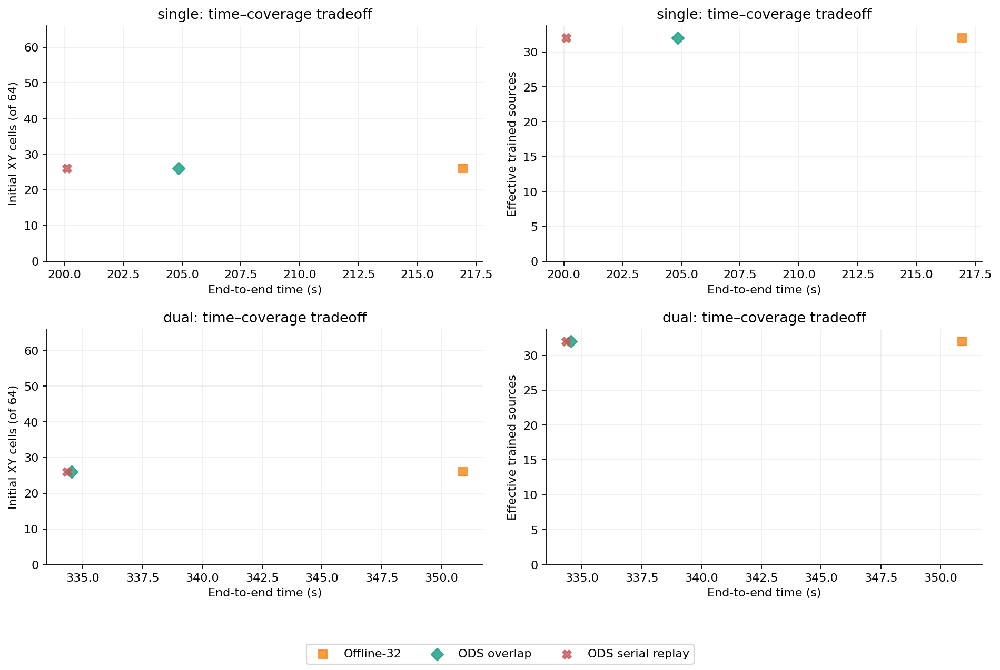
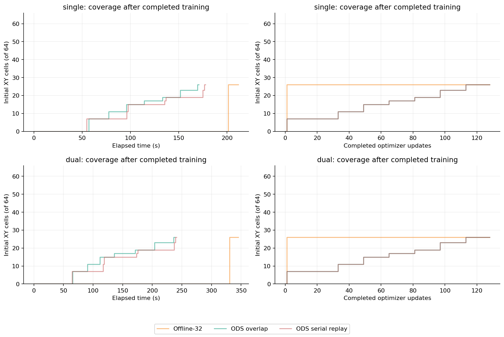
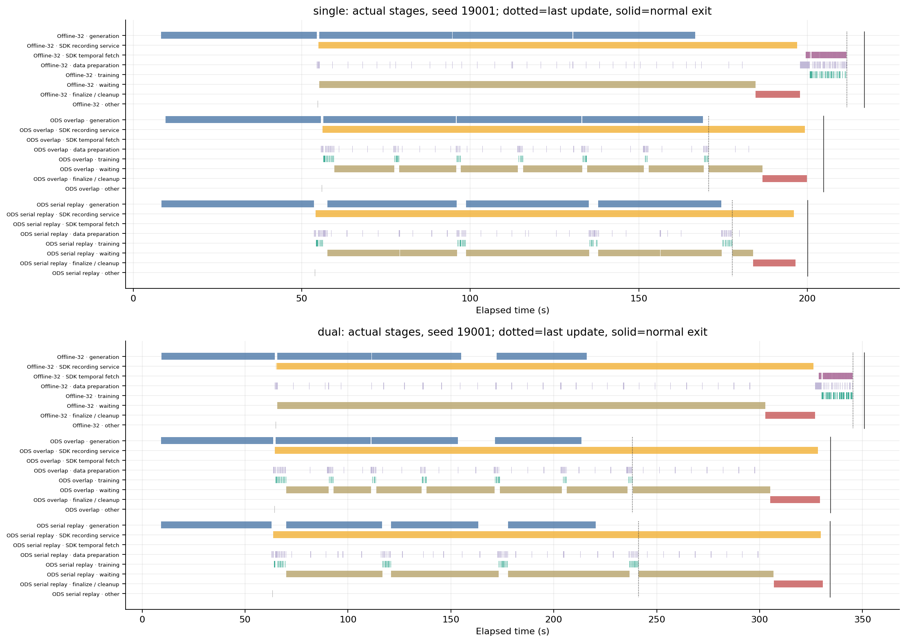
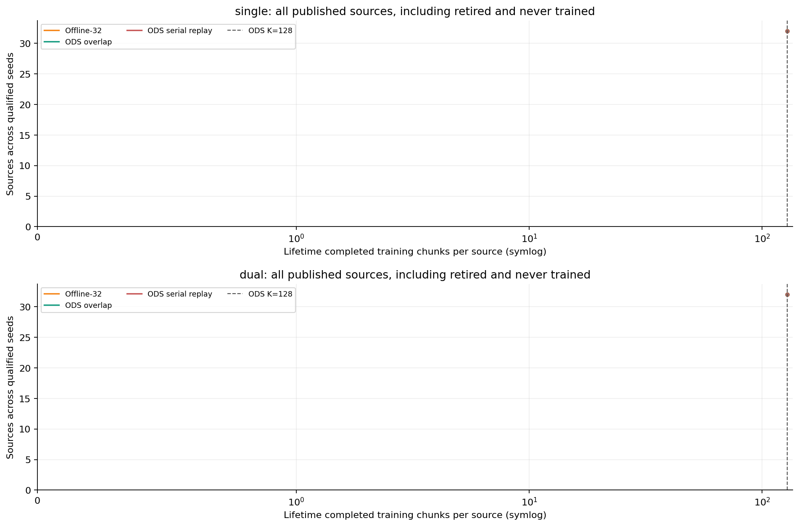

# ODS visual training: fixed-work time and diversity

Qualified runs: **6/6**; qualified pilot pairs: **4**. Failed, unsupported and unqualified runs remain in report.json and are excluded from aggregate values and paired time ratios.

Each result completes the declared optimizer-update, batch and valid-target budget. Data amount and final coverage may differ. Ratios compare total pipeline time, including acquisition, recording, decode, actual training, checkpoint and normal teardown; they do not establish equal policy quality or a universal ODS speedup.

Single-seed systems pilot. Eager controls remain outside main data and primary ratios. Zero-scene evaluation is systems-only and provides no policy-quality evidence.

## single

Values are median [minimum, maximum] across qualified seeds.

| Path | n | Total s | Trained sources | Effective sources | XY cells / 64 | Unique targets |
| --- | ---: | ---: | ---: | ---: | ---: | ---: |
| Offline-32 | 1 | 217 [217, 217] | 32 [32, 32] | 32 [32, 32] | 26 [26, 26] | 1.62e+04 [1.62e+04, 1.62e+04] |
| ODS overlap | 1 | 205 [205, 205] | 32 [32, 32] | 32 [32, 32] | 26 [26, 26] | 1.61e+04 [1.61e+04, 1.61e+04] |
| ODS serial replay | 1 | 200 [200, 200] | 32 [32, 32] | 32 [32, 32] | 26 [26, 26] | 1.61e+04 [1.61e+04, 1.61e+04] |

| Baseline / ODS overlap | Paired seeds | Total-time ratio median [min, max] |
| --- | ---: | ---: |
| Offline-32 | 1 | 1.06 [1.06, 1.06] |
| ODS serial replay | 1 | 0.977 [0.977, 0.977] |

| Path | CPU mean / assigned capacity % | Simulation GPU board mean % | Training GPU board mean % |
| --- | ---: | ---: | ---: |
| Offline-32 | 57.8 [57.8, 57.8] | 28 [28, 28] | 2.11 [2.11, 2.11] |
| ODS overlap | 59.4 [59.4, 59.4] | 29.8 [29.8, 29.8] | 1.54 [1.54, 1.54] |
| ODS serial replay | 59.7 [59.7, 59.7] | 30.1 [30.1, 30.1] | 2.55 [2.55, 2.55] |

CPU values use continuing-PID sampled interval deltas normalized by the assigned cores; new or disappeared processes may be undercounted. GPU values are whole-board NVML samples and include foreign work; they do not attribute kernel utilization to this run. Missing observations remain unknown (—), not zero. See raw resources for sample counts and process-coverage gaps.

| Path | Sampled PSS max GiB | Sampled owned GPU max GiB | Dataset MiB | Checkpoints MiB |
| --- | ---: | ---: | ---: | ---: |
| Offline-32 | 7.45 [7.45, 7.45] | 5.9 [5.9, 5.9] | 40.2 [40.2, 40.2] | 106 [106, 106] |
| ODS overlap | 8.86 [8.86, 8.86] | 7.84 [7.84, 7.84] | 40.2 [40.2, 40.2] | 106 [106, 106] |
| ODS serial replay | 8.96 [8.96, 8.96] | 7.84 [7.84, 7.84] | 40.2 [40.2, 40.2] | 106 [106, 106] |

Memory maxima are sampled observations, not guaranteed allocator/process peaks. Disk sizes are logical finalized dataset and initial/final checkpoint bytes; they exclude temporary disk peaks, logs and post-timing audit/evaluation artifacts.

## dual

Values are median [minimum, maximum] across qualified seeds.

| Path | n | Total s | Trained sources | Effective sources | XY cells / 64 | Unique targets |
| --- | ---: | ---: | ---: | ---: | ---: | ---: |
| Offline-32 | 1 | 351 [351, 351] | 32 [32, 32] | 32 [32, 32] | 26 [26, 26] | 1.62e+04 [1.62e+04, 1.62e+04] |
| ODS overlap | 1 | 335 [335, 335] | 32 [32, 32] | 32 [32, 32] | 26 [26, 26] | 1.61e+04 [1.61e+04, 1.61e+04] |
| ODS serial replay | 1 | 334 [334, 334] | 32 [32, 32] | 32 [32, 32] | 26 [26, 26] | 1.61e+04 [1.61e+04, 1.61e+04] |

| Baseline / ODS overlap | Paired seeds | Total-time ratio median [min, max] |
| --- | ---: | ---: |
| Offline-32 | 1 | 1.05 [1.05, 1.05] |
| ODS serial replay | 1 | 0.999 [0.999, 0.999] |

| Path | CPU mean / assigned capacity % | Simulation GPU board mean % | Training GPU board mean % |
| --- | ---: | ---: | ---: |
| Offline-32 | 57 [57, 57] | 21.6 [21.6, 21.6] | 2.06 [2.06, 2.06] |
| ODS overlap | 58.1 [58.1, 58.1] | 23.5 [23.5, 23.5] | 2.32 [2.32, 2.32] |
| ODS serial replay | 58.3 [58.3, 58.3] | 22.5 [22.5, 22.5] | 2.76 [2.76, 2.76] |

CPU values use continuing-PID sampled interval deltas normalized by the assigned cores; new or disappeared processes may be undercounted. GPU values are whole-board NVML samples and include foreign work; they do not attribute kernel utilization to this run. Missing observations remain unknown (—), not zero. See raw resources for sample counts and process-coverage gaps.

| Path | Sampled PSS max GiB | Sampled owned GPU max GiB | Dataset MiB | Checkpoints MiB |
| --- | ---: | ---: | ---: | ---: |
| Offline-32 | 10.7 [10.7, 10.7] | 5.92 [5.92, 5.92] | 57.6 [57.6, 57.6] | 110 [110, 110] |
| ODS overlap | 11.9 [11.9, 11.9] | 10.1 [10.1, 10.1] | 57.6 [57.6, 57.6] | 110 [110, 110] |
| ODS serial replay | 11.8 [11.8, 11.8] | 10.1 [10.1, 10.1] | 57.6 [57.6, 57.6] | 110 [110, 110] |

Memory maxima are sampled observations, not guaranteed allocator/process peaks. Disk sizes are logical finalized dataset and initial/final checkpoint bytes; they exclude temporary disk peaks, logs and post-timing audit/evaluation artifacts.

## Figures and interpretation

Coverage uses completed training only. Initial XY bins are fixed 1 cm cells over the task's 8 cm × 8 cm reset area; anchor-state voxels are 2 cm. Source identity growth alone is not physical diversity. Overlapping prediction windows share target frames and are deduplicated by immutable frame identity. Published but untrained data does not increase these metrics.

AV1 decoding is lossy. Compare source quality audits and held-out evaluation alongside timing. Differences between online raw pixels and decoded pixels prevent a claim of identical optimization trajectories. Serial trace replay isolates overlap only when its source/anchor manifest audit passes. A faster small offline run or broader large offline corpus is a valid result.

SDK recording spans cover real create/write/encode/bookkeeping/finalize service; SDK temporal fetch spans include worker initialization, dataset reads, decode, conversion and validation. Neither lane claims pure encoder/decoder CPU work or GPU kernel activity. Owner packing/copy and waiting remain separate. Intervals may overlap and are not summed into total time. Timeline rows use the first observed qualified seed per vision, without selecting the fastest run. PNG, SVG and PDF versions share measured inputs.

Formal ratios require matching initial-model/normalization SHA256, initial-C numeric prefix, camera order, declared/completed training budget, ordered primary GPU UUIDs and the same eight CPU cores. Retained supervisor launch masks/thread limits, placement guards, process exit and clocks must agree. New formal inputs additionally require chronological sdk-worker-service/v1 intervals and a revisioned full-video-integrity/v1 receipt for every saved frame; the original numeric/H2 audit remains required. Full-video YUV sequential integrity is distinct from lossless RGB fidelity or every SDK temporal seek. Missing evidence blocks claims; smoke/calibration or legacy CPU rendering fixtures are not formal comparisons. Post-timing corpus audit and evaluation durations are excluded from pipeline time.

## Excluded paired claims

Every observed paired comparison passed its evidence gates.

## Retained unqualified runs

No unqualified runs were observed in this input directory.
