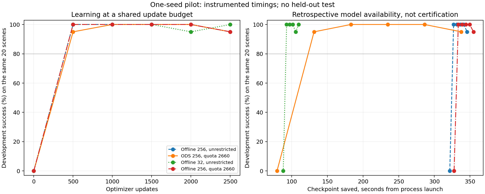

# ODS versus LeRobot: completed integration pilot

The bounded ODS pipeline works and exposes useful checkpoints before collecting a full 256-episode offline dataset. This pilot does **not** establish a general ODS speed or quality advantage: the 32-episode offline baseline produced its first evaluated qualifying checkpoint earlier and finished at 20/20 development successes, versus 19/20 for ODS. That one-scene difference is descriptive, not statistically established superiority.

Executed source: `3cd6379a092f8106f08ea6073f13bec9a4bd6f63`; protocol `offline-pilot-v1`. Four sequential runs on GPU 3 / CPUs 32–47 used one learner seed 19001, P8/C32/B256, 2500 updates each, and ChunkBC H64/action16. All 24 panels used the same 20 development scenes 810000–810019 in fresh evaluators. No final-test scenes were opened. [Evidence JSON](OFFLINE_PILOT_RESULTS.json) contains raw artifact hashes, complete curves, phase costs and audits.

## Time & Memory

These are **instrumented, provisional** observations relative to measured launcher process start. “Qualifying save” means availability of a checkpoint later scoring at least 16/20, not online certification. Every arm first qualifies at step 500, the first noninitial checkpoint; the true earlier threshold crossing is unknown.

| Arm | First update s | Qualifying save s | Training finish s | Active training s | Full process s | Native VRAM peak MiB | Tree PSS peak GiB |
| --- | --- | --- | --- | --- | --- | --- | --- |
| Offline256 practical | 322.09 | 326.96 | 346.21 | 23.34 | 1238.62 | 5864 | 6.444 |
| ODS256 protected | 79.83 | 131.28 | 341.23 | 40.29 | 1279.13 | 6324 | 7.627 |
| Offline32 practical | 88.59 | 92.79 | 109.85 | 20.78 | 1018.34 | 5864 | 6.459 |
| Offline256 protected | 328.11 | 333.53 | 355.17 | 24.50 | 1246.67 | 5864 | 6.463 |

Full process time includes deferred evaluation and cleanup. Offline256 practical spent 4.36s in audited SDK loading and 23.34s in active training; ODS spent 40.29s active and 216.54s intentionally throttled. Earlier learning availability is not higher active learner throughput. C32 bounds source cache, not total process memory: the larger observed ODS peaks are retained. Final datasets plus run-local SDK cache occupy 57.60MB for either offline256 arm and 7.30MB for offline32; ODS persisted no dataset. Temporary-write peaks remain unknown.

**Time-origin correction to prospective protocol item 1:** the runner reconstructs an approximate process origin from psutil wall-clock creation time. Its roughly −0.94s offset from launch is an alignment term, not measured import/startup latency. This addendum uses `reconstructed_origin + event_elapsed − measured_launcher_origin`. Model-initialization and normalization-fit durations were not separately measured.

## Success & Other Metrics

Curve entries are successes out of 20 at steps 0/500/1000/1500/2000/2500. Each arm completed 640,000 chunks. Repeated panels do not create 120 independent scenes.

| Arm | Accepted episodes | Development curve /20 | Latest goal error mm | Source draws min / mean / max | Binding cap hits |
| --- | --- | --- | --- | --- | --- |
| Offline256 practical | 256 | 0, 20, 20, 20, 20, 19 | 11.59 | 2365 / 2500 / 2628 | No cap |
| ODS256 protected | 256 | 0, 19, 20, 20, 20, 19 | 11.05 | 630 / 2500 / 2660 | 224/256 |
| Offline32 practical | 32 | 0, 20, 20, 20, 19, 20 | 4.69 | 19749 / 20000 / 20292 | No cap |
| Offline256 protected | 256 | 0, 20, 20, 20, 20, 19 | 11.59 | 2365 / 2500 / 2628 | 0/256 |

All four arms have identical first 32 policy-data, initialization and normalization hashes. The two independently collected offline256 corpora match across all 256 ordered episode hashes, masks and action/observation tensors; all six model states and evaluation records match exactly. Their cap never binds: maximum 2628 draws is below 2660. These arms cannot demonstrate a learning benefit caused by an active offline cap. Full minibatch traces and complete ODS256 payload identity remain unverified.

The controller targeted 2480.8224 chunks/s and delivered 2475.4550 (-0.216%). Warm productive supply was 0.915436 trajectories/s versus input 0.93264. G1 contributed 58,366/640,000 chunks; no ODS source exceeded 2660. This validates bounded data use and pacing, not GPU occupancy or quality superiority. G1 nominally allows `floor(32 × 2660 / 256) = 332` full updates, so ODS needs new sources before step 500; unrestricted offline32 can reuse G1 freely. K2660 remains a provisional reference.

## Leaderboard

Descriptive latest-development ordering only; tied policies and reused scenes are not independent quality evidence.

| Rank by latest count | Arm | Latest /20 | Peak /20 |
| --- | --- | --- | --- |
| 1 | Offline32 practical | 20 | 20 |
| 2 | Offline256 practical | 19 | 20 |
| 2 | ODS256 protected | 19 | 20 |
| 2 | Offline256 protected | 19 | 20 |

Lines connect measured checkpoints; they do not identify an earlier threshold-crossing time or online certification.

## Qualification limits and next work

- Original C256 resident-accounting overhead was +12.99% median / +13.55% p95 versus compact accounting. The pilot was not patched or algebraically corrected. Later isolated optimization still misses the strict 5% gate at C32 median 5.127%; neither profile qualifies the full resource-sampling/producer/I/O path or protected-offline per-update quota-snapshot caller.
- Offline geometry is converted once during collection and SDK-loaded once to resident CPU tensors; live ODS converts geometry during sampling. Both construct pose targets in learner loss. This is a practical whole-system comparison, not a pure memory-transport experiment. Durable offline-data reuse is a separate workload.
- Runs were process-cold/software-cache-warm in fixed order. Separate GPU 5 profiles/integrations on other NUMA cores overlapped the pilot. No foreign GPU 3 allocation was observed, but shared host/storage interference is not excluded.
- All four contract audits passed; source stayed frozen, all 44 observed owned PIDs exited, and no watchdog/forced cleanup occurred. Four-arm process cost was 1.3285 GPU-hours. Three prior SDK smokes added 383.54s; separate GPU 5 diagnostics, including a failed setup attempt, remain in the JSON cost ledger.
- Before formal timing, remove/bound redundant quota-snapshot materialization and qualify paired full-path instrumentation overhead. Then freeze a balanced multi-seed protocol retaining offline32; keep held-out tests sealed until that freeze. Predeclare the next protocol and retain every baseline, including one that performs better than ODS.
