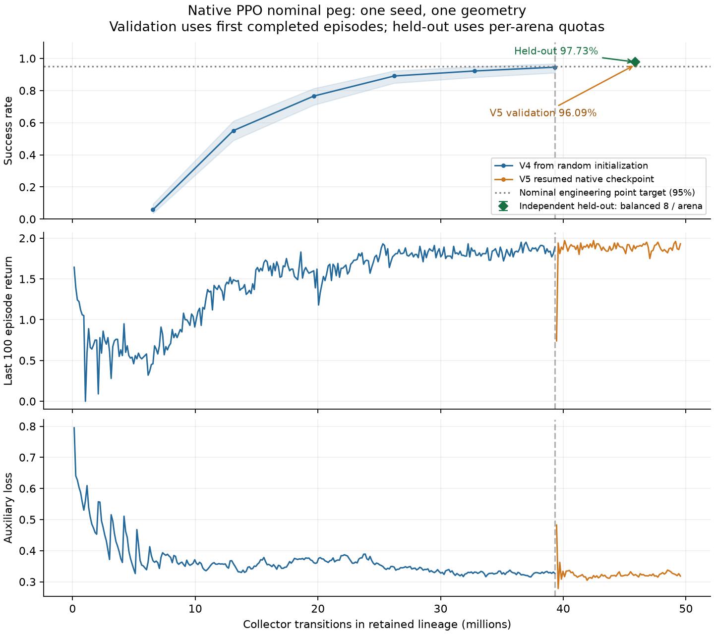

# Native blind peg insertion: measured result

The frozen native PPO checkpoint succeeds in **8006/8192 held-out nominal episodes (97.7295%, Wilson 95% interval 97.3838–98.0304%)**. This meets the single nominal 95% engineering point target. It does not establish the planned three-task, three-seed study or full paper reproduction. Both training attempts ended on numerical guards; candidate performance and training stability are separate outcomes.

The model was trained through EmbodiChain's native environment/managers, proprioceptive policy, collector, PPO and trainer. V4 started with random weights. V5 resumed the native V4 checkpoint at 39,321,600 transitions/update 300; it did not import author weights. The actor receives proprioception/history and previous actions; privileged truth/contact labels train the critic/decoder only. The public exported author network supplies a separate fixed-input numerical reference ([policy_reference.json](policy_reference.json)), rather than the trained result.

## Time & Memory

| Measurement | Environments / workload | Wall time (s) | Sampled process VRAM maximum (MiB) | Transient GPU peak | Outcome |
|---|---|---:|---:|---|---|
| V4 training, PID 391309 | 4096; 43,909,120 recorded collector transitions; 334 completed updates | 3400.374 | 10532 (3412 samples) | Unmeasured | Nonfinite PPO gradient guard |
| V5 resumed training, PID 465549 | 4096; 10,309,632 additional recorded transitions; 78 additional completed updates | 911.264 | 10570 (919 samples) | Unmeasured | Native nonfinite state guard |
| Independent frozen-model assessment | 1024; 8192 episodes; 8 per arena | 146.783 | Unmeasured | Unmeasured | Completed with fresh strict health |
| Recorded V4 + V5 cost | 54,218,752 recorded collector transitions; 412 completed updates across retained/discarded branches | 4311.638 | Not summed | Unmeasured | Selected lineage: 45,875,200 transitions / 350 updates |

Wall times are wrapper end-to-end measurements and include setup/evaluation/health readbacks/cleanup within each run; they are not steady-state throughput measurements. GPU numbers are PID-filtered nvidia-smi process samples, not transient peaks. Training plus final assessment took 4458.421 s (74.31 min) in this measured scope. Earlier A–C trials, asset/reference work, preview and unmeasured resources are excluded; no total-project cost is claimed. The failed native step can do physical work before returning to the collector, so the counters do not cover every attempted physical transition. The formal 5000-update/12288-environment budget was not run; the separate 2000-update development budget also ended early with 4096 environments.

## Success & Other Metrics

| Cohort / measure | Episodes | Value | Definition / scope |
|---|---:|---|---|
| Frozen held-out success | 8192 | 8006 / 8192 = 97.7295%; 95% CI 97.3838–98.0304% | Seed 20000; balanced 8 episodes in each of 1024 arenas; no checkpoint selection on test |
| All episode duration | 8192 | Mean 1.177583 s; median 1.12 s; p95 1.58 s | Episode length × declared 0.02 s control period |
| Successful episode duration | 8006 | Mean 1.178086 s; median 1.14 s; p95 1.58 s | Control-grid duration; not individually measured native clock |
| Failed episode duration | 186 | Mean 1.155914 s; median 0.70 s; p95 5.00 s | Same definition; maximum episode length 250 controls |
| Terminal task penetration | 8192 | Mean 1.769374 µm; p95 6.318092 µm; max 24.896221 µm | Terminal task metric, not peak mesh intersection or micrometre-accuracy proof |
| Final strict native health | 712 control boundaries × 1024 worlds | qpos/qvel/qacc finite; no capacity, convergence-budget or unclassified flags | Fresh assessment only; raw state between boundaries not sampled; zero budget flags do not establish solver convergence |
| Relocated native DexSim preview | 3 fixed seeds: 30000–30002 | 3 successes; 48 / 48 / 60 controls (0.96 / 0.96 / 1.20 s) | Separate visualization; no strict raw-state qualification |

The 186 failed episode endpoints include **170 with terminal grasped=false, 74 with terminal captured=true, and 16 of length 250 controls**. Conditions overlap and are endpoint observations, not causal classifications; full force/path traces were not recorded for this assessment. The JSONL contains every scored episode, including failures, with contiguous indices and all per-arena quotas independently rechecked. Success/failure duration and terminal penetration summaries were independently recomputed from those records.

## Leaderboard

| Implementation | Training source | Assessment | Success / confidence interval | Qualification |
|---|---|---|---|---|
| EmbodiChain native PPO, official_v1 actor, seed 0; frozen update 350 | Random initialization → V4 native checkpoint → V5 continuation | 8192 independent nominal episodes; balanced quotas | **97.7295% [97.3838%, 98.0304%]** | Single geometry / one seed simulation candidate; nominal point target met; training stability failed |

There is one measured candidate in this table. No directly comparable author-policy result, scripted baseline, multi-seed mean, generalization test or ablation result is claimed.

## Lineage, selection and failure boundaries

V4's retained parent checkpoint was update 300 / 39,321,600 transitions with first-completed validation 242/256 (94.53125%). V4 later failed at collector step 43,909,120 after 334 completed updates: a nonfinite gradient guard skipped the offending optimizer step. Earlier minibatch steps in that incomplete update are not claimed absent. Historical raw qpos/qvel/qacc coverage is unverified, while recorded capacity flags remained clear.

V5 resumed that parent with the same configuration SHA256 `9a47fa4adfb91d4bfacfcea59feff6952dd4d74383670621e4524e3a443d9ac7`. The frozen update-350 checkpoint has SHA256 `e8454a0a59d8c3b50d4f472965c95a24a0ee97d09b71aa1757948483ad7d75ce`; its selection validation was 246/256 (96.09375%). Selection uses legacy first-completed validation, which can weight arenas by completion speed; its bias direction is not established here. The final assessment uses deterministic quotas, with all arenas stepping/resetting normally and only quota-eligible episodes scored. The test did not select the model.

V5 subsequently stopped at collector step 49,631,232 after 378 completed updates (911.264 s), on the 2518th control-boundary observation with nonfinite qpos/qvel/qacc in world 515, before auto-reset. Capacity/convergence-budget flags remained clear; they do not rule out other numerical faults. The failure cause is unconfirmed and no PPO failed-batch dump was produced for this native-state guard. Thus neither training run qualifies as stable completion. The later failure does not change the completed fresh assessment of the earlier frozen checkpoint, and the fresh assessment does not retroactively certify training.

The plot and [CSV](lineage_curve.csv) retain V4 points only through the resumed parent (39.3216 M) and V5 points thereafter; discarded V4 continuation is excluded. Training return is the logged last-100-episode mean; auxiliary loss is the recorded native PPO metric. Validation bands are logged Wilson intervals on first-completed episodes. The held-out marker uses the independent balanced assessment at the frozen checkpoint's lineage counter. It is not a second training validation. V5 training diagnostics after the selected update 350 are shown through the later failure; that later unsaved work is not part of the delivered checkpoint. Source event identifiers/hashes are preserved in [result.json](result.json).

## Physics and reproduction limits

The [paper](https://arxiv.org/html/2610.23849v1) and [public project exports](https://younghyopark.me/blind-proprioceptive-assembly/) provide task and inference references. Fixed-input actor comparison with public weights has maximum action error about 4.89e-6. This does not establish author-training-code equivalence: the native critic has 235 inputs versus the paper's 240 with an unpublished complete feature list, and training-time normalizer updates/control conventions remain engineering choices. The independently proven stable PPO formula fixes an inactive exponential backward overflow without changing the finite clipped objective; it does not identify V4's failure cause.

The nominal asset uses the public mjfit generator at `5833f465896e1e06bc4be4f003be847f5183a4db`, with `bottom_thickness=0.002` in the same plate body. The floor is its generated convex mesh, cuboid-equivalent for this nominal square plate. Geometry hash: `8d5592ea6da84da3a55f0233616e864b35b29d3950831f397fe2c8ecab1260b7`. This is one geometry, a fixed ready grasp with reset perturbations and nominal public robot parameters; the public author model export is available, but its identified closed-loop dynamics and full gripper lowering are not integrated or qualified in this native deployment. It does not cover the paper's full geometry/reset distribution, real hardware, other two tasks, 3 seeds, OOD tests, ablations or full precision alignment.

The requested cadence is 1 ms physics / 20 ms control. A post-first-update timestep sample was 0.001000000047 s. The first observed control clock delta was 21.000002 ms, the second 19.999985 ms; individual substep clocks were not measured. Prepared MuJoCo options report elliptic cone, impratio 10, iterations 100, line-search 50, CCD 35 and tolerance about 1e-6, while task configuration requests 1e-8. Only timestep was checked after the first update; prepared tolerance must not be interpreted as a post-step measurement or proof that requested 1e-8 was effective. No parameters were changed after assessment. EPA capacity was 128 under the documented runtime patch; this increases capacity and is not an accuracy theorem.

Software/hardware for the fresh assessment: RTX 5090; EmbodiChain 0.3.2, DexSim 0.5.1rc1, PyTorch 2.7.1+cu128, Warp 1.17.0, Newton 1.6.0, MuJoCo and MuJoCo Warp 3.12.0. Exact source hashes, dirty-tree status, configs and runtime provenance are retained in the copied health reports. Final evaluation source HEAD was `fb542ed8630c73e6cac3a790a8bcf1eb7f8e0a82`; the preview was executed before its unchanged script was subsequently published. These execution facts are kept separate from later publication metadata.

## Evidence and reuse

[Machine-readable result](result.json), [production evaluation report](final_evaluation.json), [strict fresh health](final_evaluation_health.json), [raw scored episodes (gzip)](episodes.jsonl.gz), [V4 training health](training_v4_health.json), [V5 training health](training_v5_health.json), and [PID-filtered GPU memory samples](gpu_memory_samples.csv.gz) preserve positive and negative evidence. Raw JSONL SHA256 before gzip: `2c67d77d7d79cb5ff99cce73ec7a292c618060e24a9840632f1235c6374770b3`. JSON and health-report metric sums agree with the independently aggregated records.

The separate three-seed preview uses the relocated copy of the same checkpoint, through the actual DexSim window/native RGB camera. Its [GIF](preview.gif), [MP4](preview.mp4), [contact sheet](preview_contact_sheet.png) and [trace](preview_trace.json) include every preset outcome; video frames include initial/terminal holds and are not a native-clock measurement. Window and sensor viewpoints are shared, but projection/pixel identity was not measured. Preview traces contain qpos, actions, processed PD targets and task metrics, rather than a strict qpos/qvel/qacc health observer or force/torque proof. Actor export has exact measured native-versus-exported inference parity (max absolute error 0.0); [its manifest](actor_export.json) retains `assembly_success_rate: null`, since export alone does not certify performance.

The [local model archive descriptor](model_descriptor.json) records the 19,230,128-byte package, archive SHA-256 and exact checkpoint identity. Its archive was CRC-checked, extracted, and all 118 listed file hashes verified. The archive is a local deliverable, not a hosted model release.

Repository evidence contains no model checkpoints or author policy weights. Reuse requires the exact native checkpoint/config/resources/runtime provenance described by the separately prepared model bundle. EmbodiChain source is Apache-2.0; mjfit is MIT; the referenced Menagerie Flexiv assets are Apache-2.0 and Robotiq assets retain their BSD license text. Preserve those notices and the bundle's license directory when distributing generated resources. Public author policy weights are used only in the independent numerical reference and are not redistributed here.
