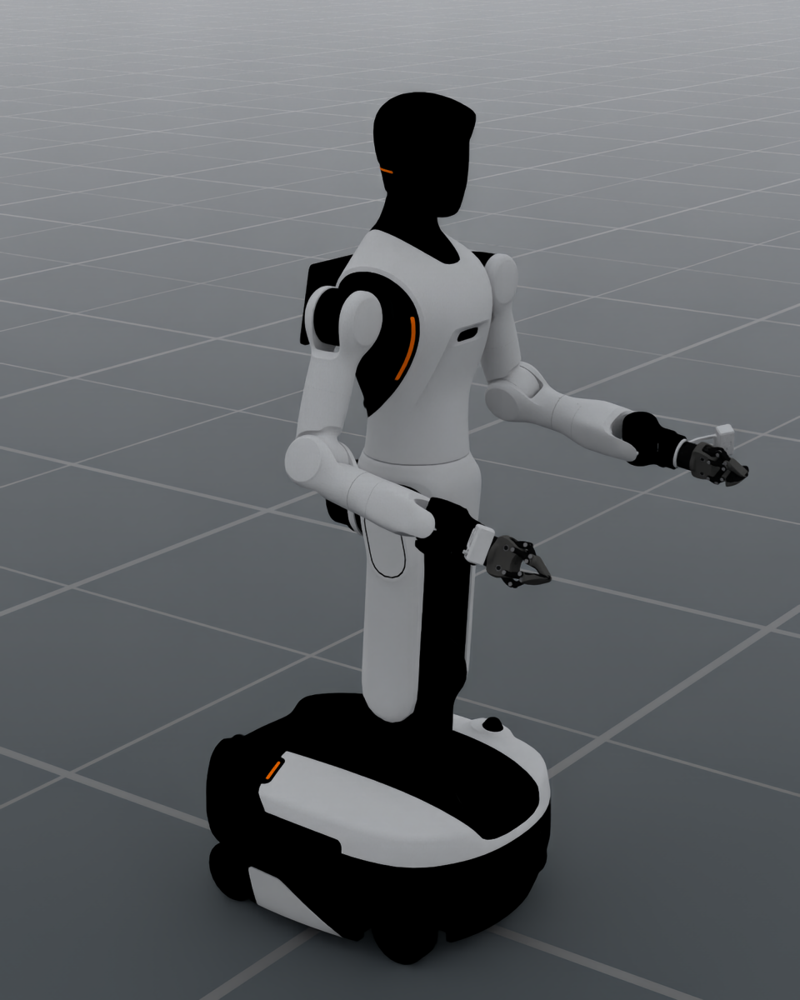

# AgiBot Genie G2



The reproducible render follows the
[W1 documentation presentation](https://dexforce.github.io/EmbodiChain/main/resources/robot/dexforce/w1.html):
`RenderCfg(renderer="rt")` (OfflineRT) defaults, a 960×1200 portrait camera,
1 sample per pixel and DLSS offscreen reconstruction (quality 2). Tone mapping
is off, exposure is `1.0`, and path depths are 4–8. It uses the default ground
and environment emission with no added direct lights. The same camera as W1
frames a G2-specific bent-elbow display pose; the catalog home pose and source
mesh materials are preserved. Physics is not stepped, and 48 rendered frames
warm up reconstruction. Run:

```bash
python -m embodichain_robots.agibot.g2._preview --output g2-render.png
```

The command also writes `g2-render.render.json`. The checked-in
[render manifest](preview.render.json) records the camera, actual joint
positions, rendering settings, asset revision, runtime versions and image hash.

Manufacturer/model: [AgiBot G2](https://www.agibot.com.cn/products/G2).
The `AgibotG2` preset selects the complete G2 with **CRS arms and two
OmniPicker grippers**. CRS-B, SwiftPicker and Wuji configurations available
upstream are not selected by this preset.

## Source and license

The description and meshes come directly from
[AgibotTech/genie_sim_robot_model](https://github.com/AgibotTech/genie_sim_robot_model/tree/6d5b2159806ae0e64b432b638e9ee288d8bddc8f),
revision `6d5b2159806ae0e64b432b638e9ee288d8bddc8f`.
The upstream README explicitly licenses its G2 description and meshes under
**Apache-2.0**; this package includes that LICENSE. The source archive also
contains unrelated third-party robots with different licenses; their notices
are retained, and this preset references only the G2's own assets.

`source.lock.json` records the source URL, archive MD5/SHA256, every required
mesh/source SHA256 and the generated URDF SHA256. The shared asset downloader
verifies the archive and repairs damaged extracted dependencies under its lock.
The upstream full source tree remains available in the cache.

The official repository was selected over community simulation conversions
and teleoperation repositories because it owns the G2 description, explicitly
licenses these assets, and supplies visual materials, link inertials, native
joint limits, mimic relations, and collision geometry together. The model is
an upstream simulation description; its physics values are not hardware
calibration guarantees.

## Portable derivation

`g2.urdf` is expanded from `g2_crs_omnipicker.urdf.xacro` using Xacro 2.1.1,
with `collision_type="fine"`. It retains the official DAE visual meshes,
convex STL collisions, wheel cylinder collisions, joint/link names, origins,
limits, mass/COM frames, materials and mimic multipliers. No meshes are rescaled or
recomputed. Asset installation changes only the relative mesh paths to point
inside the downloaded source tree.

The source principal inertias on `body_link4` and `head_link1` violate the
triangle inequality. Native loading otherwise replaces each with `1e-6` on
every axis. The derivative projects these two diagonal tensors onto the nearest
physical half-space in Euclidean norm, with a relative triangle margin of
`1e-6` for float32 import. The lock records the exact source and replacement
moments. Inertial frame orientations, masses and COMs are preserved. These
minimal admissibility repairs are simulation approximations, not identified
hardware inertias.

GenieSim extensions `loop_joint`, `drive` and `collision_checking` are omitted
from the portable URDF. Four additional gripper loop constraints are replaced
by the upstream tree's existing 14 mimic relations; this is the upstream mimic
approximation, not a closed-chain linkage simulation. Source drive gains are
declared explicitly in `cfg.py`; mimic followers have no competing PD drives.
Chassis steering/wheel gains are EmbodiChain simulation defaults. Source effort
and velocity limits remain authoritative. Self-collision is disabled by default.

Reproduce the packaged URDF without ROS (Xacro is a development dependency):

```bash
python -m pip install xacro==2.1.1
python extensions/embodichain_robots/agibot/g2/_generate.py \
  --archive /path/to/6d5b2159806ae0e64b432b638e9ee288d8bddc8f.zip \
  --output /tmp/g2.urdf
```

The generator verifies both the source archive and resulting URDF against the
lock. Ordinary installation, asset downloading and simulation do not use Xacro.

## Control and use

| Part | Source joints | Independent commands |
|---|---:|---:|
| `left_arm`, `right_arm` | 7 each | 7 each |
| `left_eef`, `right_eef` | 8 each | 1 each |
| `torso` | 5 | 5 |
| `head` | 3 | 3 |
| `chassis_steering` | 4 | 4 |
| `chassis_wheels` | 4 | 4 |

There are 46 moving joints and 32 independent controls. Increasing each gripper
leader from `-pi/4` to `0` closes it. Steering uses position control; wheel
rotation uses velocity control. The default neutral pose has all joints at
zero. Source wheel cylinders extend 4 cm below the root frame; the standalone
preset raises the root to 4.1 cm to avoid initial penetration of the default
ground. The fixed root supports standalone manipulation previews; mobile use
requires `root_props.fixed_base: false` and an application-owned base controller.

Both arm IK solvers use strict Warp SSIK with seed-local redundancy search,
on CPU or CUDA. Geometry comes from the actual URDF, including its 18 mm elbow
offset and authored rounded joint rotations; there is no zero-offset surrogate
or numerical fallback. The older `SRSSolver` requires separate DH calibration
and its shoulder/elbow reconstruction assumes the upper arm lies along the
third joint axis, which the G2 offset violates. SSIK instead reconstructs the
actual shoulder/elbow/wrist vectors and joint axes.

For reproducible CPU/CUDA accuracy, limit, latency and memory measurements,
run `python -m scripts.benchmark.robotics.kinematic_solver.agibot_g2 --output qualification.md`.
The checked-in [qualification report](../../../../scripts/benchmark/robotics/kinematic_solver/agibot_g2_qualification.md)
records both arms, midpoint/nearby seeds, and batches 1/32/128 against numerical
IK with matched acceptance thresholds. Finite swivel sampling is not a proof of
global reachability. A complete `PytorchSolverCfg` override with this preset's
root/end/TCP remains available through the existing solver replacement API.

Both solvers use `arm_base_link` as their root and the native
`gripper_l_base_link` / `gripper_r_base_link` as their end frame, with identity
TCP transforms. Configure tool offsets explicitly for grasp targets. Head,
torso and grippers use joint control. Camera housings and attachment links are
included, but no camera intrinsics/extrinsics are fabricated.

```bash
embodichain list-robot
embodichain data download --name AgibotG2
embodichain preview-robot --robot AgibotG2 --viser
embodichain preview-robot --robot AgibotG2 --headless --max-steps 10
```

```python
from embodichain.robot_registry import resolve_robot_cfg

cfg = resolve_robot_cfg("AgibotG2")
chains = cfg.build_pk_serial_chain()  # left_arm and right_arm, seven joints each
```
