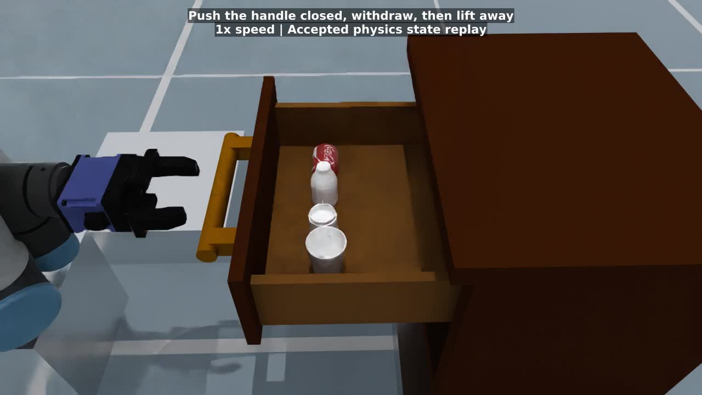

# Drawer Sorting

Open a cabinet drawer, store a drink can, water bottle, coffee cup, and paper
cup in four assigned positions, then close the loaded drawer. The single UR5
with DH PGI-140-80 executes 24 measured segments: open, four
Pick/transport/support/Place sequences, five empty-hand clearance routes, and
handle alignment and a contact push to close.

The selected `ur5_dh_pgi_140_80_full_closure` embodiment uses a 0.040 m
closure command so the jaws can grip the slender handle against rail damping.
Larger everyday objects block the fingers before that commanded endpoint.
The original embodiment and other deployments keep their existing calibration.

The full cabinet in `assets/bedside_cabinet.urdf` is derived from the existing
`Drawer/model_split_links_with_inertials.urdf` asset. A uniform 0.8 scale is
baked into its geometry, joint origins, prismatic limits, and inertias. The top,
side panels, drawer walls, handle, and all corresponding collisions remain.
The cabinet rests on a 91.4 mm plinth; the robot is raised 240 mm and the
source mat 120 mm. The native rail is `cabinet_to_drawer`, the handle is `large_handle_bar`, and the moving floor is
`drawer_bottom`.

The objects use downloaded project meshes:

| Object | Asset | Scale | Storage orientation |
| --- | --- | --- | --- |
| Drink can | `SodaCan/simple_cola_can.obj` | [0.36, 0.28, 0.36] | Horizontal |
| Water bottle | `ScannedBottle/yibao_processed.ply` | [0.64, 0.64, 0.40] | Upright |
| Coffee cup | `CoffeeCup/cup_translated.ply` | 1.0 | Upright |
| Paper cup | `PaperCup/paper_cup.ply` | 0.70 | Upright |

These are fixed calibrated object sizes, approximately 40–53 mm wide. The
can is shortened to fit the selected gripper opening. The drawer uses a
short bottle variant, about 71 mm tall, to keep its neck below the gripper
palm during the calibrated body grasp. Mesh origins and bottom heights determine the individual release and acceptance
heights. Single convex hull collisions are sufficient for external grasps;
the cup interiors are not intended for insertion or liquid simulation.

```bash
python -m embodichain run-task \
  --gym-config extensions/embodichain_tasks/configs/tasks/manipulation/drawer_sorting/task.ur5.yaml \
  --headless --disable-sensor --renderer no-render --device cpu --seed 0 \
  --filter-dataset-saving
```

Omit `--headless --disable-sensor --renderer no-render` for the native viewer
and overhead camera. Omit `--filter-dataset-saving` to record at
`/tmp/drawer_sorting/datasets`. The first run downloads missing assets.

The slide call pulls the native rail outward by 0.224 m. Four storage positions
form a single row across the accessible floor, with 60 mm between object origins.
The robot pedestal and these positions keep its forearm clear of the front
panel during floor placement. The cabinet and its collisions remain intact.

Each object uses the existing `MoveHeldObject` skill to travel above its slot
and lower onto the floor, with verified retention guards and the grasp command
retained. Empty-hand clearance and closing routes use `MoveEndEffector`.
A separate support segment checks its measured position relative to the live
drawer floor, with a 3 mm vertical tolerance. Failure stops the program
before Place can open the hand. Place uses the same floor target, preserves the
transported orientation, opens at rest, and retracts 70 mm. The pre-retract
effect gate checks that the grip is released; terminal verification checks
separation after retreat. Release occurs at the supported floor height.

The last Cartesian route contacts the handle with the fingertips,
tracks the handle inward, withdraws outward, then lifts away. The rail has zero
position stiffness and a 40 N·s/m zero-velocity damper. This resists inertial
coasting without pulling the drawer shut. Final acceptance checks every object
relative to the moving floor and requires the native rail to be within 5 mm
of zero.

The live qualification additionally installs a read-only contact sensor. It
requires object-to-floor contact before the first opening command for all four
objects, more than 200 mm of closing motion with finger-to-handle contact, and
less than 3 mm of free closing travel. Final positions alone cannot satisfy
these checks.

This deployment has fixed identities and positions, with no vision-based
classification, task-level retries, or checkpoint restoration. Qualification
covers Default physics, CPU, seed 0; it does not establish a multi-seed success
rate.

```bash
python -m pytest -q tests/gym/envs/task_program/test_drawer_sorting_sim.py \
  -m slow --run-gpu
```

The native qualification subprocess writes contact evidence and per-segment
results into its episode report. `--run-gpu` enables this repository's native
simulation tests; this particular deployment runs on CPU.

## Preview



[Full task at 4× speed](media/preview.mp4) ·
[Supported releases and contact closure at 1× speed](media/release_and_closure.mp4)

Both videos render the measured
states from an accepted Default physics episode with DexSim 0.6.0rc1, CPU,
seed 0. The source episode lasts approximately 265 seconds. The preview uses
state replay for rendering; it is not a live-render capture. All 24 segments
passed, all four releases had floor contact, and 227.975 mm of closure occurred
with finger-to-handle contact (0.027 mm without contact).
