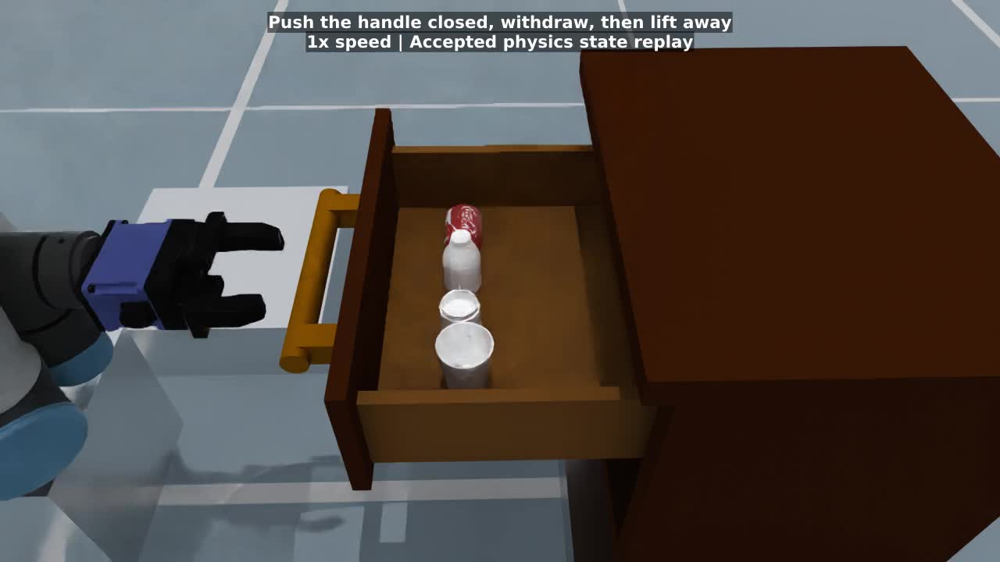

# Drawer storage Task Program

Every deployment opens a drawer, stores objects inside and closes it. The
deployments range from a single cube in four segments to four everyday objects
in 24 segments.

| Deployment | Config | Robot | Objects | Segments | Qualification |
| --- | --- | --- | --- | --- | --- |
| `ur5` | `task.ur5.yaml` | UR5, DH PGI-140-80 | 50 mm cube | 4 | Seeds 0–9, 10/10 |
| `franka` | `task.franka.yaml` | Franka FR3, Panda hand | 50 mm cube | 4 | Seeds 0–9, 10/10 |
| `ur5_long_horizon` | `task.ur5.long_horizon.yaml` | UR5, DH PGI-140-80 (full closure) | Drink can, water bottle, coffee cup, paper cup | 24 | Seeds 0–9, 10/10 |

The long-horizon deployment keeps the open → pick → place → close structure.
It repeats pick and place for four objects in assigned slots, lowers each
held object onto the moving drawer floor before release, clears the empty
hand between objects, and closes the loaded drawer with a fingertip contact
push. It selects its own scene, Task Program, integration, execution policy
and evaluation component. Only the UR5 runs the long-horizon sequence; see
[embodiment scope](#embodiment-scope).

## Single cube

The catalog offers UR5 with a DH PGI 140/80 gripper and Franka FR3 with a
Panda hand. Both use the same Default-physics scene and four-segment Task
Program. The program opens the rail to 0.26 m, picks the 50 mm cube, places
it in the drawer, releases it, and closes the rail. All movements run
through the shared Task Program and Atomic Skills.

Select `ur5` or `franka` in the config path.

```bash
config=extensions/embodichain_tasks/configs/tasks/manipulation/drawer_storage/task.franka.yaml
python .agents/skills/add-task-program/scripts/inspect_deployment.py "$config"
python -m embodichain run-task --gym-config "$config" \
  --headless --device cpu --renderer no-render --disable-sensor --seed 7
```

The deployments select their own base pose, gripper profile and motion
calibration. The top-down grasp is calibrated to the selected tool frame.
The cube must clear the drawer front during transfer. Franka lifts the
open hand before turning toward the pickup table and approaches the drawer
handle from a clearance waypoint before closing.

The execution policy projects commanded effects. The open rail and lifted
cube have measured segment validators, with measured stability windows after
opening, placement, and closing. Both deployments select the same
[evaluation component](task_program/evaluation.yaml). The placement segment
uses its containment, hand opening and clearance rules after settling. The
common `EmbodiedEnv` evaluates the same rules and the closed rail on every
success query, and seals the final evidence at episode end. Acceptance requires
all eight cube corners inside the actual drawer frame, a rail position
between -1 mm and 10 mm, measured hand joints within 2 mm of their open
targets, and both finger origins more than 80 mm from the cube. The hand
positions come from the embodiment’s open command preset, and finger link
names come from the embodiment component. The drawer
interior bounds include 1 mm of contact tolerance.

### Physical qualification

The shared-rule deployments ran on Default physics on CPU with
`dexsim-engine 0.6.0rc1`, NoRender and sensors disabled. Each embodiment ran
seeds 0–9 in fresh processes with one attempt per seed.

| Embodiment | All four stages and final acceptance | Steps per episode | Final rail position (mm) | Minimum finger clearance (mm) |
| --- | --- | --- | --- | --- |
| UR5 | 10/10 | 3391 | 7.60–7.67 | 545.66 |
| Franka | 10/10 | 3595 | 3.64 | 533.18 |

In all 20 episodes, the measured cube corners passed the drawer-frame bounds
and the hand opened within tolerance. The earlier Franka contact audit sampled
native positive normal impulses at 143,800 physics substeps for every pair
involving the robot or cube. It found zero unintended contacts. Observed
contacts were limited to fingers touching the handle or cube and the cube
touching its support surface.

## Long horizon: four objects

The `ur5_long_horizon` deployment opens a cabinet drawer, stores a drink can,
water bottle, coffee cup and paper cup in four assigned positions, then closes
the loaded drawer. The single UR5 with DH PGI-140-80 executes 24 measured
segments: open, four Pick/transport/support/Place sequences, five empty-hand
clearance routes, and handle alignment and a contact push to close.

```bash
python -m embodichain run-task \
  --gym-config extensions/embodichain_tasks/configs/tasks/manipulation/drawer_storage/task.ur5.long_horizon.yaml \
  --headless --disable-sensor --renderer no-render --device cpu --seed 0 \
  --filter-dataset-saving
```

Omit `--headless --disable-sensor --renderer no-render` for the native viewer
and overhead camera. Omit `--filter-dataset-saving` to record at
`/tmp/drawer_storage_long_horizon/datasets`. The first run downloads missing
assets.

### Scene and embodiment

The selected `ur5_dh_pgi_140_80_full_closure` embodiment uses a 0.040 m
closure command and a 3000 N/m finger drive so the jaws hold the slender handle
against rail damping. Larger everyday objects block the fingers before that
commanded endpoint.
The single-cube `ur5` deployment keeps the original `ur5_dh_pgi_140_80`
calibration.

The full cabinet in `assets/bedside_cabinet.urdf` is derived from the
`Drawer/model_split_links_with_inertials.urdf` asset that the single-cube
scene uses at native scale. A uniform 0.8 scale is baked into its geometry,
joint origins, prismatic limits, and inertias. The top, side panels, drawer
walls, handle, and all corresponding collisions remain. The cabinet rests on
a 91.4 mm plinth; the robot is raised 240 mm and the source mat 120 mm. The
native rail is `cabinet_to_drawer`, the handle is `large_handle_bar`, and the
moving floor is `drawer_bottom`.

The objects use downloaded project meshes:

| Object | Asset | Scale | Storage orientation |
| --- | --- | --- | --- |
| Drink can | `SodaCan/simple_cola_can.obj` | [0.36, 0.28, 0.36] | Horizontal |
| Water bottle | `ScannedBottle/yibao_processed.ply` | [0.64, 0.64, 0.40] | Upright |
| Coffee cup | `CoffeeCup/cup_translated.ply` | 1.0 | Upright |
| Paper cup | `PaperCup/paper_cup.ply` | 0.70 | Upright |

These are fixed calibrated object sizes, approximately 40–53 mm wide. The
can is shortened to fit the selected gripper opening. The drawer uses a
short bottle variant, about 71 mm tall, to keep its neck below the gripper
palm during the calibrated body grasp. Mesh origins and bottom heights
determine the individual release and acceptance heights. Single convex hull
collisions are sufficient for external grasps; the cup interiors are not
intended for insertion or liquid simulation.

### Execution

The slide call pulls the native rail outward by 0.224 m. It grasps the handle
from one canonical approach direction, so every seed uses the same grasp, and
starts the straight reach 0.1 m in front of the handle so the free approach
cannot sweep the fingers through it. Four storage positions
form a single row across the accessible floor, with 60 mm between object origins.
The robot pedestal and these positions keep its forearm clear of the front
panel during floor placement. The cabinet and its collisions remain intact.

Each object uses the existing `MoveHeldObject` skill to travel above its slot
and lower onto the floor, with verified retention guards and the grasp command
retained. Empty-hand clearance and closing routes use `MoveEndEffector`.
A separate support segment checks its measured position relative to the live
drawer floor, with a 3 mm vertical tolerance. Failure stops the program
before Place can open the hand. Place uses the same floor target, preserves the
transported orientation, opens at rest, and retracts 70 mm. The pre-retract
effect gate checks that the grip is released; terminal verification checks
separation after retreat. Release occurs at the supported floor height.

The last Cartesian route contacts the handle with the fingertips,
tracks the handle inward, withdraws outward, then lifts away. The rail has zero
position stiffness and a 40 N·s/m zero-velocity damper. This resists inertial
coasting without pulling the drawer shut. The closing segment checks every
object relative to the moving floor and requires the native rail to be within
5 mm of zero.

### Final acceptance

The deployment selects the
[long-horizon evaluation component](task_program/evaluation.long_horizon.yaml).
As for the cube deployments, the common `EmbodiedEnv` combines program
completion with a fresh measurement of these rules on every success query and
seals the final evidence at episode end. Acceptance requires 14 support points
of each object's scaled collision hull inside the actual drawer frame, a rail
position between -3 mm and 5 mm, measured hand joints within 2 mm of their open
targets, and both finger origins more than 80 mm from every object. The
interior spans the inner wall faces and runs from the floor top to the
side-wall top, with 1 mm of contact tolerance. The hand position comes from the
embodiment's open command preset, and finger link names come from the
embodiment component.

The support points lie along the hull's six axes and eight diagonals; for a
cube they are its face centres and corners. Bounding-box corners are not
surface points of round or tapered objects. A drink can that rolls 11° on the
floor would put two box corners 3 mm below it.

### Physical qualification

The live qualification additionally installs a read-only contact sensor. It
requires object-to-floor contact before the first opening command for all four
objects, more than 200 mm of closing motion with finger-to-handle contact, and
less than 3 mm of free closing travel. Final positions alone cannot satisfy
these checks.

This deployment has fixed identities and positions, with no vision-based
classification, task-level retries, or checkpoint restoration. It ran on
Default physics on CPU with `dexsim-engine 0.6.0rc1`, NoRender and sensors
disabled. Seeds 0–9 ran in fresh processes with one attempt per seed, using the
cube deployments' `demo_success` benchmark.

| Seeds | All 24 segments and final acceptance | Steps per episode | Final rail position (mm) | Minimum finger clearance (mm) |
| --- | --- | --- | --- | --- |
| 0–9 | 10/10 | 6660–6670 | 0.021–0.090 | 365.62 |

Before the handle grasp was fixed, the same sweep accepted 5/10: three seeds
sampled a straight handle grasp that slipped at 53 mm of travel, and two
diverged into arm postures that failed the paper-cup release gate or rode over
the handle while closing.

```bash
python -m pytest -q tests/gym/envs/task_program/test_drawer_storage_long_horizon_sim.py \
  -m slow --run-gpu
```

The native qualification subprocess writes contact evidence and per-segment
results into its episode report. `--run-gpu` enables this repository's native
simulation tests; this particular deployment runs on CPU.

### Embodiment scope

Only the UR5 runs this sequence. With top-down grasps, a Franka Panda hand
cannot store the four objects in this 0.8-scale drawer. Its 208 mm housing
spans the closing axis and sits 37 mm above the TCP. Closing front to back puts
the housing on the drawer front panel, whose top is 0.517 m high, before the
object reaches the floor. Closing along the row puts the 26 mm-thick fingers
into neighbouring objects at the 60 mm pitch. At the outer slots, the housing
also reaches over the side walls. Native Franka trials reproduced the panel
and side-wall contacts: the can stopped 71 mm and 6.8 mm above the floor. The
PGI-140-80 closes front to back with 85 mm fingers, so its body stays above the
panel and its fingers stay clear of the row.

### Preview



[Full task at 4× speed](media/long_horizon_preview.mp4) ·
[Supported releases and contact closure at 1× speed](media/long_horizon_release_and_closure.mp4)

Both videos render the measured states from an accepted Default physics
episode with DexSim 0.6.0rc1, CPU, seed 0, recorded before the handle-grasp
fix. The source episode lasts approximately 265 seconds. The preview uses
state replay for rendering; it is not a live-render capture. All 24 segments
passed, all four releases had floor contact, and 227.975 mm of closure occurred
with finger-to-handle contact (0.027 mm without contact).
