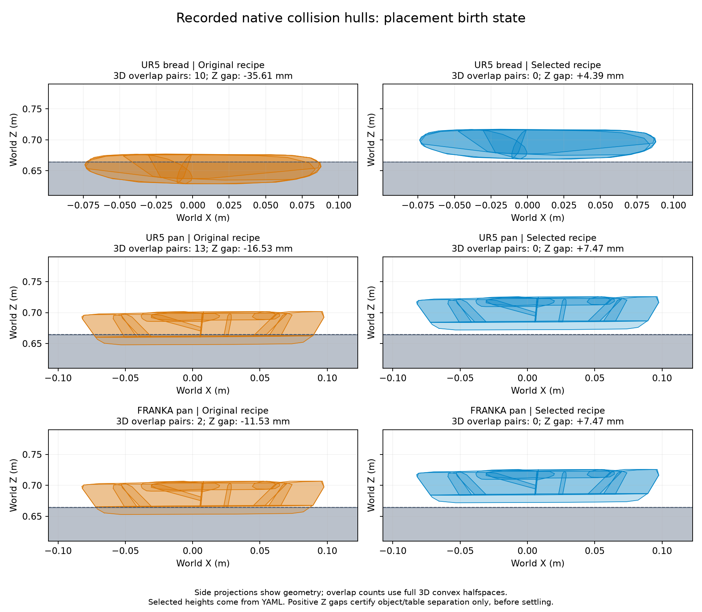
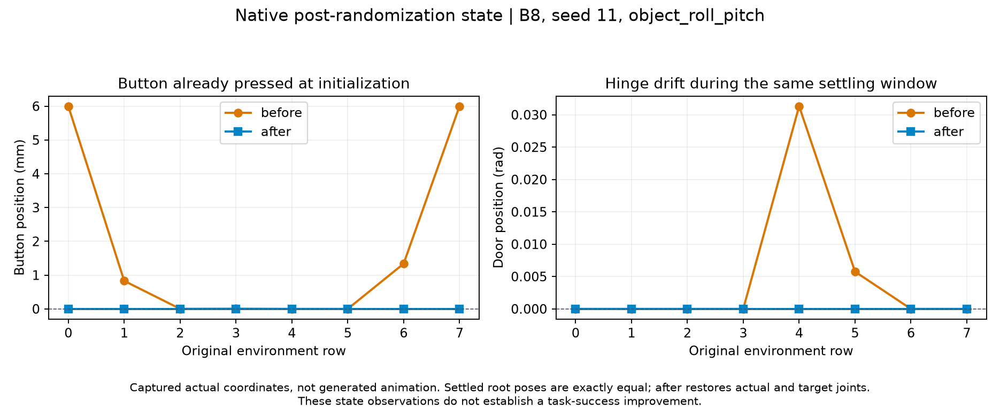

# Atomic benchmark initial-state corrections

This evidence covers placement fixture interpenetration and articulation joint
drift during root randomization. The figures are generated from recorded native
collision hulls and joint observations. They are geometry/state plots, not
simulator screenshots or a new task-success measurement.

## Reproduce the geometry checks and figures

From the repository root, with NumPy, SciPy, Matplotlib and PyYAML installed:

```bash
python scripts/benchmark/motion_generation/initial_state_evidence.py \
  --output-dir /tmp/atomic-initial-state-evidence
```

No GPU, asset download or simulator initialization is required. The script reads
the selected checkout's production placement YAML files. It transforms each
captured, already-scaled convex shape by its native local pose and object pose
once, then solves for a positive-radius interior witness in the combined 3D
convex halfspaces. Side projections alone are not the intersection test.

Expected results:

| Fixture | Original intersecting hull pairs | Corrected pairs | Corrected vertical gap |
| --- | ---: | ---: | ---: |
| UR5 bread / table | 10 | 0 | 4.393 mm |
| UR5 pan / table | 13 | 0 | 7.465 mm |
| Franka pan / table | 2 | 0 | 7.465 mm |

These are **pre-settling** object/table checks. They do not certify robot
collision clearance, contact offsets, subsequent stability or task success.
The UR5 mounting height changes from 0.1 m to 0.3 m in both placement suites;
the object corrections are bread 0.675881→0.715881 m, UR5 pan 0.651→0.675 m,
and Franka pan 0.656→0.675 m. Other placement recipe parameters are retained.



To independently check the old recipe, materialize the PR base in another
checkout and point the same script at it:

```bash
git worktree add --detach /tmp/atomic-initial-state-before 981894847a7f9929ced0e2d0b5b9fd2ef4241d35
python scripts/benchmark/motion_generation/initial_state_evidence.py \
  --suite-root /tmp/atomic-initial-state-before \
  --output-dir /tmp/atomic-initial-state-before-figures
```

That invocation must fail the final no-intersection assertion: the selected
base recipe still has the original heights. It does not modify either checkout.

## Reproduce the joint-state regression

```bash
PYTHONPATH="$PWD:$PWD/extensions" python -m pytest -q \
  tests/benchmark/motion_generation/test_atomic_pose_config.py \
  -k randomize_articulation_root_pose_is_deterministic
```

The existing regression now models a settling step that depresses a button by
6 mm, moves a hinge by 0.03 rad, and lowers the root by 2 mm. It requires the
production randomization method to retain the settled root, restore actual and
target joints including **nonzero captured initial joints**, clear dynamics and
retain exactly the original settling-step count. With the base implementation
and this same regression test, the joint-restoration assertion fails.

To run that negative control in the throwaway base checkout created above,
copy only the extended test and leave its production implementation unchanged:

```bash
cp tests/benchmark/motion_generation/test_atomic_pose_config.py \
  /tmp/atomic-initial-state-before/tests/benchmark/motion_generation/test_atomic_pose_config.py
(cd /tmp/atomic-initial-state-before && \
  PYTHONPATH="$PWD:$PWD/extensions" python -m pytest -q \
  tests/benchmark/motion_generation/test_atomic_pose_config.py \
  -k randomize_articulation_root_pose_is_deterministic)
```

The native capture below is a different, real B8 observation from
`spatial-microwave-controls@object_roll_pitch`, Press, case seed 11,
randomization stream 32. Before the fix, rows 0 and 7 are already depressed to
6 mm and the door coordinate in row 4 has moved to 0.031325 rad. After the fix,
actual and target joint arrays equal the captured initial arrays exactly;
actual/target velocities are zero. The two settled root-pose arrays are equal.



The example's joint values can be inspected directly in `observations.json`.
The figure generator checks restoration and root equality before rendering.
This native observation is distinct from the controlled settling stub used by
the CPU regression test.

## Measured task outcomes and interpretation

The captured comparisons keep gripper commands, TCP, grasp parameters, original
case/seed populations, timing budgets and success criteria fixed. Articulation
restoration can change derived link targets and automatically selected grasp
instances, so that intervention fixes the recipe rather than freezing every
derived world-pose payload.

| Comparison | Population per condition | Planning before→after | Execution before→after | Physical successes before→after |
| --- | --- | --- | --- | --- |
| Placement, combined mounting/object-height correction, TOPPRA | 102 common valid inputs in 18 groups | 102→102 | 10→102 | 0→0 |
| Press, joint initialization correction, TOPPRA calling label | 212 inputs in all 58 original groups | 172→163 | 172→163 | 32→32 |

The 192 original placement preparation rejections remain unmeasured in the
original baseline and are excluded from the common-valid comparison. The
combined placement comparison does not isolate each height's individual causal
contribution. Press's nine planning losses are retained. Its original declared
method view over 42 measurable cases has unchanged native case-equal physical
score, 38.10%→38.10%; row counts above are not that score. Calling labels sharing
sequential IK are not independent algorithm confirmations. These results show
an initialization correction and improved placement execution, without a
physical task-success gain.

## Capture provenance

The native data were captured on 2026-11-05 with DexSim 0.5.1rc1 and source base
`7b76de6116323f60bf6308ee602a90d1e8ec5b06`, using the same recorded runtime on
both sides of each comparison. Only the declared initialization intervention
differs. These historical measurements have not been rerun as a full native
benchmark on this PR's newer base, which uses DexSim 0.6.

`collision_geometry.json` contains the native hull vertices/local transforms;
asset scale is already applied. `observations.json` retains raw joint/root
arrays, the two native attempt IDs, method hashes, original capture/review
hashes and the observed task-count summary. No successful retries or failed
rows were selected out of the reported comparisons. Generated images can be
replaced by rerunning the command above.
