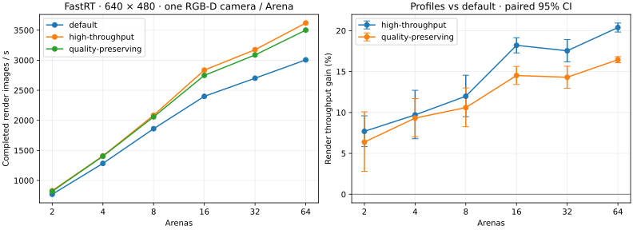
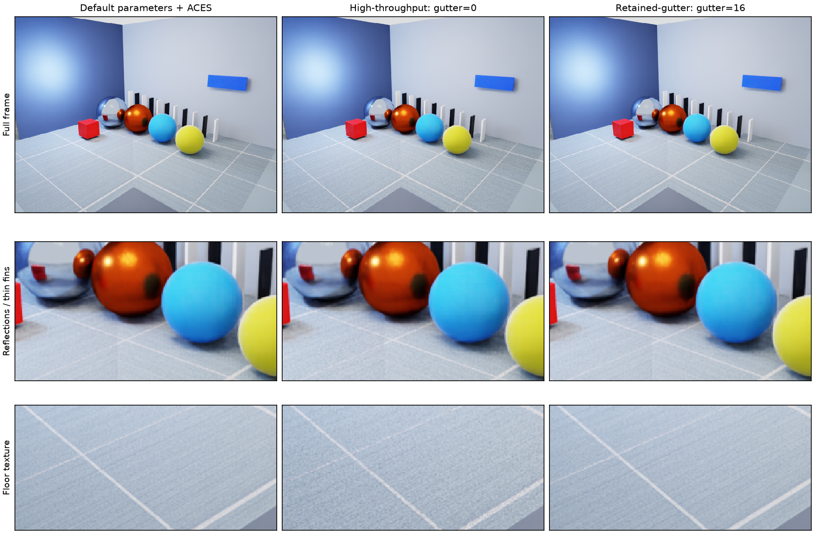

# FastRT camera profile measurements — 2026-11-17

GPU: NVIDIA GeForce RTX 5090, 595.58.03, 32607. Runtime: {"cpu_threads": 4, "python": "3.12.16", "sdk": "0.6.0rc2", "torch": "2.11.0+cu130"}. Base: `9474d998d3fb5d78390aba7473ff7a89ffb77cda`.

Same static fixed_reflective scene, one 640x480 RGB-D camera per Arena, one native group. Five matched blocks per size, three fresh processes per block, 16 warmup and 64 measured frames. Profile order rotates/reverses. This completes 90 processes and 5760 measured frames.

[Machine-readable raw timings, native settings, quality captures and source identities](fast_rt_profiles_640x480_20261117.json). [Per-frame raw process timings](fast_rt_profiles_640x480_20261117.samples.jsonl) are recorded as 90 compact JSONL rows. No host paths or binary SDK files are published. Capture scripts are archived as text in the JSON for reproducing the quality protocol.

## Time & Memory

| arenas | profile | render_ms | render_median_ms | cost_time_ms | render_images_per_s | complete_images_per_s | cpu_delta_mb | gpu_delta_mb | peak_gpu_mb |
| --- | --- | --- | --- | --- | --- | --- | --- | --- | --- |
| 2 | default | 2.598 | 2.513 | 2.626 | 769.8 | 761.5 | 2700.3 | 5539.0 | 6037.0 |
| 2 | high-throughput | 2.412 | 2.34 | 2.437 | 829.0 | 820.7 | 2700.3 | 5533.0 | 6031.0 |
| 2 | quality-preserving | 2.443 | 2.347 | 2.466 | 818.8 | 811.1 | 2700.3 | 5539.0 | 6037.0 |
| 4 | default | 3.116 | 2.992 | 3.147 | 1283.8 | 1270.9 | 2703.0 | 5705.0 | 6203.0 |
| 4 | high-throughput | 2.84 | 2.763 | 2.871 | 1408.5 | 1393.1 | 2702.9 | 5697.0 | 6195.0 |
| 4 | quality-preserving | 2.85 | 2.774 | 2.885 | 1403.4 | 1386.7 | 2703.0 | 5705.0 | 6203.0 |
| 8 | default | 4.299 | 4.225 | 4.335 | 1860.8 | 1845.6 | 2708.6 | 6120.0 | 6618.0 |
| 8 | high-throughput | 3.838 | 3.751 | 3.881 | 2084.2 | 2061.3 | 2708.6 | 6095.0 | 6593.0 |
| 8 | quality-preserving | 3.887 | 3.784 | 3.927 | 2058.3 | 2037.4 | 2708.6 | 6120.0 | 6618.0 |
| 16 | default | 6.668 | 6.488 | 6.711 | 2399.5 | 2384.0 | 2720.2 | 6866.0 | 7364.0 |
| 16 | high-throughput | 5.641 | 5.508 | 5.686 | 2836.4 | 2813.7 | 2720.3 | 6786.0 | 7284.0 |
| 16 | quality-preserving | 5.823 | 5.672 | 5.867 | 2747.9 | 2727.1 | 2720.2 | 6866.0 | 7364.0 |
| 32 | default | 11.845 | 11.713 | 11.894 | 2701.6 | 2690.4 | 2741.1 | 8495.0 | 8993.0 |
| 32 | high-throughput | 10.077 | 9.937 | 10.124 | 3175.5 | 3160.8 | 2741.0 | 8387.0 | 8885.0 |
| 32 | quality-preserving | 10.362 | 10.289 | 10.407 | 3088.2 | 3074.9 | 2741.1 | 8495.0 | 8993.0 |
| 64 | default | 21.288 | 21.386 | 21.348 | 3006.4 | 2997.9 | 2779.8 | 10408.0 | 10906.0 |
| 64 | high-throughput | 17.683 | 17.711 | 17.741 | 3619.3 | 3607.4 | 2779.9 | 10140.0 | 10638.0 |
| 64 | quality-preserving | 18.28 | 18.207 | 18.343 | 3501.1 | 3489.1 | 2779.9 | 10408.0 | 10906.0 |

`render_ms` and `cost_time_ms` aggregate process means. Median columns aggregate process medians. Render/complete throughput count camera images, not color/depth channels separately. CPU RSS and GPU deltas are retained allocations; `peak_gpu_mb` is sampled process VRAM, not a transient allocator peak. CPU readback, encoding, validation and memory queries are untimed.



## Success & Other Metrics

| arenas | reference | candidate | success_rate | render_gain_pct | paired_95_interval_pct | depth_mask_iou | depth_max_abs_m | rgb_ssim | rgb_ssim_last |
| --- | --- | --- | --- | --- | --- | --- | --- | --- | --- |
| 2 | default | high-throughput | 100.0 | 7.69 | [5.82, 9.59] | 1.0 | 0.0 | 0.9265 | 0.9229 |
| 2 | default | quality-preserving | 100.0 | 6.38 | [2.81, 10.08] | 1.0 | 0.0 | 0.9643 | 0.9644 |
| 2 | high-throughput | quality-preserving | 100.0 | -1.22 | [-4.28, 1.94] | 1.0 | 0.0 | 0.9582 | 0.9536 |
| 4 | default | high-throughput | 100.0 | 9.7 | [6.78, 12.71] | 1.0 | 0.0 | 0.933 | 0.9047 |
| 4 | default | quality-preserving | 100.0 | 9.32 | [7.00, 11.68] | 1.0 | 0.0 | 0.9651 | 0.9653 |
| 4 | high-throughput | quality-preserving | 100.0 | -0.35 | [-2.32, 1.66] | 1.0 | 0.0 | 0.9645 | 0.9324 |
| 8 | default | high-throughput | 100.0 | 11.99 | [9.49, 14.55] | 1.0 | 0.0 | 0.9327 | 0.9083 |
| 8 | default | quality-preserving | 100.0 | 10.6 | [8.26, 12.99] | 1.0 | 0.0 | 0.965 | 0.9653 |
| 8 | high-throughput | quality-preserving | 100.0 | -1.24 | [-2.37, -0.10] | 1.0 | 0.0 | 0.9645 | 0.9372 |
| 16 | default | high-throughput | 100.0 | 18.21 | [17.28, 19.13] | 1.0 | 0.0 | 0.9334 | 0.9275 |
| 16 | default | quality-preserving | 100.0 | 14.52 | [13.42, 15.62] | 1.0 | 0.0 | 0.9653 | 0.9657 |
| 16 | high-throughput | quality-preserving | 100.0 | -3.12 | [-3.83, -2.41] | 1.0 | 0.0 | 0.9645 | 0.9573 |
| 32 | default | high-throughput | 100.0 | 17.54 | [16.19, 18.91] | 1.0 | 0.0 | 0.9331 | 0.9184 |
| 32 | default | quality-preserving | 100.0 | 14.31 | [12.97, 15.66] | 1.0 | 0.0 | 0.9652 | 0.9644 |
| 32 | high-throughput | quality-preserving | 100.0 | -2.75 | [-3.87, -1.62] | 1.0 | 0.0 | 0.9645 | 0.9483 |
| 64 | default | high-throughput | 100.0 | 20.38 | [19.84, 20.93] | 1.0 | 0.0 | 0.9344 | 0.9136 |
| 64 | default | quality-preserving | 100.0 | 16.45 | [16.08, 16.83] | 1.0 | 0.0 | 0.9653 | 0.9651 |
| 64 | high-throughput | quality-preserving | 100.0 | -3.27 | [-3.55, -2.98] | 1.0 | 0.0 | 0.9658 | 0.944 |

Intervals pair process means within matched blocks and are not simultaneous intervals. All final views pass the worker validity checks; first/last-view RGB and depth comparisons use block 0. RGB metrics compare profiles with different tone mapping and are not ground-truth quality scores.

## Leaderboard

| profile | success_rate | geomean_render_images_per_s |
| --- | --- | --- |
| high-throughput | 100.0 | 2072.9 |
| quality-preserving | 100.0 | 2031.4 |
| default | 100.0 | 1815.8 |

All three profiles are ranked by successful captures and geometric mean throughput, not by absolute image quality.

## Controlled quality verification

Current-base additional captures hold ACES and fixed DLSS cadence constant. Static: 64 warmup+32 frames; motion: 16 warmup+32 frames along the same deterministic camera/cube path. First/last views are verified separately; final depth samples cover both Arena endpoints. Static temporal STD averages per-pixel/channel variation in 8-bit code-value units and includes quantization/convergence.

- **first view**: static SSIM versus matched default 0.9668 (gutter0), 0.9954 (gutter16). Static temporal STD: 0.4602 (matched default), 0.4774 (gutter0), 0.4643 (gutter16).

- **last view**: static SSIM versus matched default 0.9419 (gutter0), 0.9954 (gutter16). Static temporal STD: 0.4940 (matched default), 1.0553 (gutter0), 0.5067 (gutter16).



## Scope and reproduction

These measurements use released DexSim 0.6.0rc2, not the upstream CameraVK MR build, and portable scene assets. This SDK has no overscan capability; omitted overscan preserves that behavior and explicit zero remains off. Positive overscan requires a newer SDK. The retained-gutter profile preserves a guard band, not equivalence to an independent quality reference. All comparisons are limited to this scene and hardware. Native logs select direct CUDA output at 64 views for all profiles; the group remains unsplit.

Run from the repository root with the normal working native-renderer environment:

```bash
python -m scripts.benchmark.rendering.camera_profiles \
  --config scripts/benchmark/rendering/settings/fast_rt_high_throughput.yaml \
  --quality-config scripts/benchmark/rendering/settings/fast_rt_quality_preserving.yaml
```

Raw run outputs and source hashes are emitted under outputs/benchmarks/camera_profiles_<timestamp>/. The exact quality capture source text and captured-array hashes are included in the JSON. These diagnostic captures clone GPU RGB before the next render and read back only after each sequence; they do not replace the throughput measurements.
