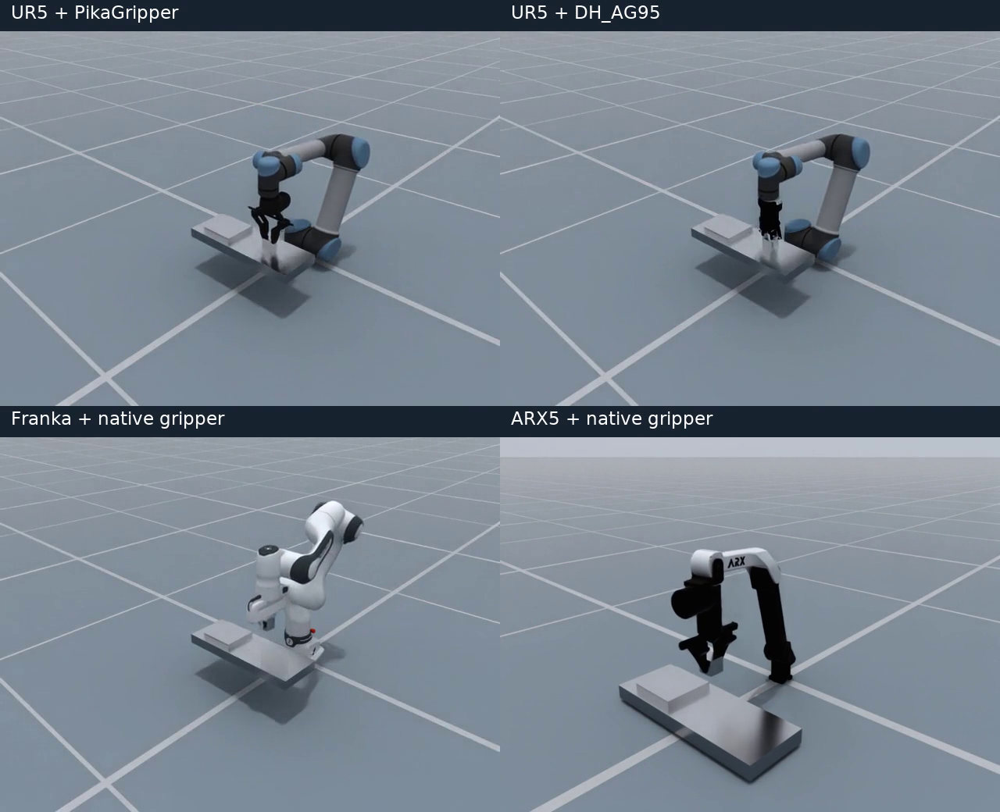
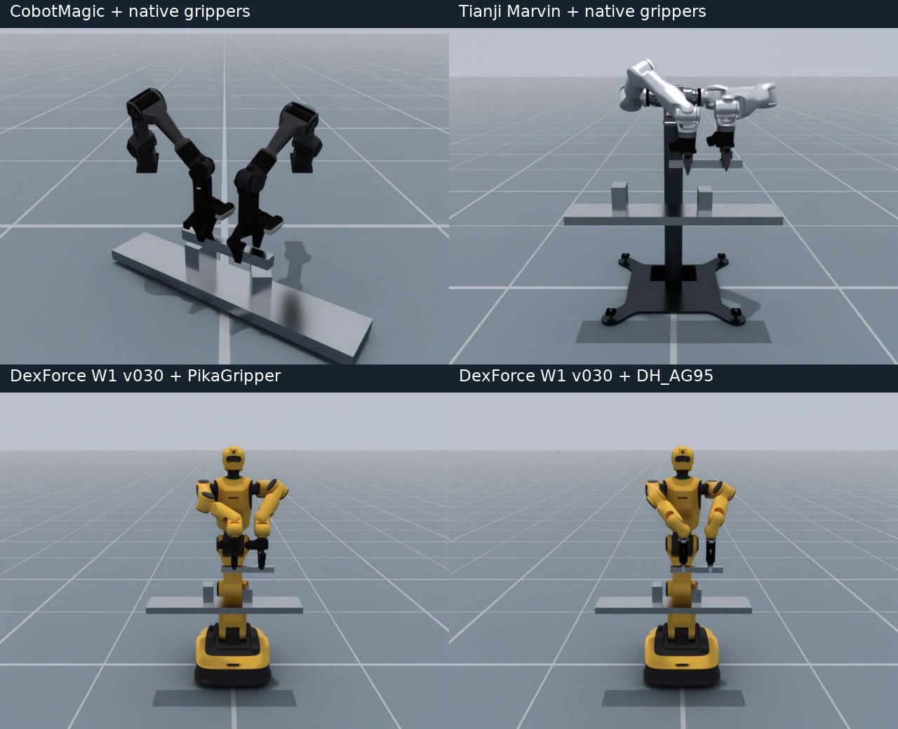

# 跨机器人、夹具复用 Atomic Skills

`embodiment_switching.py` 展示同一段任务代码如何在不同机器人和夹具上执行。
`single_arm.py` 和 `dual_arm.py` 保留为更短的入门示例。

**原子技能定义一次，通过资源绑定复用。** 在满足物理可行性和技能资源协议的前提下，
可以切换机器人和夹爪，继续使用相同的 PickUp、HandOver 和 Place 实现，
以及本例中不含型号判断的 `pick_place()` / `handover()` 调用。
机器人关节、TCP、夹爪开闭方式和场景标定由 embodiment 配置提供。

## 全部组合的实际录像

点击预览图播放对比视频；双臂均为正面视角。下面的录像来自物理仿真回放，
ARX5 使用调整后的展开腕部轨迹。

| 同一 PickUp → Place，切换机器人和夹爪 | 同一 HandOver → Place，切换机器人和夹爪 |
| --- | --- |
| [](../../../docs/source/_static/atomic_actions/embodiment_switching/single-arm-comparison.mp4) | [](../../../docs/source/_static/atomic_actions/embodiment_switching/dual-arm-comparison.mp4) |

单独播放：[UR5 + Pika](../../../docs/source/_static/atomic_actions/embodiment_switching/ur5_pika.mp4)、
[UR5 + DH_AG95](../../../docs/source/_static/atomic_actions/embodiment_switching/ur5_dh_ag95.mp4)、
[Franka](../../../docs/source/_static/atomic_actions/embodiment_switching/franka_auto.mp4)、
[ARX5](../../../docs/source/_static/atomic_actions/embodiment_switching/arx5_auto.mp4)、
[CobotMagic](../../../docs/source/_static/atomic_actions/embodiment_switching/cobotmagic_auto.mp4)、
[Tianji Marvin](../../../docs/source/_static/atomic_actions/embodiment_switching/tianji_auto.mp4)、
[W1 + Pika](../../../docs/source/_static/atomic_actions/embodiment_switching/w1_030_pika.mp4)、
[W1 + DH_AG95](../../../docs/source/_static/atomic_actions/embodiment_switching/w1_030_dh_ag95.mp4)。
Sphinx 的 [Atomic Skills tutorial](../../../docs/source/tutorial/atomic_skills.rst)
嵌入全部八段可播放录像。

## 先运行一个组合

在仓库根目录、已安装 EmbodiChain 及其仿真依赖的环境中运行：

```bash
python scripts/tutorials/atomic_skill/embodiment_switching.py
```

默认使用 UR5 + PikaGripper，将小方块从起点搬到目标承载面。
省略 `--headless` 可以查看原生窗口，并在规划前暂停检查场景。
使用 `--headless --renderer no-render` 可执行无窗口、无录像的物理验证。

## 切换机器人与夹具

| 任务 | `--robot` | `--gripper` | `auto` 解析结果 |
| --- | --- | --- | --- |
| `pick_place` | `ur5` | `auto` / `pika` / `dh_ag95` | PikaGripper |
| `pick_place` | `franka` | `auto` | Panda 原装夹爪 |
| `pick_place` | `arx5` | `auto` | X5A 原装双指夹爪 |
| `handover` | `cobotmagic` | `auto` | CobotMagic V100 原装夹爪 |
| `handover` | `tianji` | `auto` | Tianji Marvin 原装夹爪 |
| `handover` | `w1_030` | `auto` / `pika` / `dh_ag95` | 双侧 PikaGripper |

下面八个命令覆盖全部组合。每次启动只运行一个组合：

```bash
python scripts/tutorials/atomic_skill/embodiment_switching.py --robot ur5 --gripper pika
python scripts/tutorials/atomic_skill/embodiment_switching.py --robot ur5 --gripper dh_ag95
python scripts/tutorials/atomic_skill/embodiment_switching.py --robot franka
python scripts/tutorials/atomic_skill/embodiment_switching.py --robot arx5

python scripts/tutorials/atomic_skill/embodiment_switching.py --task handover --robot cobotmagic
python scripts/tutorials/atomic_skill/embodiment_switching.py --task handover --robot tianji
python scripts/tutorials/atomic_skill/embodiment_switching.py --task handover --robot w1_030 --gripper pika
python scripts/tutorials/atomic_skill/embodiment_switching.py --task handover --robot w1_030 --gripper dh_ag95
```

`--task handover` 省略机器人时选择 W1 v030。W1 的两侧安装同一种夹具。
不支持的任务/机器人/夹具组合在仿真创建前报错。

## 阅读代码：哪些东西需要变化

教学脚本中的 `pick_place()` 与 `handover()` 按逻辑资源编写，不按机器人型号分支：

1. **绑定资源。** 单臂的 `primary` 绑定运动资源与抓取资源；双臂的
   `source`、`destination` 分别绑定两侧资源。绑定通过现有
   `AtomicSkillEngine.make_invocation()` 的 `control_parts` 接口传入。
2. **描述目标。** `GraspGoal` 指定要抓取的物体；`AssembleGoal` 描述物体相对
   目标承载面的位姿。Place 使用抓取后建立的 `object_to_eef` 关系推导 TCP
   目标，所以更换夹具长度或 TCP 后，任务仍使用相同的物体目标。
3. **编译技能。** 单臂组合 PickUp → Place；双臂先通过 HandOver 完成交接和
   源手撤离，再由接收手执行 Place。`arm_selection="bound"` 使角色绑定明确。
4. **执行并观察。** 宿主回放轨迹，读取物体实际位姿和夹指状态，检查任务结果。

[embodiments.py](../../../examples/sim/atomic_skill/embodiments.py) 集中管理物理差异：
机器人预设、初始姿态、任务坐标系、夹具资产与安装位姿、完整 TCP、开闭命令、
抓取几何和驱动参数。Franka、CobotMagic、Tianji 使用已有的夹具抓取模型；
Tianji 复用官方 embodiment 中显式声明的仿真标定。

更换 UR5 或 W1 的夹具时，物体尺寸、起点、目标和机器人任务坐标系保持一致。
机器人之间允许使用各自可达的场景高度；两个任务函数仍不变。

| 抽象层 | 保持一致或按配置替换的内容 |
| --- | --- |
| 技能定义 | 抓取、交接、放置的阶段与效果，由已有原子技能实现 |
| 任务调用 | 物体目标、逻辑参与者、技能顺序；本例的两个任务函数没有型号分支 |
| 资源适配 | 运动/抓取资源绑定、FK/IK、关节范围、资产安装、完整 TCP、开闭命令、mimic、抓取模型和驱动 |
| 物理可行性 | 可达工作区、无碰撞路径、夹爪开口、稳定接触；新增组合需要重新检查 |

例如，UR5 的 `--gripper pika` 改成 `--gripper dh_ag95` 时，只有配置层改变。
`GraspGoal` 仍指向同一物体，`AssembleGoal` 仍指向同一承载面；Place 通过
抓取关系计算新夹具的 TCP 目标。替换双臂机器人时，HandOver 仍使用
`source` / `destination`，配置将它们绑定到该机器人的左右臂和夹爪。

双臂使用同一根 320 mm 长条，中部支撑在小台座上，为不同长度的手指留出
向下伸入的空间；目标也使用中部支撑。CobotMagic 采用 35° 倾斜台面安装，
任务坐标系绕竖直轴转 -35°，并使用较低、较近的交接与放置区域。两手使用同向的
等价夹持朝向，让保留在资产上的相机外壳错开；整段运动保持在原资产的关节范围内，
并开启仿真自碰撞。

Franka 的预备 TCP 朝向与方块抓取朝向对齐，减少抓取前转腕，并让放置运动保持在
同一肘部逆解分支。优化位于 embodiment 配置层，两个任务函数和技能实现保持一致。

Pika 的张开指令为正向移动的米制坐标，DH_AG95 为带 mimic 的转动关节。
两者的开闭值、轴方向与 TCP 分别配置。ARX5 原装双指关节彼此独立。
这些配置是针对资产网格的仿真标定，不代表实机安装或电机参数。

ARX5 使用 50 mm 高的工作台、向外展开的肘部和不翻转的腕部逆解分支，
初始姿态和自碰撞设置继承扩展包的
[`ARX5Cfg`](../../../extensions/embodichain_robots/arx5.py)。台面、目标和该场景的
IK 分支范围仍由示例配置管理。旧的高工作台与折叠腕部组合会让腕部网格与前臂相交。
调整位于物理配置层，PickUp → Place 的调用、抬升距离与物体目标定义保持一致。

## 结果与可视化

启动日志显示解析后的资源绑定、TCP 与夹指命令。回放完成后输出
`Measured result`，分别报告 `planning_success`、`playback_completed`、
`task_success`，以及抓取阶段结束时的抬升高度、放置误差和静置漂移。双臂额外检查源手张开，
以及源手撤离期间物体相对接收手的位姿保持情况。物理检查失败返回非零退出码。

`compile()` 中投影的抓取状态用于后续规划；物理结果由回放中的观察独立判断。
物体依靠接触完成抓取、搬运与交接。

[录像验收数据](../../../docs/source/_static/atomic_actions/embodiment_switching/validation.json)
保存各组合的规划、回放和物理结果。ARX5 额外检查计划与实测关节轨迹的非相邻
碰撞网格间隙；采样检查的范围与数值见同目录的 `arx5_clearance.json`。
CobotMagic 的[相机与双臂间隙报告](../../../docs/source/_static/atomic_actions/embodiment_switching/cobotmagic_clearance.json)
覆盖计划和实测轨迹的每个指令点，检查左右臂碰撞网格及包含相机外壳的可见网格。
[Franka 轨迹对比](../../../docs/source/_static/atomic_actions/embodiment_switching/franka_trajectory.json)
记录优化前后的 TCP 路程和关节行程。
这些测量对应本例的标定场景；更换硬件配置或场景后需要重新验证物理可行性。

录像沿用现有 tutorial 参数，例如：

```bash
python scripts/tutorials/atomic_skill/embodiment_switching.py \
  --task handover --robot w1_030 --gripper pika \
  --headless --renderer hybrid --auto_play \
  --auto_play_video_path /tmp/w1_pika_handover.mp4
```

`--auto_play` 跳过终端暂停并录像；`--headless` 单独使用不会启用录像。
`--viser --headless` 发布浏览器场景，并在结束后保留到 Ctrl+C。
首版物理验收使用 `--physics default --planner trapezoidal --num_envs 1`。
Newton 和其他规划器沿用共享入口，尚未覆盖完整组合的物理标定。
