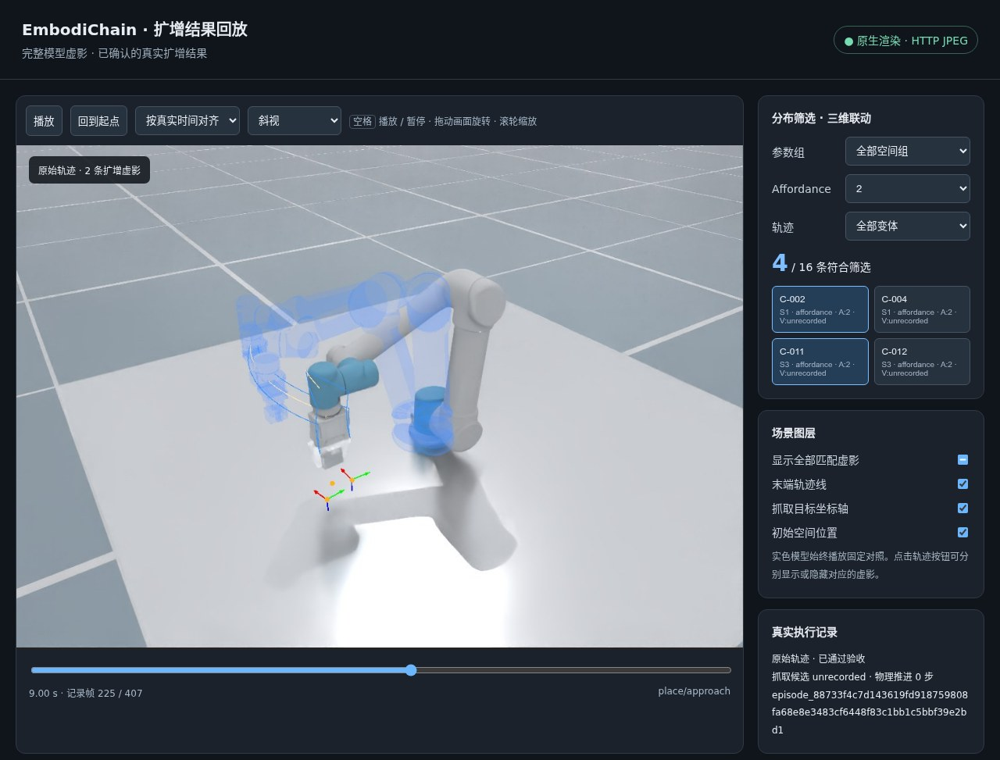

# UR5 抓取放置的布局与抓取姿态扩增

这个教程用同一台 UR5 和平行夹爪抓取桌上的立方体，把它放到目标位置。先记录一条原始轨迹作为对照，再用两种策略改变布局。每种策略各采集 4 条固定抓取轨迹（`object_pose`）和 4 条抓取姿态扩增轨迹（`affordance`），共 16 条扩增轨迹。

| 采集模式 | 改变的内容 |
| --- | --- |
| `reference` | 立方体和放置目标使用任务的初始位置，执行一次固定抓取。 |
| `scene_first` | 先在桌面范围内提出布局，再检查机械臂能否完成接近、抓取、抬升和放置。 |
| `robot_first` | 先从机械臂工作空间选取可达抓取位姿，再以此为约束生成布局。 |

## 采集

从仓库根目录运行。在装有 EmbodiChain、DexSim 和 LeRobot 的 `py312` 环境中执行以下命令。每个模式把实际配置和采集结果写入单独的子目录。已有完整结果时可以直接进入「网页回放」。重新采集时给 `out` 换一个新目录。

```bash
conda activate py312
demo=scripts/tutorials/expansion/ur5_pick_place
out=outputs/ur5-affordance-demo

python "$demo/collect.py" reference   --output "$out"
python "$demo/collect.py" scene_first --output "$out"
python "$demo/collect.py" robot_first --output "$out"
```

三个命令默认使用种子 7，可用 `--seed` 指定。每次采集结束都会打印各算子通过验收并保存的轨迹数。各模式的 `expansion.yaml` 保存实际使用的参数，`collection/expansion.json` 记录完成情况，`collection/dataset/<算子>/` 保存轨迹和验收记录。

## 网页回放

已有原始录制时，跳过 `reference` 采集，将下面的 `reference` 变量指向原始录制的 `job.json` 所在目录，即可逐帧复用同一条实体轨迹和图表基准。

```bash
conda activate py312
out=outputs/ur5-affordance-demo
reference="$out/reference/collection/dataset/object_pose"
python -m embodichain expansion preview \
  --reference "$reference" \
  --input "$out/scene_first/collection" \
  --input "$out/robot_first/collection" \
  --port 0 --open
```

- 回放通过原生 WebRTC 视频呈现。连接要求见[预览说明](../../../../examples/expansion/engine/ghost-preview.md#webrtc-视频回放)。
- 页眉的 **语言**可以在简体中文和 English 之间切换。播放进度和当前筛选会保留。
- **空格**播放或暂停，播放结束后再按空格从头开始。拖动进度条可定位到某一帧。使用下拉框或复选框时，空格操作当前控件，点击回放画面即可继续用空格控制播放。
- 原始轨迹始终以实体显示。右侧每个轨迹按钮独立切换一条半透明虚影。按上述命令加载时，前两个参数组来自 `scene_first`，后两个来自 `robot_first`。
- 在 **抓取分支**（**Affordance**）下拉框中选择 `1` 或 `2`，可以查看采用该抓取分支的轨迹。使用任务固定抓取姿态的 `object_pose` 记录显示为「未记录」。
- 画面下方的 TCP 图分开显示相对原始轨迹的平移距离（mm）和最短旋转角（°）。关节图显示每条轨迹最大的臂关节绝对偏差。三条曲线都用色带标出同一时刻各轨迹的最小值至最大值，用实线标出均值。悬停可读取三项数值和参与轨迹数。
- **object_pose 物体起点分布**统计两种布局策略各 4 条 `object_pose` 扩增轨迹。选择抓取方块 `cube` 或放置目标 `goal`，可查看该物体在 8 条轨迹首帧的实测 XY 位置。X、Y 轴分别贴合该物体的起点范围，两端各留半格。图旁标有单格的实际宽、高。悬停或轻点网格可读取坐标和轨迹数。

下图停在 9.00 秒。选择抓取分支 `2` 后有四条轨迹符合条件，图中打开了 `C-002`（`scene_first`）和 `C-011`（`robot_first`）两条虚影。两条虚影和原始轨迹共享同一回放时钟。[查看偏差曲线](assets/deviation-bands.png) · [查看方块扩增起点热力图](assets/object-heatmap.png)



## 修改配置或可视化

两种策略共用一份配置。默认布局允许立方体和放置目标在 X、Y 方向各偏移 ±6 cm。`trajectory.affordance.call_indices: [0]` 将抓取扩增应用到第一次调用 `pick`。`fixed_object_to_eef: null` 在 affordance 组启用夹爪的对向接触候选生成器。`branches: 3` 让采集器轮流请求分支 1 和 2，再按实际抓取、搬运、释放和放置结果验收。可以在同一处调整分支数、布局范围和每组轨迹数。[扩增配置](expansion.yaml) · [任务与机器人配置](../../../../extensions/embodichain_tasks/configs/tasks/manipulation/workspace_pose_pick_place/acceptance/scene_first/task.yaml)

播放键、筛选器和时间轴在回放页面中实现，偏差曲线和物体热力图各有独立的绘图脚本。改完重新运行「网页回放」命令即可用同一批轨迹查看效果。[回放页面](../../../../embodichain/lab/expansion/_preview.html) · [偏差曲线脚本](../../../../embodichain/lab/expansion/_preview_charts.js) · [热力图脚本](../../../../embodichain/lab/expansion/_preview_heatmap.js)
