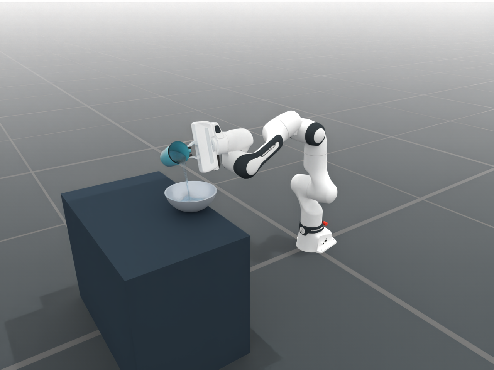
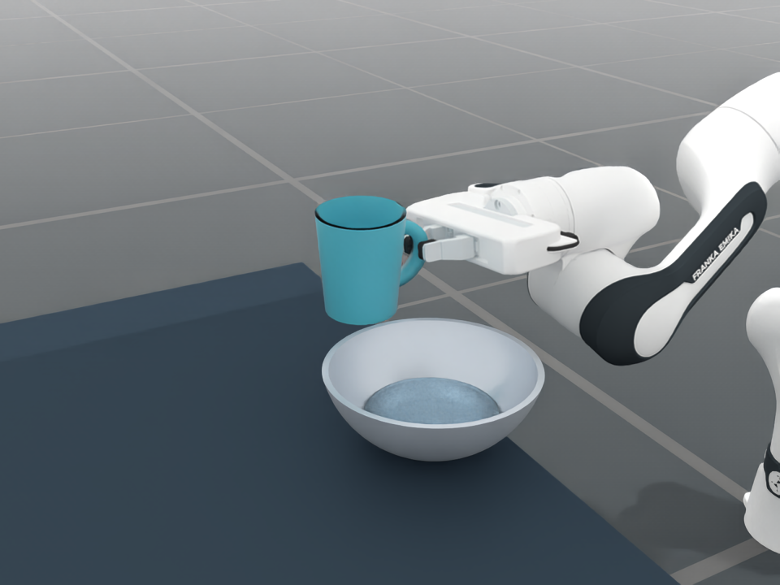

# 已验证的 Franka DFSPH 演示资料

运行说明和边界条件见
[任务 README](../../../../../embodichain_tasks/configs/tasks/manipulation/tableware/pour_cup/README.md)。
此目录约 31 MB，为 draft 提供可直接回放的输入和可检查的最终输出。

| 文件 | 用途 |
| --- | --- |
| `trajectory.pt` | MuJoCo 实际机器人/杯子状态，1160 帧、20 Hz；脚本默认输入 |
| `franka_dfsph_pour.mp4` | 完整全景，31 秒、744 帧 |
| `water_closeup.mp4` | 完整杯口/水流/碗近景，31 秒、744 帧 |
| `water_settling_closeup.mp4` | 近景第 12–30 秒片段，18 秒、432 帧 |
| `frame_15.png` / `close_23.png` | 倾倒全景与静置后液面 |
| `particles_30.npz` | 最后时刻 30.975 秒的全部粒子位置、速度、杯位姿 |
| `validation.json` | DFSPH 参数及全程 32 组物理统计 |
| `media_validation.json` | 三段视频逐帧解码、31 份原始快照的有限值和数量检查 |
| `newton_smooth_validation.json` | 轨迹平滑前后指标与原 MuJoCo 任务完成元数据 |
| `settling_comparison.json` | 相同初始快照的两组静水对照 |
| `environment.json` | 验证环境版本与提交来源 |
| `pr_smoke_validation.json` | 当前分支 2 秒 GPU 短测，76,538 粒，容器外粒子数为 0 |
| `manifest.json` | 资料大小和 SHA-256 |

原始报告保留录制机器的路径作为来源记录，不用作运行输入。
除最终粒子快照和两张预览外，其余每秒快照/图片未提交；可运行脚本重新生成。
`media_validation.json` 记录的是当时所有 31 份原始快照的检查结果。

轨迹和完整录像生成于 EC 提交 `3bb2a03c5`，使用本机 DexSim 0.5.1 wheel。
Draft 基于 `453675d8a`，配置按当前 `eef` 命名调整；此次基线的静态检查与
GPU 短测另记在 PR。这里的原录像不是新基线重新完整运行的声明。

`trajectory.pt` 是本演示自产的 Torch / TensorDict 序列化文件，包含
`states`、`actions` 和 `meta`。液体脚本读取 `meta.dt`、机器人 9 维 `qpos`
和杯子 7 维位姿（XYZ + XYZW），不会依赖原机器的绝对路径。

单向耦合：机械臂和杯子为轨迹回放，水为真实 DFSPH 粒子仿真。
最终约 140.38 mL 进入碗、117.11 mL 留在杯中、0.83 mL 在容器外。
台面以下粒子只从渲染副本过滤，物理和统计仍保留全部 76,538 粒。

