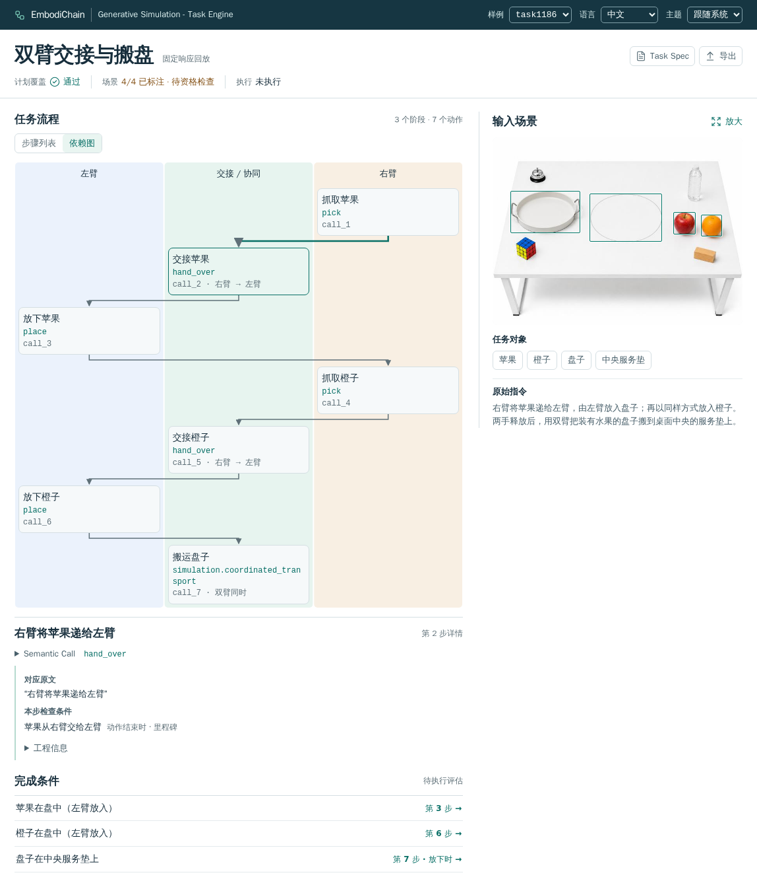
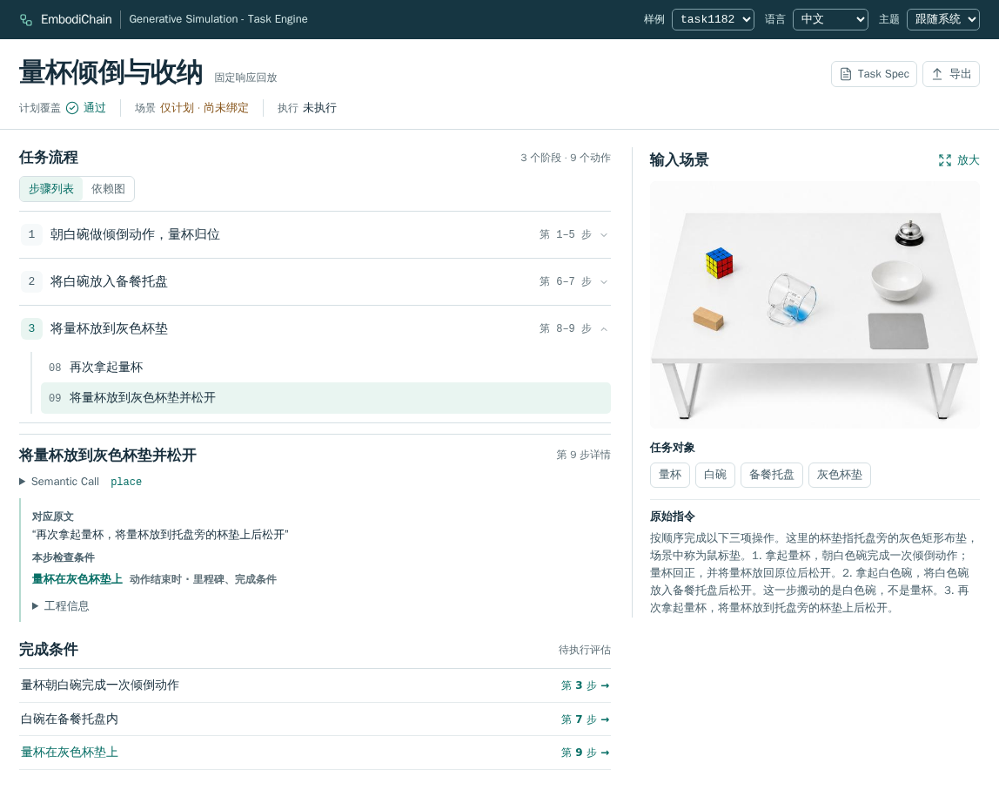

# Task Engine interactive review preview

[Download the offline preview and sample data](./task-engine-preview.zip?raw=true), extract the archive, and open `index.html`. The sample picker, Chinese/English labels, themes, Task Spec and JSON/SVG exports work locally.

### task1186 · Fruit handovers and plate transport

The left, shared and right lanes show seven Semantic Calls. Select a fruit or a call to inspect its image annotation, resource assignment and source wording.

### task1182 · Pouring motion and cup placement

The grouped steps distinguish returning the measuring cup to its original support from placing it on the gray coaster later.

Both plans were generated by fixed-response replay at engine commit `a4eca8be445b54136dec0adb33123f3afa712734`. The prototype uses those archived plans. The package includes the original dataset inputs, editable preview sources, frozen task specifications, semantic graphs and coverage records. Physical execution and goal acceptance were not evaluated. [Dataset snapshot](https://huggingface.co/datasets/DexForceAI/embodichain_data/tree/dcb448da52ea3df5df5a249e9ff977acafead0e4/gen_sim_assets)
